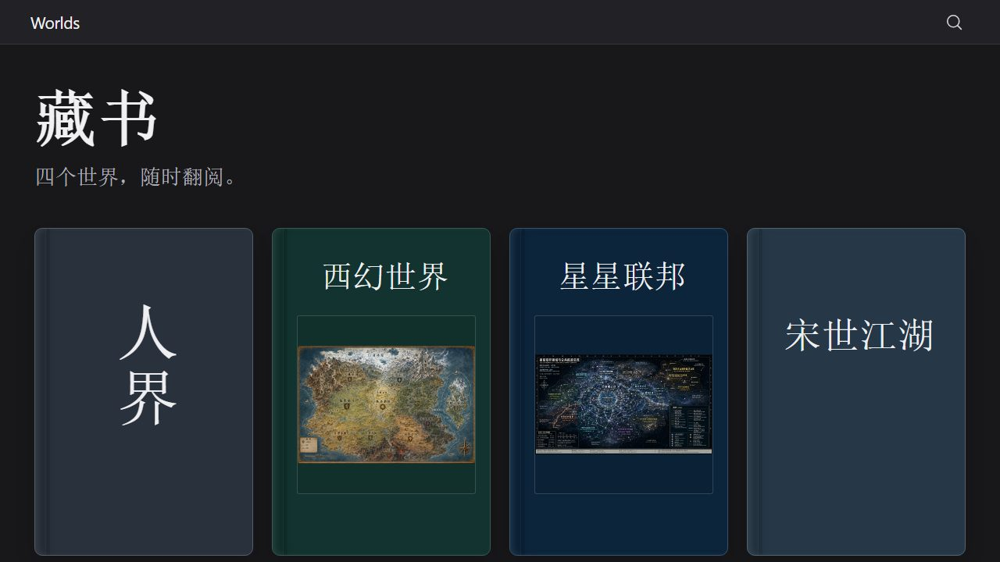

# Worlds

A personal archive of four imagined worlds, written as Markdown manuscripts and presented through a read-only library. The manuscripts and their maps are the source of truth; the author decides what is canon.

[Open the library](https://seiya058904.github.io/Worlds/) · [Explore the worlds](#the-worlds) · [Read locally](#read-locally)

*Original illustration of the archive, not a screenshot.*

## The worlds

- [The Human Realm](worlds/%E4%BA%BA%E7%95%8C.md) — a cultivation universe shaped by nine races, eight domains, imperial eras, and cosmic history.
- [The Fantasy World](worlds/%E8%A5%BF%E5%B9%BB%E4%B8%96%E7%95%8C.md) — a working-title high-fantasy setting of five principal races, a level system, and artifacts that affect the world's rules. [View its original map](worlds/%E8%A5%BF%E5%B9%BB%E4%B8%96%E7%95%8C%E5%9C%B0%E5%9B%BE.png).
- [The Star Federation](worlds/%E6%98%9F%E6%98%9F%E8%81%94%E9%82%A6.md) — an interstellar federation of member civilizations, public routes, industry, and guarded technology. [View its original map](worlds/%E6%98%9F%E6%98%9F%E8%81%94%E9%82%A6%E7%96%86%E5%9F%9F%E4%B8%8E%E5%85%AC%E5%85%B1%E8%88%AA%E9%81%93%E6%80%BB%E8%A7%88.png).
- [Song-Era Jianghu](worlds/%E5%AE%8B%E4%B8%96%E6%B1%9F%E6%B9%96.md) — a Song-inspired martial world of schools, lineages, regional rankings, and chronicles.

The English names above are descriptive labels; the original-language manuscript titles remain authoritative. Each world is maintained as one complete source file.



*Actual Chromium capture of the local reader; the manuscript interface is in Chinese.*

## Reading room

- Browse a table of contents and move through chapters and sections.
- Search across the manuscripts with `Ctrl+K` or the search control.
- Open referenced maps with zoom, pan, and full-screen viewing.
- Adjust reading preferences stored in the current browser.
- Follow local manuscript edits or published revisions while the reader attempts to preserve your position; failed updates retain the last successfully loaded content.

The reader is **read-only**. It cannot edit manuscripts, resolve lore conflicts, or publish to GitHub.

## Read locally

On Windows, open the repository and double-click the [reader launcher](%E5%90%AF%E5%8A%A8%E9%98%85%E8%AF%BB%E5%99%A8.cmd), then read at `http://127.0.0.1:4175/`. Keep the launcher window open. Node.js 22.12 or newer is required; the first launch may need internet access to install the locked reader dependencies.

For development from the repository root:

```sh
cd reader
npm ci
npm run dev
```

To run tests and preview the production build:

```sh
npm test
npm run build
npm run preview
```

The production preview uses `http://127.0.0.1:4176/`; serve it over HTTP rather than opening the generated HTML directly. Source changes appear online only after an authorized commit, push, and successful deployment.

## Repository map

- [`worlds/`](worlds/) — canonical manuscripts and their referenced maps.
- [`reader/`](reader/) — React/TypeScript/Vite reader, content scanner, exporter, and tests.
- [`INBOX.md`](INBOX.md) — unstructured ideas whose world or status is uncertain.
- [`AGENTS.md`](AGENTS.md) — collaboration, canon, and validation boundaries.

## Authorship and canon

The author owns the worlds and decides what is canon. AI may help organize, analyze, and polish the material; proposals remain proposals until explicitly accepted. Preserve unresolved conflicts rather than silently deciding them, and keep uncertain material in the appropriate notes.

No repository-wide open-source license has been declared.
