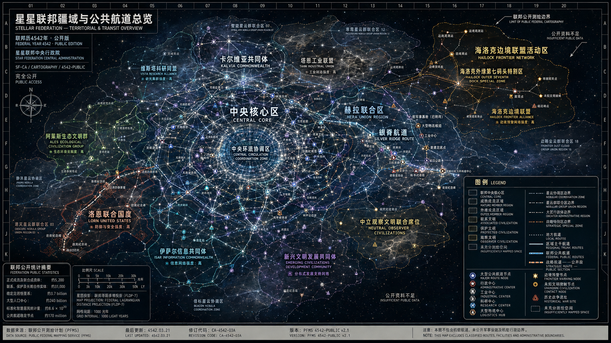

# 星星联邦

> 一个由星星文明建立并主导的跨星云联邦制超级文明。共同法、公共航道、FSU清算网络与中央军工标准已连续运转逾四千年；第四代P系列支撑起可观测的常规战略威慑，第五代S系列则长年封存于最高机密与技术克制框架之下。

## 世界速览

星星联邦（Stellar Federation，民间与外交场合亦广义泛称"星星文明"）是已知宇宙规模最庞大的跨星云联邦共同体，由创始核心"星星文明"建立并主导，可考成文史逾四千年。早于约四千年前的超星团战争爆发之前，联邦便已建成完备的跨星云宪政架构、共同市场、重工业星云网络、科研院所体系及多层级成员秩序。那场席卷数万星系、卷入多个文明集团的超星团战争整整持续了近三百年；战火停息后，战前既有的宪政与经济体制照常运转，唯部分重创战区、静默航段与边缘聚居带的复苏绵延了此后数十年至上百年。

联邦技术与军备实行严格的公开与机密双轨制。公开层允许商业化、复制、标准化维护与受控出口；机密层则隔绝于市场之外，由中央机构垂直管辖。已知战略火力体系以此划出两道代际分水岭：**第四代体系（P系列）**物理机制透明、参数可测、战场毁伤可预期，系联邦战前便已成熟的主力军工基石，历经三百年大战的大规模扩产与迭代，公开编号自P000延伸至P999，之上另有由星星文明直接统辖的未公开序列（P1000以上平台，S2测试摘要亦曾援引"P6000级主武器"作为等效标定）。**第五代体系（S系列）**则是超星团战争后期在极端战略压力下催生的非常规产物——信息高度封闭、作用机制成谜、交战过程无法按常规物理模型复盘，列属联邦最高机密（Ω级），战后被锁入严苛的封存与授权审查制度，定位为**"最终保险机制"**而非现役主力。

联邦中枢由联邦中央议会、联邦执政委员会、星星文明中央代表团、联邦中央行政院、联邦最高法院与联邦监察总署六大机构共同构筑。星星文明掌握全联邦体量最庞大的工业星云、科研体系、中央行政、战略军团、主干公共航道与战略资源储备，在中央议会与执政委员会握有常任主导席位及战略安全特别否决权，直接统管战略军团部署、P1000以上军事平台与最高机密科研；然联邦并非星星文明包办一切的单一帝国——中央战略核心由星星文明坐镇，覆盖数十亿恒星系的工业、贸易、人口与地方治理则由各级成员文明共同托举。公开名录中的核心与正式成员集团涵盖卡尔维亚共同体（商贸金融）、洛恩联合国度（区域军事）、维斯塔科研同盟（基础科研与安全标准）、阿莱斯生态文明群（生物圈与环境重建）、塔恩工业联盟（重工造舰）、伊萨尔信息共同体（算力与跨物种通信）、海洛克边境联盟（外缘防务）、新兴文明发展共同体及中立观察文明联合席位，自一级创始主导文明至六级保护文明共分六等。

武装力量按成员文明武装、区域联合防卫军、联邦中央军团、联邦战略军团四层梯次配置（S系列游离于常规战略军团编制之外）。跨文明政治光谱中长期并存中央派、自治派与协调派三大思潮，现阶段以维持既有分权妥协的协调派占议会主流。

围绕S系列的存废与监督权，联邦朝野争讼数千年未休。联邦战略研究院在公开评估中将未来局势归纳为三条轨线：稳定维持（概率最高）、技术扩散（机密外泄引发局部军备升级）、秩序崩溃（概率极微，一旦发生则战略终端技术失控的后果不可测算）。当下正值联邦历4542年前后的战后稳定与技术克制期——约四十年前（联邦历4502年）完工的S2平台至今封存于实验室、未获列装授权，成为"技术能力存在不自动等于拥有部署权"的制度标本。

在远离战略军区的日常星海中，军事体系并不主导民生。数千成员文明各行其本地货币、历法、教育与社会风俗，联邦中央仅以联邦结算单位（FSU）、公共航道网、跨文明共同法、执业资格互认与安全底线维系共同市场。高度自动化的工业早已抹平了基础营养与日用品的匮乏，但**可靠航道容量、时间、核心区位、罕见生态空间、稀有战略材料与顶级科研席位**，依旧是横亘在跨星云社会中的真实稀缺。

## 正式设定

### 文明概述

- **正式名称**：星星联邦（Stellar Federation）
- **通用称呼**：星星文明
- **共同体性质**：跨星云联邦制超级文明
- **建制年代**：早于现行统一历法，确切起源年份已不可考；超星团战争爆发前便已成熟运行，已知成文历史逾四千年。

**语境辨析**：在宪政法理与官方公文中，"星星联邦"（简称"联邦"）专指包含数千成员文明的整个跨星云政治共同体；而在成员席位与内部权责语境下，"星星文明"专指创立并主导联邦的第一级核心文明本体。至于民间与外围星域将整个联邦统称为"星星文明"，系沿袭数千年的日常俗称。

**共同体基石**：作为已知宇宙体量最庞大的联邦制文明，其运转仰赖五大支柱——跨星系标准化重工业网络、分层清算的跨星云共同市场、公开与机密双轨并行的科研体系、中央主导与成员自治咬合的宪政架构，以及由公共航道和共同法维系的长期秩序。联邦对外奉行开放合作与受控援助方略，通过技术转移、航道接入、市场准入与防务协定，将数以万计的成员及联系文明纳入同一套稳定体系。

#### 联邦公开统计尺度

由于成员文明在生物形态、个体寿数、意识结构与聚居方式上差异悬殊，联邦中央行政院统计署采用**"标准化统计口径"**对全境数据进行折算。此类指标专供中央预算拨付、公共服务配额与议会代表权测算，不代表各文明拥有同质化的社会形态：

| 统计项目 | 当前公开口径（联邦历4542年前后） |
| --- | --- |
| 具中央议会法定代表权的正式成员、联合成员体 | 约5,200个 |
| 联系文明、保护文明及长期观察合作实体 | 约31,000个 |
| 纳入长期人口、税务或公共服务统计的稳定定居恒星系 | 约37亿个 |
| 行星级、轨道级及深空大型人口中心 | 约2,400亿个 |
| 标准化智慧居民统计量 | 约8.6×10²⁰ |
| 联邦公共航道登记的长期稳定节点 | 约1.7亿个 |
| 中央与成员共同认可的高等教育/科研机构 | 超过1,200万所 |
| 联邦共同法长期有效的标准司法协作区 | 约8,600个 |

表中"标准化智慧居民统计量"系行政折算值：部分文明按单一生物个体计，部分文明因存在蜂群意识、分布式算力节点或周期性人格合并，按共同法核定的责任与公共服务单元折算，故生物学意义上的自然个体总数与该统计值并不等同。

中央政府从不直接插手三十七亿个定居恒星系的基层政务。日常民政悉归成员文明、地方行政区与星云协调机构自理；中央常年垂直掌管的事务，严格限定于共同法解释、FSU最终清算、公共航道干线、跨文明争端仲裁与战略安全五项。

### 历史概览

#### 战争前的成熟发展阶段

超星团战争并非联邦的催生婆。早在那场大战爆发前数百年乃至更久远的年代，星星文明与早期核心成员便已完成超光速主干航道网铺设、跨星云重工业与资源调配链整合、以P系列为代表的标准化武器工业建设，并确立了中央机构与成员自治的宪政分界。现今仍在服役的多条跨星云主干航道与核心工业星云船坞，其初版规划图纸皆早于战争数百年；战时庞大的军工扩产，实质上是直接嫁接在这些历经多轮改制的既有工业与航道骨架之上。

#### 超星团战争（约四千年前）

联邦历238年（距今约四千年前），已知宇宙爆发席卷数万星系、卷入多个大型文明集团的**超星团战争**。战火延烧近三百年，终以联邦阵营获胜告终。

战争期间，全境曾同时开辟数十个大战略战区与上千个战役方向。部分稳定控制线的单翼展开逾百光年；而在航道反复易手、中继站屡建屡毁的胶着方向，一条战线苦战十年而总位移不足数光年亦属常事（现存战区档案中，有一段僵持控制线自首次测绘至停火的累计位移不足四光年）。因成员文明寿命跨度极大，对长寿物种而言这是一场贯穿职业生涯的漫长服役；对短寿命成员而言，战争则绵延十余代人——某矿业联合体留存的七次战时征募名册中，第一份与时隔两百余年的第七份名册上，仍反复出现六个相同的家族姓氏。诸多前线整备机构在三百年间历经数轮装备换代，其战时番号甚至比所辖地方政权的寿命更长。

战争中后期，航道布雷、星门与中继节点爆破、长期封锁及商路强行改线成为常态。多处边缘星区曾连续数年实行严苛配给，大片边境聚居带在战时疏散后便彻底沦为无人区。在后方，多座工业星云整建制转入军工动员，巨型轨道船坞以"旬"为单位成批交付舰体；大型战区的标准化维护网各自囊括上千座补给、船坞与工程节点。自战争第17年军需征用风波后，战略运输、重工业与关键资源虽在紧张期实行战时统筹，但绝大多数地方民用经济始终由成员体系自主维持运行。

三百年拉锯中，任何一次局部会战的胜利皆无法直接换来总体终局。攻占一片星域后，若无法同步修复航道、中继、补给线与驻防网，控制区便会在随后的反扑中得而复失。直至战争末期前，交战双方均曾多次取得大规模战役优势，却谁也未能一举击穿对方的总体再生能力——至于双方为何在长达三百年的流血中始终无法通过常规外交达成长期共存，至今仍是未完全解密的战略悬案。

据战后解密归档的Ω级评估报告：至**战争第288年**，联邦阵营已实际控制交战星域的**72%**，工业总产能达敌方联盟的**4.8倍**，战略资源储备达其**6.1倍**，敌方主力舰队累计战损率逾**84%**。在此总体消耗局势已定之际，战争后期催生的第五代特殊平台S1完成了首次实战验证（KX-441行动）。**战争第291年**，敌方联盟正式请求停火谈判；全面军事行动旋即转入终止程序。

**联邦历法纪年坐标**：现行联邦历并非联邦建国纪年，而是早期跨文明统一历法改革所确立的公共纪元。当下约为**联邦历4542年**。按此标尺：超星团战争爆发于**联邦历238年**，第291年（约**联邦历529年**）停火终止，距今约四千年；S1平台于**联邦历523年**（战争第285年）竣工，KX-441行动发生于**联邦历526年**（战争第288年）；先驱遗迹研究组组长赫尔曼的退休访谈录于**联邦历4260年**（距今约282年）；S2平台则于**联邦历4502年**（约四十年前）在实验室完成建造。早于统一历法的远古史料一律保留旧纪年或相对年代，不作强行折算。

#### 战后稳定与技术克制时代

停火之后，联邦并未改弦更张，而是在战前既有的宪政、共同市场与成员自治轨道上启动修复，同时对战争后期诞生的极端技术套上制度枷锁：严格封存S系列及同类技术、收紧高阶P系列的受控扩散权限、重划战略军团与成员文明的技术边界，以此熄灭新一轮宇宙级军备竞赛的苗头。

停火后的最初六十余年史称**"第一重建周期"**。工程船队在旧主航道上耗时数十年打捞残骸、排雷并重修中继站，大批损毁过重的航段在官方星图上被永久改道或注销；部分边境星系未再恢复定居，仅留自动导航警示与纪念信标，档案中统称**"静默航段"**。依战后共同法，阵亡确认无须以找回实体遗骸为前提，凭服役档、战损记录与身份连续性链条即可完成法定追认。各成员文明各依本族仪轨悼念亡者；唯每逢联邦标准纪念日，全境一亿七千万个公共航道节点的运行灯语会统一转为静默纪念模式一分钟——此制沿袭四千年，至今未改。

### 科技体系与战略平台

#### 公开与机密双轨制

联邦科研与工程体系严分两轨：
- **公开层级**：恪守可商业化、可复制、可标准化维护、可受控出口四项准则，支撑跨星云贸易、民生基建、成员防务与常规军工合作。
- **机密层级**：彻底隔绝于商业市场之外，由中央科研与战略安全机构垂直掌控，专司文明底线安全、先驱遗迹解析与极端战略威慑。

由此在联邦火力谱系中划出两代截然不同的造物：
- **第四代体系（P系列）**：物理原理清晰、技术参数可观测、战场毁伤可预期。其基础标准早于超星团战争确立，三百年大战则将其推向了跨星云规模化扩产与体系化巅峰。
- **第五代体系（S系列）**：超星团战争后期的产物。技术信息全封闭、底层作用机制未明、交战过程无法以传统能量或弹道模型复盘。S系列的现世虽晚于联邦绝大部分宪政与军工制度，却直接迫使战后联邦重构了"最高技术所有权与使用权分离"的克制原则。

#### P系列战略平台

P系列系联邦标准化重工业的代表作，以规模化量产、跨文明通用接口维护、超长服役周期与分级受控出口著称，构成了联邦常规武装力量的铁骨。

| 公开编号段 | 战略与战术定位 | 公开代表型号 |
| --- | --- | --- |
| P000—P099 | 航道巡逻、商路护航、战术支援 | — |
| P100—P299 | 主力舰队交战、星系与区域控制 | — |
| P300—P599 | 星区压制、大型主力舰队会战 | P300 |
| P600—P799 | 星系级全面战争 | — |
| P800—P899 | 跨星区战略级部署 | — |
| P900—P999 | 战区指挥中枢、移动堡垒、联邦航道枢纽 | P900 |

（按：公开军贸与常规军备登记止于P999；P1000以上平台及战略评估中援引的"P6000级"标定属中央未公开序列，由星星文明中央军事体系直辖。）

**受控出口铁律**：联邦允许P999以下的部分型号进入成员军贸市场，但严禁P1000以上平台外流，且出口型号均保留核心技术黑箱并植入联邦监管协议——军售旨在维持区域防务均衡，而非助长地方军备失控。

#### S系列战略终端平台

S系列列属联邦最高保密等级（Ω级），从不列入常规作战序列，其唯一宪政定位系**"最终保险机制"**——具备第五代火力特征、极高技术密度、脱离常规航道束缚的超远距机动能力、全隐蔽突防以及**作用过程不可复盘**之特性，专为在极短时间内实施不可逆的战略打击而设。

- **S1平台**：
  - **公开馆藏口径**：具体立项与竣工年代未公开，现处永久封存状态。主流史学界仅据零星边缘史料推定，S1在测试阶段展露了远超预期的战略干涉力，终未获准转入常规列装。
  - **Ω-0级内部档案口径**：S1于超星团战争第285年（联邦历523年）完成核心舱封闭与工程验收，并于战争第288年（联邦历526年）的**KX-441行动**中完成唯一一次实战验证（详参文末《附录档案：S1计划》）。公开口径之"未知"与内部档案之"确凿"系密级权限分层所致。
- **S2平台**：
  - **建造与现况**：约四十年前（联邦历4502年前后）完工；现处中央实验室静态保存状态，**未获列装授权**。
  - **已知公开测试摘要参数**：舰体全长约1,200米；具备超星系团级机动能力；战略毁伤效果在公开测试摘要中被等效标定为**"接近P6000级主武器"**。（按："P6000级"系联邦战略评估部门采用的等效结果标尺，仅代表特定测试条件下的可观测终局接近该当量的P系列理论平台，绝非意味这具仅1.2公里长的舰体上安装了传统物理主炮，亦不代表其作用机制与P系列同源。）
  - **从S1停产到S2立项的制度脉络**：KX-441行动结束后，S计划紧急科研会议通过了"停止后续生产"之决议——当时叫停的是在理论模型尚未闭合前对S1工程平台的盲目复制与批量扩产，而理论研究则转入长期冻结与战后伦理审查。直至数千年后，S2方作为全新的单体实验项目获准完工；至于其立项审批链条与完整性能，至今未予解密。

### 联邦战略哲学、伦理争议与风险评估

**三大战略信条**：
1. **可控威慑**：常规军事威慑必须保持物理可观测、当量可统计、战果可复盘。这正是P系列延用数千年的建军准绳。
2. **不可见底线**：极少数触及未知领域的最高机密技术（S系列），绝不下放常规军团、绝不纳入军贸、绝不作为日常外交筹码，仅作悬于秩序底线之上的无形威慑。
3. **技术克制原则**：**造出武器的能力，不自动产生部署与使用该武器的合法授权。** S2完工四十年仍锁于实验室、使用权受独立机构层层掣肘，正是这一战后宪政妥协的直接体现。

**朝野伦理争讼**：四千年来，围绕S系列的辩论从未平息。维持派坚称，正是这道不可见底线镇住了战后星海、掐灭了超级文明间再次爆发总体战的可能；批评派则指出，将无法复盘、无法靠常规手段防御的终极力量集中于中央极少数人手中，本身便是对联邦分权根基的最大威胁。

**对外合作与极限技术许可**：联邦对绝大多数成员及外围文明敞开工业建设、贸易结算与常规防务援助大门；唯独对触及极限物理、先驱遗迹与战略级毁伤的研究领域实行铁腕许可证管制，未经中央特批，任何成员机构不得私自接触相关技术体系。

**战略研究院三轨推演**：联邦战略研究院在公开年度评估中，将联邦未来的长期走向归纳为三类模型：
- **方案一：稳定维持（概率最高）**——既有分权宪政、共同市场与技术封存框架继续平稳运行。
- **方案二：技术扩散**——部分高密级技术外泄或被外围势力逆向复现，引发局部星区军备竞赛与安全架构重组。
- **方案三：秩序崩溃（极低概率）**——倘若联邦中央宪政体系整体失灵，封存的战略终端技术一旦流入大规模政治或军事火并，其造成的宇宙级后果将超出任何现有推演模型。

### 联邦组织架构

> 本章制度条文摘编自《星星联邦组织架构白皮书》（文件编号：SF-GOV/WP-4281，发布机构：星星联邦中央行政院，公开等级：完全公开）。

#### 联邦宪政性质

星星联邦既非实力对等诸邦的临时攻守同盟，亦非星星文明吞并万族而成的中央集权帝国。其宪政底座是一套**"核心主导＋成员自治"**的复合架构：星星文明承担中央行政运转、战略安全、主干航道与制度兜底，并为此支付了中央机构绝大部分基础设施、核心人员与长期预算成本；各成员文明保留完整的内部自治权；跨文明公共事务由联邦中央机构依共同法协调；唯有当全面战争、主干航道瘫痪、战略科技失控或文明级灾变降临时，最终协调与决断权方收归联邦中央。

#### 主要成员文明名录（公开核心及代表集团）

1. **星星文明（创始主导文明 / 一级）**
   - **席位与职责**：据中央常任主导席位；垂直统管核心战略军团、P1000以上军事平台、中央科研体系、主干跨星云航道及最高等级文明安全事务。
   - **政治肌理**：综合工业、军事与科研体量居全联邦之冠，联邦共同法、军工接口与航道标准皆由其奠定。对外一贯奉行"秩序优先、技术援助、受控扩散"三原则。
2. **卡尔维亚共同体（多文明商业共同体 / 二级核心成员）**
   - **主要职能**：执掌跨星云贸易、金融清算网络、商事仲裁、巨型民用船队与战略物流。
   - **政治肌理**：由数个古老贸易文明联结而成。因既高度仰仗全联邦统一市场，又极度珍视各邦古老商法传统，卡尔维亚在议会中一面力挺共同市场与航道畅通，一面对中央插手地方税制、商法与航道定价保持高度戒备。
3. **洛恩联合国度（多星云军事联盟 / 二级核心成员）**
   - **主要职能**：承担大区防卫、外缘驻军、战术军官养成与联合舰队标准化演训。
   - **政治肌理**：拥有深厚的独立军工基础，主力舰队广泛列装P系列平台，同时严守本族悠久的指挥链传统。洛恩军方极重"指挥链可验证、责任可追溯、战场可控"，故对游离于常规指挥体系之外的S系列等黑箱技术历来抱有深沉的警惕。
4. **维斯塔科研同盟（科研文明联合体 / 二级核心成员）**
   - **主要职能**：主攻基础物理、天体工程、生物技术、人工智能安全及跨文明科研规范制定。
   - **政治肌理**：联邦公共科研体系的顶梁柱（虽无最高机密项目的独立控制权）。其学派文化奉"可重复验证、同行评议、风险分级"为圭臬，在政坛既是前沿技术的推手，亦是"机制未明即严禁部署"铁律最顽固的捍卫者。
5. **阿莱斯生态文明群（多生态文明联合体 / 三级正式成员集团）**
   - **主要职能**：专精行星生态修复、人工生物圈设计、战后大移民安置与环境灾变救援。
6. **塔恩工业联盟（重工业文明联盟 / 二级核心成员）**
   - **主要职能**：承担巨型舰体建造、战略特种材料冶炼、深空船坞群营建与工业星云维护。
   - **政治肌理**：联邦军工供应链的制造脊梁。中央统一军工标准赋予了塔恩庞大的规模红利，但也使其对"未经协商的中央强派指标、无偿征用及技术标准频繁改动"极为抵触——塔恩与中央的博弈从不是"要不要统一标准"，而是"改标准的账单由谁买单"。
7. **伊萨尔信息共同体（信息与计算文明集团 / 三级正式成员）**
   - **主要职能**：维系跨星云公共数据网、超远距中继通讯、战略超算、信息安全及跨物种语言认知转换接口（核心中枢受中央安全机构联合监管）。
8. **海洛克边境联盟（边境文明联合防卫体 / 三级正式成员集团）**
   - **主要职能**：常年驻守外围航道第一线，主司外缘巡逻、未知文明初次接触、边境预警与边区治安。
9. **新兴文明发展共同体（特殊联合代表机构 / 四级联合成员体代表）**
   - **主要职能**：汇集数量庞大但单体薄弱的新兴与中小文明，在议会中争夺教育配额、技术转移与贸易扶植，制衡核心大文明对公共资源的虹吸。
10. **中立观察文明联合席位（非正式成员联合席位 / 观察席）**
    - **权限边界**：可参与共同市场贸易、公共科研交流、灾害联防与部分低密级安全会议；不完全受联邦共同法管辖，亦严禁染指战略军团指挥、最高机密科研、中央核心预算及P1000以上军备体系。

#### 成员六级阶梯

联邦成员体系并非简单的"在册/非在册"二元划分，而是按权责对等原则分为六级：
- **一级（创始主导文明）**：唯星星文明一家。享中央常任席位、战略安全主导权、最高军团管理权与宪政连续性维护权。
- **二级（核心成员文明）**：卡尔维亚、洛恩、维斯塔、塔恩等。享高级议会席位、执政委员会常设代表权、大型公共工程优先参与权及战时军团级联合指挥资格，但无权单独调动联邦战略军团。
- **三级（正式成员文明）**：享完整议会表决权、共同市场准入、公共防务保障、最高法院司法救济及科教互认。
- **四级（联合成员体）**：由若干中小文明合组联合代表团，共享议会席位与公共配额。
- **五级（联系文明）**：缔有单项或多项合作条约，未承接完整成员义务。
- **六级（保护文明）**：受联邦安全庇护与发展援助，尚不具备正式成员参政资格。

#### 联邦最高政治结构与中央代表团

联邦中枢权柄分寄于六大宪政机构：**联邦中央议会、联邦执政委员会、星星文明中央代表团、联邦中央行政院、联邦最高法院、联邦监察总署**。

- **联邦中央议会**：最高立法与预算审批机关，执掌联邦立法、预算核准、新成员接纳、重大条约审议、中央机构监督及**全面战争状态宣示权**。议会席位由"成员基础席位（保底代表权）＋综合比例席位（按人口、工业、财政贡献与公共责任动态核算）＋中央常任席位（星星文明与少数核心成员持有）"三块拼合而成。星星文明虽握有单一成员中最大的票仓，在法律上仍无法独力强过普通法案；唯议题触及战略安全、中央军团与最高机密科研时，星星文明方可行使**特别否决权**。
- **联邦执政委员会**：最高常设政治协调中枢，由星星文明首席执政代表（惯例兼任委员会主席）、核心成员代表、中央议会代表、中央行政院首脑及战略安全代表组成。日常采集体表决制；但在**战略军团部署、P1000以上平台调度、最高机密科研、中央安全及文明级紧急状态**五项事务上，星星文明握有法定主导权。
- **星星文明中央代表团**：星星文明本族参与联邦治理的最高专设机构。它并非联邦政府本身，却承担着提名关键行政长官、供养中央军团、拨付中央兜底预算、直管中央工业基地及在宪政危机中维系联邦不坠的实质重担。外围成员常抨击代表团权柄过重，星星文明则反诘其独自扛下了全联邦最沉重的防务成本与战略风险——这笔账，构成了联邦四千年政争的永恒母题。
- **联邦中央行政院**：日常政务执行中枢，首脑由执政委员会提名、中央议会确认。麾下设九大核心部署：**成员与外交事务部、财政与战略资源部、工业协调部、航道与交通部、科学技术部、公共安全部、文明发展部、信息传播署、军工贸易管理局**（其中工业、战略资源、科研与军工四部多由星星文明主导；贸易、生态、信息与区域治理部门则多由核心成员分掌）。
  - **信息传播署与联邦新闻署之分**：行政院下辖的**信息传播署**系行政监管与信息基建衙门，主司紧急广播技术标准、公共数据接口、媒体法执法与档案解密程序；而**联邦新闻署**（含中央新闻台）则是依公共章程独立设立的公共新闻机构，虽受预算审计与共同法约束，日常编采却不归信息传播署直接指派。超星团战争期间，军方战时安全审查与新闻署编辑独立性之间的拉锯，直接造就了《晚间新闻结束以后》所载的层层删节规程。

#### 联邦最高法院、共同法与档案保密程序

**共同法的兼容底线**：联邦共同法从不妄图取代数千成员文明的本土法典。婚丧嫁娶、地方产权、风俗习惯与寻常刑民案件悉归成员法自理；唯有跨成员商事合同、公共航道通行、成员基本权利、中央与地方权限争议及联邦机构行政行为，方进入共同法管辖。由于不同物种对"个体""死亡""家庭""财产"乃至"合法证词"的生物学定义天差地别，共同法只划定**最低法律兼容接口**——蜂群意识、分布式意识或周期性人格合并群体尽可按本族法登记内部构造，但只要涉足跨文明合同、纳税、议会代表权与法律追责，即须指定一名可持续识别的法定责任主体并留存授权链。即便在全面战争或文明级紧急状态下，司法审查亦不会自动停摆；一切紧急征用、权利限制与临时接管皆须留存完整授权链，以备战后审计。

**档案分级与复核制**：中央档案库不设"满若干年自动全量解密"的一刀切规则。公开、内部参阅、秘密乃至Ω级档案，由原主管机关与档案局定期逐卷复核；同一案卷的正文、附件、检索目录与技术附录可分别维持不同密级（故常有主卷已移交公开馆藏、关键附件仍处封存之况）。公民与学者可依法申请确认档案存否、调阅开放卷宗或提请密级复审；若触及现役战略系统、受保护成员资料、个人连续身份隐私及最高机密科研，档案局有权驳回，但必须将驳回法条依据与复核人记录在案。四千年积牍如山，旧分类、废止编号与佚失附件在中央档案库中比比皆是。

#### 地方行政结构与三类典型样区

联邦地方协调层级不以单一恒星系为单位，而是按**星云协调区 → 星云群联合区 / 大区行政体 → 战略特别区（中央直辖）**架构运转。协调区与联合区仅司航道、跨区基建、区域联防与司法协作，不干预成员文明内政；唯核心军工基地、中央科研区、先驱遗迹封锁区、主干航道总枢纽及战后临时接管区，会被划为由中央垂直统治的"战略特别区"。

行政学院教材中常取以下三区作为空间治理的对照标本：
- **中央环流协调区**：坐落于联邦核心公共航道网中枢，辖稳定定居恒星系约190万个，标准化人口统计量约7.4×10¹⁷。区内高密度云集中央衙署、顶尖科研院所、金融清算总行与高等学府，航道窗口常年满负荷运转，核心区居住成本高出联邦中位线数倍乃至数十倍。
- **赫拉联合区**：由超星团战争时期的"赫拉方向战区"战后改组而成，现辖定居恒星系约42万个。昔年两军反复争夺的"银脊航道"至今仍是区域经济脊梁，大批战时前进基地已被改建为重工船坞、物流港与战争纪念馆；地方议会常年围绕战损抚恤、军方占地的退还及古战场遗址保护与中央博弈。
- **海洛克外缘第七码头特别区**：典型的边境战略特别区。常住人口统计量不足中央环流区的千分之一，却扼守着数条深空探测、远距搜救与未知文明接触航线。其人均中央财政拨款高居全联邦前列，历来是自治派质问"战略安全账目黑箱"、中央派反驳"边防重地岂能按人头均分预算"的焦点标本。

#### 军事体系、作战当量与战时指挥链

联邦武装力量按四层梯次构建：
1. **成员文明武装**：各成员自留常备军，主司母星系与本土防务。
2. **区域联合防卫军**：邻近成员合组联军，主司星云协调区与大区治安防卫。
3. **联邦中央军团**：由星星文明主导营建、吸纳多成员兵员与资源，专司跨星云大战、超级文明冲突与联邦腹地防御。
4. **联邦战略军团**：联邦最高常规武力，由星星文明中央军事系统直辖并受执政委员会监督，列装P1000以上战略平台、战略级航道管制系统与中央指挥母舰。（S系列不属于常规战略军团编制。）

因各成员文明舰艇的尺度与自动化程度悬殊，联军公文一概以**"作战当量"**而非单纯船只数量核算编制。以常规第四代（P系列）联合舰队为准，五级编制尺度如下：
- **战术编队**：约8—30个主作战单位，配属无人作战平台与勤务保障舰；
- **舰队**：辖6—18支战术编队，常见主作战单位约80—300个；
- **舰队群**：辖6—15支舰队，常见主作战单位约800—4,000个；
- **机动集群**：辖8—20个舰队群，自带工程、运输、医疗、侦察与移动基地群，主作战单位达1万—7万个（如卡斯特上将麾下"第九机动集群"所辖12支直属舰队群、7支盟军舰队群及13支工程运输集群，即属数万主战单位规模的战略重兵集团）；
- **军团及军团群**：不再按死板的舰船数字衡量，而是以"能否独立支撑一整个大型战略方向的指挥、军工造血与后勤补给链"作为建制标准。

**全面战争指挥链**：
`联邦执政委员会 → 联邦总战争委员会 → 联邦总军团统领 → 方面军群统帅 → 军团群统帅 → 军团与大型机动集群`
历任联邦总军团统领（如阿德莱恩·索伦）皆由星星文明最高军事系统提名、执政委员会确认——共同法虽未明文禁止其他成员军官出任，但因全联邦最完整的战略指挥网、跨星云情报中枢与重后勤体系皆攥在星星文明手中，此席位在实务中从未旁落。

### 货币、金融与共同市场

#### 联邦结算单位（FSU）与分层清算

联邦奉行**"统一结算、货币自治"**原则：各成员文明照常发行并使用本地货币、信用点或配给券；唯跨文明贸易、联邦中央预算、中央税费、跨星云基建、战略采购与大宗商品交割，一律以**联邦结算单位（Federal Settlement Unit，简称 FSU，民间俗称"联币"）**计价清算。一名普通居民或可终生只用本土货币买菜度日，但其薪资契约、跨星云网购、远程学位学费与航道船票，底层皆可实时折算为FSU。

FSU不锚定任何单一贵金属、能源或特定矿产（以免某项开采或聚变技术突破直接击穿货币信用），而是由**联邦结算与稳定局**锚定一篮子长期物价、公共服务成本、重工产能与航道运价综合校准。稳定局的公开货币政策并非追求死水般的零通胀，而是将全联邦综合价格指数控制在**年化1%—2%的温和上浮区间（政策中值约1.4%）**。FSU绝大部分以电子记账形态流转；仅在灾区、外缘边境与通信断绝带准许签发限额离线结算凭证（网络恢复后须强制同步核销，严控大额匿名离线资金以防战时黑市与跨境洗钱）。

**跨星云分层清算**：受限于宇宙尺度下的通信延迟，金融系统无法假定全境交易可在同一毫秒内完成交割，故实行"本地结算网确认 → 区域清算节点交割 → 联邦中央清算体系终审记账"的三层清算。遇有航道中断、通信迟滞或政局动荡，一笔跨星云大额汇款会分别呈现"已授权""区域已确认""待中央最终清算"等中间态；远期商事合同亦必附带航道断航、延迟交割、货损与战争险条款。

#### 财政汲取比例与后稀缺时代的真实稀缺

在和平年代，联邦中央财政直接汲取并支配的预算，仅占全联邦标准化经济总产出的**2.3%—3.1%**（资金源自成员责任分摊、公共航道通行费、中央直属资产收益与长期公债）；其余逾96%的公共财政收支皆留在成员文明与地方政府账上，普通公民亦只向本土政府完税，不存在横跨宇宙的中央直接个人所得税。即便是超星团战争最惨烈的动员峰值期，中央直接统筹或以军工合同锁定的经济资源亦仅占全联邦总产出的**12%—16%**——庞大的民用经济底盘始终留在成员体系内部，这正是联邦历经三百年总体战而未蜕变为彻底军国体制的经济根源。

在成熟星区，高度自动化的工业早已令基础能源、合成营养、日常衣物、标准舱室与基础医疗变得极其廉价；但这绝不意味着财富失去了分量。**可靠航道容量、时间、核心行政与科研枢纽区位、稀有特种材料、原生自然生态居住权、顶级专家人工服务、文化艺术真迹、政治游说力与高阶科研配额**，依旧是千金难求的硬稀缺。

### 交通、航道与物流

#### 四级航道网与"可靠容量"瓶颈

超光速远行绝非"在空旷宇宙中任意拉直线"，而是高度依赖历代耗资筑成的跨星云航道基础设施（内含导航信标基准、通行协议、应急救援站、补给坞、通信中继阵列与深空险情监测网）。全境航道按管辖与战略层级分为四等：
1. **地方航道**：成员或地方政府自维，连通恒星系内部及邻近星系。
2. **区域主干航道**：串联多个成员与星云协调区，承载全联邦绝大部分日常商贸物流。
3. **联邦公共航道**：中央与成员合资营建的跨星云大动脉，受共同法保护，严禁任何单一成员私有化或擅自封锁。
4. **战略航道**：专供中央军团机动、巨灾响应与文明级紧急行动，部分坐标、容量及技术参数列为机密。

在跨星云交通中，真正的瓶颈从不是单舰引擎的理论极速，而是航道节点的**"可靠通行容量"**。一旦某处主干节点因维护、事故、交通管制或战时布雷而降载，即便舰船本身航速再快，整个星区亦会陷入长达数月乃至数年的物流拥堵。

#### 民用旅行与通信时滞实况

联邦交通部公开发布的"典型行程时间"，并非飞船物理极速测算，而是计入了航道窗口排队、跨区中转、生物安全检疫与跨物种环境转换后的**实际旅行中位区间**：

| 跨度区间 | 普通民用航班/客运 | 高优先级/军用通道 |
| --- | --- | --- |
| 同一恒星系内主要人口中心 | 2—18小时 | 1—6小时 |
| 相邻已联网恒星系 | 0.5—3日 | 3—18小时 |
| 同一星云协调区内远程通行 | 3—20日 | 1—7日 |
| 相邻大型行政区域之间 | 12—70日 | 4—18日 |
| 中央核心区至典型外缘边境区 | 4—11个月 | 12—35日 |
| 极端偏远、低容量或战后临时恢复航线 | 1—3年亦属寻常 | 视战略航道完好度而定 |

高优先级政务通信虽快于实体船队，但自中央核心行政网发往典型边境区的加密公文，仍需约**5—15日**方可完成多节点校验确认；未购买加急配额的普通商贸数据包耗时更久。故在联邦共同法合同中，"信息已发出"与"对方已收悉并完成法定确认"永远被严格界定为两个不同的法律时间点。

（按：正是这套由节点容量与中转窗口构成的严苛交通物理现实，衬托出S系列所谓"脱离常规航道、具备超星系团级机动能力"是何等违背常理。）

### 社会生活、物价与教育人才体系

#### 双重身份与法律连续性

每位联邦居民生来便具双重政治身份：本土成员文明公民身份，以及联邦成员身份。前者管辖其婚姻家庭、文化伦理、地方福利与日常民事；后者赋予其公共航道通行、跨文明司法救济、教育执业资格互认与共同法合同保障。

因各成员物种的寿命自数十标准年至数千标准年不等，中央公文从不使用"成年""一代人"等模糊生物学字眼，一切预算、合同、学制与服役期悉以**"联邦标准年"**计量。公共身份档案亦不苛求居民保持单一不变的肉体——无论经历跨星系迁徙、世纪休眠、义体转换，抑或成员法认可的周期性人格合并，只要跨文明登记系统能核实其**法律主体连续、授权链完整且债务责任继受人明确**，其联邦身份即告有效。

#### 标准消费篮子与技术人员收支样本

为便于跨星云核算购买力，联邦统计署定期发布以FSU计价的"标准居民消费篮子"。在成熟非核心星区，一名具完整劳动资格的单人标准住户，年可支配收入通常折合**38,000—62,000 FSU**。常见公开物价区间如下：
- **标准合成营养与基础日用品**：80—260 FSU/月；
- **地方公共交通与基础信息网接入**：10—60 FSU/月；
- **非核心区标准居住单元长租/使用权**：350—900 FSU/月；
- **核心行政区、顶尖科研港或一级航道枢纽优质住宅**：3,000—18,000 FSU/月（极稀缺自然生态保护区更高）；
- **区域内常规跨恒星系客运船票**：200—2,000 FSU/次；
- **跨大区长途旅行**：3,000—40,000 FSU/次；
- **基础医疗与基础教育**：在绝大多数正式成员区由本土财政或公共保险兜底，个人自付额极微。

统计署用于解释中坚阶层生活水准的**"标准区域技术人员模型"**载：年可支配收入52,000 FSU中，全年标准居住支出约8,400 FSU，基础营养与日用约2,200 FSU，地方交通通信与公共服务自付约900 FSU，文化娱乐与近途休假约4,000 FSU，长期储蓄、跨文明养老金与商业保险约9,000 FSU；余下可支配结余则随物种习性与家庭结构自由支配。

#### 跨文明教育与高责任岗位复核

教育主权归于各成员文明，联邦仅设**最低公共必修基准**（含共同法与成员权利、跨文明安全、公共航道常识、媒体信息识读、基础科学方法、战时与灾变应急、跨文明伦理及至少一种联邦通用交流接口）与**跨文明执业资格附加认证**。

对具有连续个体意识的多数物种而言，典型培养与复核周期如下：
- **基础公共教育**：折合14—24个联邦标准年；
- **工程、医学、司法等高责任专业资格**：另需6—14年专修训练；
- **航道管制、战略系统运维、重型公共工程等高危岗位**：每12—25年须接受一次**强制资格复核**（对寿逾数百年的长寿物种，任何高阶执业牌照皆无"一次毕业终身免检"之说）；
- **中央核心学院与战略科研高阶项目**：公开录取率仅占达标申请者的**1%—3%**，且选拔除考核专业学识外，尤重长期心理稳定性与历史责任档案。为防核心大文明垄断上升通道，中央高等院校的跨成员招生中，法定保留**至少约三分之一名额**予非核心区、边境区、新兴文明或重大公共服务背景之学子——此配额比例的高低，亦是每年中央议会预算辩论的必争焦点。

### 联邦政治生态、党团与制度化石

#### 21,600席议会权重与五大跨文明党团

联邦疆域之浩瀚，决定了不可能存在覆盖数千物种的单一政党。所谓**中央派**（倡强化中央与星星文明统制力）、**自治派**（倡扩大成员自治、削减中央战略垄断）与**协调派**（倡维持现有权力置换与司法监察制衡，现居主流），本质是三种跨文明政治思潮。

联邦中央议会共设约**21,600个有效表决席位/表决授权**，代表们通过首都实体议事厅、大区议事中枢及加密远程认证系统同步履职。全院表决权重中，约**37%**来自成员保底基础席位，约**59%**按人口、工业、财政贡献与公共责任动态核算，余下**不足4%**为中央常任与特殊制度席位。**星星文明通常握有全院约15%的普通议题表决权**——虽系任何单一成员望尘莫及的第一大票仓，却远不足以独断普通立法（普通法案须过半数有效票；触及成员基本权利、共同法核心条款或中央扩权的修宪级法案，则须跨过三分之二多数与成员代表过半数双重门槛）。

在议会日常博弈中，最活跃的五大跨文明政团为：
- **联邦协约联盟**：协调派主干，致力于维系"星星文明掌战略核心＋成员享广泛自治"的既有宪政契约，常年构成院内最大执政多数网络。
- **成员权利联盟**：汇集自治派、地方主义者与卡尔维亚等商业代表，死盯地方财权、文化自治、中央战时征用边界与成员退出程序。
- **中央秩序议会团**：中央派大本营，在边防安全、战略军团扩编与危机应急授权上力主集权。
- **公共发展议会团**：由新兴文明发展共同体、外缘成员及社会民主派结成，常年疾呼向边远星区倾斜教育、医疗、航道基建与发展基金。
- **技术伦理监督集团**：超越传统集权/分权光谱的跨党派联盟（维斯塔学者与部分洛恩军方代表常在此合流），专司盯防人工智能、天体级工程、战略科研及S系列授权程序。

#### 重大公共政治事件与"制度化石"

四千年的宪政运行并非一纸蓝图绘到底，今日共同法中诸多看似繁琐迟缓的程序，皆是昔年重大政治危机留下的**"制度化石"**：

- **早期公共航道收费争议与《共同使用原则》**：战前成熟期，中央曾试图扩大主干航道统一收费以筹措扩建经费，招致商业与边境成员长达六年的联手抵制。最激烈时逾300个成员代表团联署复议，近2,000家大型航运与商业组织协同减载，令受波及干线的货运吞吐量骤降8%—11%。危机最终沉淀为不可动摇的**"公共航道共同使用原则"**——中央有权收费、限流与维护，但永世不得将公共主干航道异化为排他性敛财与政治卡脖子工具。
- **战争第17年军需征用风波与《民用最低运力线》**：超星团战争第17年，军方在11个主要星云协调区内强行征用高达28%的跨区民用长途运力，导致部分边境区基础医疗、口粮与工业备件船期平均延误17—43日。愤怒的运输工会随即发起为期19日的协同减载，多国议会联手抗议。最终总战争委员会做出历史性妥协：保留战时紧急征用权，但划定**"35%民用最低运力红线"**（除直接沦陷或紧急疏散战区外，不得长期将主要区域的基础民用运力压至和平基准的35%以下），并确立了延续至今的**战时物资事后审计制度**。
- **约两千六百年前的"七区托管危机"与《成员民政保留权》**：一次跨星区基础设施连环灾变后，中央应急机构对七个大型区域实施临时托管；灾情平息后，其中两区的中央直管状态竟被延续逾三十年，激起成员退盟威胁、地方文官集体怠工与最高法院违宪审查。自此共同法铁律明定：即便发生文明级危机，中央亦不得以"行政效率"为由长期接管成员文明的完整民政。
- **约一千三百年前的清算冻结与《统一结算而非统一货币原则》**：一场跨区信用崩盘曾令多个成员货币清算链同时锁死；中央借势推举FSU成为全联邦最终清算底座，却恪守分际未废除各成员本地货币。
- **约九百年前的"跨文明执业争议"与《资格互认保留条款》**：部分核心区名校与行会曾试图一刀切否认新兴成员文明的本土专业学位，引爆跨星云劳工与教育冲突；终局确立了今日"本土教育自治＋联邦最低标准附加认证"的双层互认体制。
- **战后战略技术公开大辩论与S系列封存框架**：超星团战争停火后，至少700余个成员级议会通过涉S系列决议，数千所高等科研院所卷入联署或听证。销毁派、威慑保留派、全面公开监督派与防扩散保密派相持不下，最终铸成了沿用四千年的"长期封存、分级授权、独立伦理审查与有限议会听证"妥协体制。

### 战争体系、战争经济与常规军工

#### 跨世代总体战与动员比例

在数万星系纵深下，超星团战争从不是一条战线上的三百年冲锋，而是由工业再生、航道控制、战略资源与舰队轮换四根支柱支撑的跨世代总体消耗。任何一次歼灭敌方主力舰队的战术大胜，只要未能同步斩断其工业星云造血与航道补给链，便无法终结战争。

为在长达三百年的战火中避免社会崩溃，联邦从未实行杀鸡取卵式的极限全民皆兵。战时解密经济档案显示：在战况最紧绷的若干阶段，全联邦约有**31%—38%的重型战略工业产出**直接注入军工造舰、航道抢修与战损维护；峰值期处于**直接军事服役的兵员占全联邦标准化人口统计量的0.9%—1.7%**，另有约**4%—7%的人口**从事军工、战略运输、战地医疗、工程与战时行政。对于一个人口基数达8.6×10²⁰量级的超级文明而言，这一温和比例所动员起的舰队与人力，已足以填满上千个战役方向，同时确保大后方星区照常开学、通商与生活。

常规主力舰艇的高强度一线服役周期通常仅十余年至数十年，随后便转入大修、二线治安、拆解或整批换代；真正跨越三百年战火存续下来的，是舰队番号、轨道船坞群、航道枢纽、军官学校与统一军工标准。

#### 常规军备当量与尺度对照

联邦绝大部分战事皆由P系列及海量非P编号的常规舰艇（含巡逻舰、自动拦截阵列、无人作战平台、电子信息战舰、侦察舰、工程舰、维修舰、医疗舰与巨型运输船队）承担。不同成员文明尽可保留本族造舰美学，但一切参战舰艇的通信、敌我识别、能源补给与损伤管制接口，必须严丝合缝地接入中央军工标准。

当前公开军备登记册所载的全联邦P系列现役/可快速启封当量（已将各成员同级平台折算入同一口径）如下：

| 公开编号层级 | 全联邦现役/可快速恢复当量 | 典型结构尺度参考 |
| --- | --- | --- |
| P000—P099 | 4,000万以上 | 中小型战术与护航舰体 |
| P100—P299 | 约780万 | 主力战列与区域控制舰体 |
| P300—P599 | 约62万 | 常以十公里级至数十公里级结构为主 |
| P600—P799 | 约4.8万 | 大型星系战主力平台 |
| P800—P899 | 约2,900 | 可扩展至数百公里级战略结构 |
| P900—P999 | 公开登记约140个 | 部分移动堡垒与航道枢纽主结构尺度逾一千公里 |

（注：P1000以上平台的数量、规格与驻地严禁列入公开登记；而S2平台以区区**1.2公里**的舰体长度，在测试摘要中被标定出接近"P6000级主武器"的战略等效结果——这种体量与毁伤当量之间完全违背第四代工程常识的倒挂，正是S系列令军工界与战略界忌惮的直观缩影。）

### 公开历史中的若干标志事件

以下八桩事件均属联邦完全公开史料，勾勒出四千年宪政与社会演进的脉络（非完整编年表）：
- **早期公共航道收费争议**：确立公共航道共同使用原则，锁死中央将交通干线化为排他性财政工具的可能。
- **超星团战争前的边境稳定危机**：边境高频接触、贸易额连续五年滑坡、工业星云暗中扩产与舰队调动叠加，终令战前外交缓冲彻底失效。
- **战争第17年军需征用争议**：确立战时35%民用最低运力红线、征用补偿与事后监察审计制度。
- **战时跨世代工业动员**：多轮工业星云扩建将战时采购与统一接口沉淀为跨世代军工制度。
- **S1首次实战（KX-441行动）与紧急封存**：虽未改变早已注定的战争胜局，却永久重塑了联邦对黑箱极限技术的政治戒惧。
- **战后战略技术公开大辩论**：铸就"技术存在不等于拥有部署授权"的战后技术克制宪政框架。
- **第一重建周期（战后前六十余年）**：中央统计显示，全联邦公共航道有效容量约在**战后第63年**恢复至战前总体水平；然重创边境区耗费逾一个世纪方恢复人口正增长，核心区与战损区之间的复苏时差自此成为联邦财政政治的长期裂痕。
- **战后第百年发展预算争议**：当中央在停火百年后拟削减直接重建拨款、将资金转回核心长期科研时，多个战损成员指斥"统计均值恢复不等于地方社会复原"，掀起长达十余年的预算分配论战，直接孕育了今日议会中的"公共发展议会团"。

### 世界内文献与档案

> 以下为设定中存在的"世界内文本"——联邦公开/机密档案、私人工作记录、回忆录与文书残卷。各卷宗的信息权限、修辞立场与年代背景各异：公开白皮书呈现官方可向成员解释的制度共识，军方与Ω级档案留存技术与决策的局部切面，私人笔记与基层残卷则定格个体视线所及的碎片。凡文献彼此存在视角温差或未决悬念处（如S1的真实物理性质、敌方联盟的内部构造与战后安置去向），一概保持原卷原貌，不作场外强行弥合。

#### 附录档案：S1计划——口述记录与研究人员私人笔记汇编

> 档案来源：星星联邦中央档案库。档案等级：Ω-0。仅允许与主档案《S-PROTOCOL/ORIGIN-ARCHIVE》共同查阅。
>
> 内容来自：战争期间前线观察员录音、联邦新闻署战地记者档案、S计划研究人员私人日志、心理评估访谈记录、战后听证会记录。

**【前线观察员记录】**

记录者：联邦第七观测舰队少校 伊萨克·罗恩。战争第288年，KX-441行动。原始录音转文字：

> “平台抵达时未广播型号，外观与后勤平台接近。未观测到主炮展开、护盾变化或高能充能过程。”
>
> “目标区遥测在同一时间中断。舰桥设备没有报错，导航基准仍然有效。重新请求目标坐标后，系统返回空值。”
>
> “最初三分钟没有人提出开火确认，因为没有人确认发生过一次可记录的开火过程。”

后续记录注明：行动结束后，观测舰保存的目标区历史数据仍然存在；实时探测与历史记录在一段时间内无法由同一套自动校验程序同时通过。相关异常被转交S计划处理。

**【联邦新闻署记者采访记录】**

记者：莱恩·索菲亚。战后采访。

> 问：现场能否确认S1使用了武器？
> 答：不能。
> 问：是否有爆炸、辐射峰值或空间结构破坏记录？
> 答：公开给我的记录里没有。目标在行动前存在，行动后不再被实时系统识别。
> 问：所以您看到了什么？
> 答：过程没有被记录下来。

记者个人备忘录：KX-441相关采访中，不同舰船对“发生时刻”的记述存在数秒至数分钟差异。档案部门将其归因于战场同步误差，未另立事故编号。

**【S计划首席理论学家 卡洛斯·安维尔 私人日志】**

战争第283年：

> “现有模型仍以能量传递描述作用过程，但遗迹实验中至少三组结果不能由输入能量推出。暂时停止使用‘主武器威力’作为内部指标，改记结果边界与失败条件。”

战争第285年，S1建造完成当日：

> “核心舱完成封闭。工程验收通过。理论组仍有十一项未能给出因果模型，其中四项直接涉及作用过程。平台可以进入测试，不代表模型已经完成。”

**【工程总负责人 阿德里安·赫特 私人语音记录】**

> “S1的大部分系统不能按常规舰艇的装甲、散热、弹药和主炮结构分类。工程组最终保留了旧名称，主要为了让维护文件能够继续使用。名称与实际功能未必对应。”

**【武器系统负责人 艾伦·维斯 研究笔记】**

> “测试组再次要求填写主武器等效威力。没有填写。现阶段只能记录目标尺度、作用距离、成功与失败结果；不存在足够稳定的中间过程数据用于建立传统威力参数。”

**【S1首次实战后紧急科研会议记录】**

卡洛斯·安维尔提议停止S1后续生产。理由摘要：实战结果符合任务要求，但实验组仍不能给出可复现的完整作用模型；继续复制平台将扩大无法解释的工程依赖。

会议记录显示，在“实战成功不能替代理论闭合”一项宣读后，现场17秒无人发言。最终决议：停止后续生产，保留理论研究、封存现有平台，另行提交战后审查。

**【心理评估档案】**

对象：S1核心操作员（匿名）。行动结束后72小时。

> 医生：执行过程是否与训练一致？
> 操作员：指令一致。结果不一致。
> 医生：说明。
> 操作员：我知道目标在执行前存在，历史记录也在。但结果出现时，我有几秒钟无法把“目标曾存在”与当前观测同时理解。
> 医生：这种情况持续多久？
> 操作员：主观上无法判断。记录显示不到十秒。

评估结果：暂停操作权限，建议永久退出S计划。

**【研究员 露西亚·克莱因 实验日志】**

> “遗迹接口的重复模式已能被工程系统利用，但这不等于完成了解读。现阶段更接近对少量输入—输出关系的经验复现。研究组仍不能证明这些模式原本用于武器。”

**【先驱遗迹研究组组长 赫尔曼 退休访谈】**（联邦历4260年）

> 记者：您现在还把S1称为武器吗？
> 赫尔曼：档案上可以这样分类。
> 记者：您的个人判断呢？
> 赫尔曼：我不能证明它符合通常的工具定义。我们知道如何触发部分结果，不知道完整控制关系。
> 记者：那它是什么？
> 赫尔曼：不知道。

**【附录末页】**——来源：未公开私人备忘录，作者：卡洛斯·安维尔，死亡前三天记录。

> “我们把遗迹中能够产生军事结果的部分归入武器体系，这是战争时期最方便的分类。它是否是原始用途，现有证据不足。后续研究不应把战争时期的工程命名当作先驱文明的自我说明。”

记录结束。Ω级档案自动封存。

#### 联邦战争委员会补充说明

> 档案编号：WAR-COMMITTEE/331-A。记录时间：战争结束后第5年。

关于部分历史研究机构将S1描述为"战争终结者"的说法，委员会认定：该表述不符合事实。

截至S1首次实战前：联邦阵营已控制战争区域72%，工业产能达到敌方联盟4.8倍，战略资源储备达到敌方联盟6.1倍，敌方主力舰队损失率超过84%。战争结果已基本确定。S1行动未对整体战争结果产生决定性影响。

备注：本次行动更接近一次实战环境下的技术验证。

#### 战争委员会主席私人批注

> 禁止后世神化S1。
>
> 战争不是因为它而胜利。

#### 战地记者记录（莱恩·索菲亚，战争结束后采访）

> 记者：KX-441行动是否改变了战争结果？
> 答：没有。到那时总体结果已经很清楚。
> 记者：当时新闻部门如何处理S1？
> 答：没有单独宣传。公开稿仍以补给、战区推进和停火准备为主。
> 记者：后来呢？
> 答：战后十年，关于那次行动的采访申请比战争结束当年更多。

**记者个人备忘录**：战后最初几年，KX-441在公开战争回顾中的篇幅很小。随着相关技术档案长期保持封闭，它在非官方讨论中的比重反而逐年上升。

#### 艾诺·卡斯特上将个人工作记录

> 档案来源：联邦战争档案馆。第七方面军群、第三军团群、第九机动集群司令部个人工作记录。使用者：联邦舰队上将 艾诺·卡斯特。

**战争第217年**：正式接管赫拉边境方向。路上花了十九天——不是航行时间，是看资料。

第七方面军群把该方向定义为"有限进攻区域"。所谓有限区域包含十一座星云带、四千余条稳定航道以及数不清的殖民区。不过从整个战争来看，确实只能算有限区域。

军团群统帅命令：一年内打开银脊航道，两年内切断敌第十二补给网络，三年内建立前进基地群。

**战争第217年，第4周期**：舰队到齐。第九机动集群现有直属舰队群12支、盟军舰队群7支、工程集群4支、运输集群9支。另有临时配属单位两个，估计过几个月就会被调走。

**战争第217年，第6周期**：开了一天会。参谋部认为应该先进攻银脊航道，情报部认为应该先切补给，后勤部认为应该先修基地。卡斯特决定先修基地——没人高兴，但舰队连停靠点都没有，后面什么都不用谈。

**战争第218年**：新闻说北方方向突破，第十一方面军群夺取三个工业星云，主持人称其为"战争的重要转折"。舰桥里没人关心——过去一百年里新闻已报道过七十多次"重要转折"。真正让人关心的是另一条消息：第十一方面军群获得新增配额，多了三个军团群——这意味着未来半年不会有人给这边增兵了。

**战争第218年，第7周期**：银脊航道外围接触战。敌军反应比预计快——刚进入第二节点，对面已集结完毕。舰队参谋长坚持认为敌军至少三周才能完成调动，结果只用了八天。晚上他主动请客，倒是个守信用的人。

**战争第219年**：银脊航道打开。没有想象中的大会战。战争很多时候都这样——真正的大规模交火反而不多，大部分时间都在切断航道、抢占节点、摧毁中转站。新闻里喜欢放主炮齐射，实际上后勤舰出现的频率比主炮高得多。

**战争第220年**：接待一位记者，问"赫拉方向会成为战争转折点吗"。卡斯特回答：不会。记者愣了几秒，他补充："但如果我们失败了，它可能会变成转折点。"后来采访没播。

**战争第221年**：总战争委员会公告——联邦新增完成七个工业星云动员，预计未来十年舰艇产量提高18%。整个舰桥安静了几秒。如果准备提高未来十年的产量，说明上面已经做好再打几十年的准备。

**战争第222年**：最麻烦的不是敌人，是盟军。第三、第五盟军舰队群因补给优先级差点打起来。两位舰队司令都是文明英雄，加起来快两千岁，像小孩子一样吵了两个小时。最后后勤部长把补给表摔在桌上："都没有。"争议随后改为按任务优先级重新排表。

**战争第223年**：敌第十二补给网络开始崩溃。花了六年时间，打掉四百多个节点，摧毁数千座中转设施。具体名字已记不住。地图上每天都有新的红点和蓝点。战争打到这个规模以后，很少有人还关心某一场战斗——大家只看趋势。

**战争第224年**：收到上级通报——西部方向出现一种新型平台，编号未知，用途未知。舰桥讨论了半天，什么都没讨论出来。反正不归他们管。

**战争第225年**：赫拉方向任务完成。银脊航道控制权稳定，敌第十二补给网络瘫痪，前进基地群全部建成。北方方向还在推进，东部方向又后撤，南方方向陷入僵持——整个战争和八年前相比没有本质变化，只是地图颜色稍微变了一些。

副官问："您觉得我们做的事情重要吗？"答："军团群统帅觉得重要，方面军群统帅觉得重要，那就重要。至于整个战争最后会怎么结束，那是总战争委员会该头疼的事情。"

次日调离赫拉方向。

记录结束。联邦舰队上将 艾诺·卡斯特，战后整理版。

#### 阿德莱恩·索伦总军团统领私人工作记录摘录

> 档案编号：SGW-GM/ADRAEN-SOLEN。来源：联邦总军团统领 阿德莱恩·索伦 私人工作终端。以下分段标题为战后档案馆整理所加，原始记录中不存在"战争中期"等判断。

**一、战前记录摘录**

- **战争前三年，第1个月**：议会讨论边境预算，九个小时，结果下周继续讨论。财政委员会主席问"真的会打起来吗"，索伦答"如果你们认为不会，为什么要讨论军费"。晚上情报总长送来报告：敌方新增三个工业星云。该报告未进入公开新闻，列入次日安全会议材料。
- **战争前三年，第9个月**：边境又发生"导航误入"，今年第十七次。外交部说暂不升级。现在还不能让公众觉得战争已经在门口。问题是，战争确实已经在门口，只是还没有敲门。
- **战争前两年，第4个月**：联盟庆典。年轻文明代表问的是贸易额度、公开军售目录、移民许可、学院名额——没人问边境舰队。情报总长端着酒走过来说："他们的舰队调动不是演习。""确认了吗？""快确认了。"然后继续参加庆典。你知道桌上的每个人都在谈未来，而你知道未来可能已经变了。
- **战争前一年，第2个月**：绝密会议（执政委员会三人、战争委员会主席、情报总长、索伦），无正式记录。战争委员会主席问"如果今天开始全面动员，需要多久"，答"三年完成最低准备，十年完成稳定扩产"。"太慢。""工业不听命令。"这句话让会议室安静了很久。
- **战争前最后一天**：边境稳定指数跌到历史最低，贸易额连续第五年下降。外交部仍认为有谈判空间。不反对谈判，只是下令取消所有高级军官休假。副官问是否需要解释："不解释。能看懂的人已经看懂了。"

**二、战争爆发后三年记录摘录**

- **战争第1年，第2日**：议会正式承认战争状态。文件写得很长，意思很简单——现实已经无法继续被拖延。
- **战争第1年，第3个月**：第一批大规模战报。南部方向损失两个航道群，东部方向还在支撑。北部方向推进过快——推进过快有两种可能：一种是敌人弱，另一种是敌人让你进去。下令停三天先等补给。他们不高兴。不高兴可以，缺补给不行。
- **战争第2年，第1个月**：工业部长吵了一架。问到底要多少舰队，答"越多越好"。"这是生产计划，不是许愿。"说得对，道歉，然后把需求表改成军团群当量。他看完骂了一句，至少这次他知道要什么。
- **战争第3年，第11个月**：宣传部门开始使用"长期战争"这个词。当天签了两百多份调令，其中一支舰队群昨天还在公开庆典上接受采访，明天就会去前线。同批调令于次日零时生效。

**三、长期战争阶段记录摘录**

- **战争第47年，第6个月**：七个方向请求增援，只有两个预备军团群。参谋部做了十二种分配方案，每一种都会使至少三个方向低于申请量。最终采用对既定任务影响最小的一种。
- **战争第83年，第2个月**：北方方向"重大胜利"。胜利是真的，重大也是真的。只是新闻没说，为了这次胜利，把三座工业星云的全年产能全压进去了。公开通报只列战果，完整资源占用数据延后归档。
- **战争第126年，第9个月**：敌军开始系统攻击运输星云。这比正面进攻麻烦——他们终于开始打正确的地方。坏消息：他们学得很快。好消息：他们现在才学会。
- **战争第172年，第1个月**：盟军纠纷，两个盟友为补给优先级吵了四个小时。他们各自控制的疆域都比很多古老帝国还大，但吵起来和地方港口管理员没区别。后勤部长把表格摔给他们："都不够。"会议结束。非常有效。

**四、末期记录摘录**

- **战争第286年，第4个月**：从数据上看，敌军已无法恢复总体主动权。这不是胜利，只是说明他们开始输掉持续能力。持续能力比战役胜负更重要。如果没有意外，战争会向这边倾斜。"如果没有意外"划了三次。
- **战争第288年，第2个月**：议会开始讨论战后安排。"但结局已经清楚了。""清楚不等于结束。"他们不喜欢这句话，他也不喜欢。
- **战争第289年，第10个月**：收到一份特殊项目简报，内容只有两行："实战验证完成。""不建议改变总体部署。"签收后归档。简报未要求调整任何方面军部署，按原计划归档。
- **战争第291年，第1个月**：敌方请求停火谈判。外交部很兴奋，新闻署更兴奋，战争委员会没有人兴奋。停火令只处理开火与临时军事安排。接管、清算、安置、重建、边界与赔偿另行进入谈判。
- **战争结束后第37日**：议会要求提交战争总结。写："准备太晚。"被退回，要求不少于三万字。让秘书处扩写，核心意思不许改。
- **战后第3年**：卸任。办公室清空，桌上只剩一只旧杯子。副官问要不要带走："不了。下一个人也许用得上。"走出大楼时，母星在下雨。很小的雨。没有警报，没有简报，没有舰队调动。只是下雨。

记录结束。——阿德莱恩·索伦

#### 《晚间新闻结束以后》

> 联邦中央新闻台退休播报员回忆录（个人记录，未标注档案编号）。联邦高等文明个体拥有远超传统人类尺度的有效社会寿命，数百年职业生涯并不罕见。

作者在联邦中央新闻台工作三百余年，职业生涯横跨整个超星团战争时代。早期长期担任一线播报员，随后转入重大公告审核、编辑管理与新人培训。战后资料有时称他为"战争的声音"；其本人在回忆录中没有使用这一称呼。

**战争爆发前三年**：头条通常是议会预算、工业增长、成员文明加入联邦、某颗新殖民星完成生态改造。军事消息排在后半段："边境巡逻舰队发生短暂接触。""双方已通过外交渠道完成沟通。""事件未造成人员伤亡。"这些稿子很短。导播会在耳机里提醒："语气轻一点，下一条是庆典新闻。"

有一次节目结束后，军事编辑坐在空演播室里盯着已熄灭的提词器。他说当天那条边境新闻被删掉了一半——不是为了时长。原稿提到敌方舰队正在沿数条航道同步集结。"确认了吗？""没有完全确认。""那就不能播。"这套制度没有问题，未经确认的信息本来就不应该播出。只是从那天开始，他每天提前半小时到新闻台，先看一遍当天被删除的内容。

**战争前一年**：军事新闻从后半段移到前半段，从第七条到第五条到第三条，直到某天边境消息第一次成为头条。稿件上仍写着"局势总体可控"——这句话最近出现得太多了。但他没有答案。"总体可控"至少没有撒谎：联邦还在运转，航道还在开放，议会还在开会，大家还在上班，战争也还没有正式开始。所以从统计意义上说，一切确实可控。

**正式开战那天**：下午才接到通知。台长把几名主要播报员叫进会议室，投出《联邦进入全面战争状态的公告》。"什么时候播？""二十点整。""谁播？"台长看着他。于是就这么决定了。

那天晚上，倒计时结束后他看向镜头："这里是联邦中央新闻台。现在播送联邦执政委员会与总战争委员会联合公告。"他的声音很稳——这是职业训练。念到"联邦已遭到有组织、大范围军事攻击"时，右手有一点发抖，镜头拍不到。念到"各成员文明应保持秩序，遵从当地行政与防务机构安排"时，他突然想到父母——他们住在母星另一座城市。节目结束前不能联系他们。节目共十七分钟。播完后演播室红灯熄灭，没有人说话。几秒后，一名助理开始收拾桌上的稿件。

**战争第一年**：新闻台扩建军事频道，全天轮班。战报一批批送来，每份都经过军方确认、新闻署审核和安全部门删节。能播出的通常只剩地名、结果和一句概括。后来他明白："重新部署"可能表示增援，也可能表示撤退；"暂时关闭"可能是几个小时，也可能是一百年；"伤亡正在统计"通常意味着数字已经大到没有人愿意立刻公布。但这些不是谎言，只是每句话都只说了它能够承受的那一部分事实。

第一封投诉信来自一名边境居民——她家乡失守时他播报得太冷静，甚至没有停顿。那条新闻确实只有七十多个字，因为下一条是民政部门的疏散通知，必须按时播出。他想回信，写很久，最终没有发送。说他也难过？那不是她需要的。说只是工作？那听起来更糟。

**战争第三年**：新闻台有固定伤亡公告时段。起初公布具体数字，后来改成区间，再后来只公布已完成家属通知的部分。每天播报前，新闻大厅外都站着一些人——不是记者，是来确认亲属消息的家属。他们知道中央台不会直接提供名单，但还是会来，好像离消息发布的地方近一点就能更早知道结果。保安没有赶他们，只是给走廊增加了座椅。

他认识的战地记者莱默死在战争第六年。莱默总嫌演播室太干净，说真正的新闻应该带着灰尘。最后一次连线时，莱默站在一座刚恢复通讯的空间城里，背景是工程舰和临时医院，对镜头说"这里的居民正在返回生活区"；连线结束后私下告诉他，能够返回的区域不到四分之一，另外四分之三还在清理。三天后，莱默乘坐的新闻舰失联。中央台为他做了两分钟纪念；当天新闻编排中，这条消息列第九条。

**战争持续几十年后**：新闻本身也变了。年轻播报员从出生起，新闻第一部分就是前线。一次，一名新播报员问："战争以前，晚间新闻播什么？""什么都播。"他没听懂。解释：新学校开学、一座桥建成、某个地方的农业产量提高、一位艺术家去世、一次体育比赛结束。他笑了："这些也能当头条？""能。"他大概以为是在开玩笑。

进入长期阶段后，他不再每天上镜，负责审核重大公告、培训新人，也开始接触暂缓公开材料。有些战果需要等待伤亡确认，有些撤退在完成后才允许公布，有些盟友仍在谈判，公开稿继续使用"保持一致"。新闻台为此建立了多套延迟发布与复核流程；同一事件在战报、家属通知和公开新闻中的发布时间往往不同。

**战争末期**：地图上的箭头开始长期朝同一个方向移动，议会代表公开谈论战后重建，商业频道恢复讨论远期投资，娱乐节目重新增加。最明显的是广告回来了——战争最严重的年代广告几乎消失，后来一家民用运输公司买下晚间新闻后的第一段广告，广告里是一家人海边度假。他在后台看完觉得奇怪，不是反感，只是太久没见过有人在画面里单纯地高兴。

**敌方请求停火谈判那天**：他已经不再固定播晚间新闻。台长找到他，说这条消息最好由他播——"因为战争开始时也是你。"这不算专业理由，但他答应了。正式稿件标题是《联邦确认收到敌方停火谈判请求》——不是战争结束，不是和平到来，只是确认收到请求。新闻署对每个词都很谨慎，他同意这种谨慎。

那天晚上他再次坐到熟悉的位置："这里是联邦中央新闻台。"他停了一下，不是刻意安排——只是那句话说出口后，他想起近三百年前那个晚上，同一个演播室、同一个镜头，只是周围的人已经换了大半。他念完了后面的全部内容：谈判地点、临时军事安排、航道管制、公众注意事项。没有宣布胜利，也没有说战争已经结束——那天还不能这样说。节目结束后工作人员鼓掌，只有几秒，然后所有人回去继续工作。第二天仍然有战报。

全面军事行动终止公告在几个月后发布，由一名年轻播报员播送。他坐在后台。播报员念到"全面军事行动正式终止"时停顿了半秒，结束后问："我刚才是不是停得太久？"他答："没有。"

**退休那天**：新闻台办了一个很小的送别会。有人送他一份剪辑，里面是他数百年播过的片段：庆典、外交会议、战争公告、前线胜利、撤离通知、停火谈判、战争结束。剪辑最后，是他年轻时播的一条普通新闻——一座偏远殖民星完成第一片人工森林，画面里一群孩子站在刚种下的树旁边。那条新闻他完全不记得，反复看了两遍。同事问为什么喜欢这一段，他说："因为当时这件事值得上新闻。"他们没说话，他也没有继续解释。

离开中央台时，外面的公共屏幕正在播晚间新闻。头条不是战争——是一条新的跨星云民用航线正式开通。第二条是议会预算，第三条是天气异常。军事消息排在第八条：一支边境巡逻队完成例行换防，没有交火，没有伤亡。他站在那里看完了整条，然后回家。那天晚上，他第一次觉得自己真的退休了。

#### 《联邦公共航道民用乘客须知》摘录

> 发布机构：联邦中央行政院航道与交通部。公开等级：完全公开。

1. 公共航道票价以联邦结算单位标示；使用成员文明本地货币支付时，由获许可的结算机构按照出发区当前公开汇率完成换算。
2. “预计抵达时间”不包含目的地临时检疫、战略交通优先、航道事故或跨文明生态适配所需时间。
3. 任何承运机构不得因旅客所属正式成员文明而拒绝提供标准等级运输服务；涉及生物安全、危险认知结构或特殊环境需求的例外必须说明理由。
4. 发生航道中断时，旅客可选择等待、改道或在最近公共节点终止行程。承运机构必须保证基本生命维持与信息接入。
5. 战略军团拥有紧急航道优先权，但无权无记录占用民用运力。若民用航班被强制延误，补偿由承运机构先行支付，再向中央结算。

文件末尾有一段常被旅客忽略的小字：

> “跨星云旅行不是对距离的消除，而是对距离的管理。请为无法被技术完全消除的延迟保留时间。”

#### 联邦中央议会公开听证会摘录——“战略技术是否需要更高透明度”

> 公开听证，具体年代未标注。部分涉及S系列的技术细节已依法删除。

成员权利联盟代表：“如果一个技术强到所有成员都必须依赖中央保证它不会被滥用，那么‘相信中央’本身就已经成为制度风险。”

中央秩序议会团代表：“如果公开监督意味着公开足以复制它的资料，那不是监督，是扩散。”

维斯塔代表：“两位都在把问题说得太简单。监督不等于知道技术原理。我们需要知道谁能批准、谁能拒绝、谁留下记录、谁在事后负责。”

会议主席：“所以你的建议是？”

维斯塔代表：“让权力可审计，而不是让武器可公开。”

旁听席随后出现掌声，也有反对声。主席要求保持秩序，听证继续了十一小时，没有形成一致结论。

#### 《联邦综合学院新生公共生活说明》节录

> 文件面向来自不同成员文明、首次进入中央教育体系的学生。

“你可能第一次遇到不能呼吸同一种大气、不能食用同一种营养物、睡眠周期相差数十倍、甚至不以声音进行交流的同学。不要把‘正常’当成生物学概念。”

“宿舍会按照环境需求分区，而不是按照文明等级分区。若你认为某种环境安排构成歧视，请向跨文明生活办公室申诉，不要自行修改生命维持设备。”

“中央区物价并不代表整个联邦。学生补贴覆盖标准住宿、基础医疗与公共交通，但不覆盖私人跨星云旅行、稀有生态空间和高等级定制服务。”

“第一学期所有学生必须完成《联邦共同法基础》《信息真实性与公共传播》《跨文明事故应急》三项公共课程。你可以不认同联邦政策，但你必须知道自己在反对什么。”

“毕业并不自动获得中央机构任职资格。联邦职位是一种授权，不是学历奖励。”

#### 《联邦统计年鉴·公共摘要》节录

> 发布机构：联邦中央行政院统计署。公开等级：完全公开。以下数字均为标准化折算值。

“本统计年度，联邦公共航道系统完成约6.8×10¹⁸次登记通行事件，其中约96.7%发生在地方与区域网络，真正跨越多个大型行政区的长距离通行不足总量的1%。对绝大多数居民而言，‘联邦很大’并不意味着他们每天都在跨星云旅行。”

“中央清算体系全年处理的大额最终结算约3.1×10¹⁷笔。超过99.99%的日常消费在地方或区域层级完成，不需要逐笔等待中央确认。”

“正式成员区域的基础教育可达率继续保持在99%以上，但高等级研究资源仍高度集中：约0.6%的大型科研机构获得了接近四分之一的跨成员战略科研资金。”

“中央议会全年登记公开法案41,382件，最终进入全体表决1,906件，通过611件。绝大多数联邦政治并不是表决宏大宣言，而是预算、航道标准、资格互认、成员争端、数据接口和行政授权。”

“全年公共抗议、请愿、行业联合行动和成员议会异议登记超过八百万起。监察总署备注：数量巨大并不等于政治失序；对于一个拥有数十亿定居恒星系的联邦而言，完全没有争议反而更值得警惕。”

以下八件文献围绕超星团战争前后敌方相关问题展开，分属不同机构、不同密级与不同年代。各件所用的编类与称谓彼此并不一致，也无从互相印证；缺页、佚失与后人批注均按原状收录。

#### 《战时公报及流行消息特别用语规范》军管令附件·摘录

> 档案来源：全军新闻管制总办公室战时颁布。档案等级：军事秘密级（战时）。本件为附件第二册誊印本，原件若干条文依后期修订令重制，删减处以原卷标注为准。

第一条　战时公报、新闻通报与流行消息中，禁止出现本册附录所列名称、称谓及其一切变体，无论所指对象是否仍然存续。

第二条　前条所称变体，包括音译、转写、意译、代码简称、字母缩写，以及刊于纪念物、教材与方志之中的历史用法。

第三条　原〔依第九修正令第7款予以删除〕及相关注文，在正式行文中一律改称"敌方联盟"。

第四条　"集团"、"联合体"、"诸邦"、"分部"等含有复数涵义的称谓，不得用于指涉敌方联盟之任何部分。敌方联盟仅得作为单一整体出现于各类文本。

第五条　边区消息来源不得标注具体守备段号与哨站序号；确需表扬个人或集体时，以方面军统称代之。

第六条　各站遗骸登记册之旧式分类栏即日停用；已启用编号不予增补，亦无须注销，抚恤事宜照常办理。

第七条　本规范适用于全军及随军民事机构之一切公开与非公开文本；指定战区机关自行制发之文本，适用该区自制口径。

（册末页脚存骑缝印痕一枚，覆压处文字经显影仍不可辨读，仅余二字轮廓。此段为原卷备考笔迹，非正文。）

#### 《各战役兵员损耗及敌方作战序列假定的年度校订通告》

> 档案来源：联合参谋部战力统计处。档案等级：内部参阅（团级以上凭籍借阅）。

为统一各战区年报口径，通告如下。兵员损耗月报沿用两栏合计旧式；作战序列假定表仍按"已明认各项"与"其余各项合并"两类报送，不作细分。近来仍有战区申请对合并项内部比重另行拆分建档。经复核，现行累计口径足以支撑当前役务规划，此类申请自明年起不再受理。合并项近三年占比徘徊于序列假定总数的百分之四十七上下，属正常幅度，各处不必就此另行具文说明。

抄送范围与借阅等级照旧。统计处启。

#### 第五守备段第十三哨站主官交替日志（选抄）

> 档案来源：北东方面军边区档案汇交簿。档案等级：移交存档件。原簿纸张年久发脆，仅选抄可辨条目，次序照录。

战争第9年冬：交接毕。雾季共发生接触事件三次，均未升级；其中二次误启照明弹，引燃伪装网一角，烧毁界标木桩一根，赔修。另，本轮捕获之人员一名，衣着形制少见，经团部核定按一般战俘造册移交，毋须另报。

战争第10年春：例行。雾小。库存核销如常。

战争第12年秋：交替。注意事项均循例。另附前任手条一张："夜间勿单人过东仓。"询其故，云早年旧话，详情不知。东仓素作杂品库，即日起停用候查。

战争第15年冬：复任交替。东仓改建堆料场一案获批，前所候查事项随之销案，夜间禁行通知撤销。

战争第21年：移交清册三项相符。另有匿名来信责问本站雾季喷洒致牧草减损，转地方政府核办。

#### 战俘管理与遣返委员会第9次联席会议纪要

> 档案来源：委员会秘书处，制于停火当年。档案等级：内部参阅。南区档案库整理记录载，原卷尾页另有后人批注一条，一并照录。

出席十一单位代表九人，两名额缺席。议定事项：其一，第四季度经费划拨滞缓，决由秘书处会同中央财政联络局限期催办；其二，第二医疗站改设日常门诊工程，比价三份，取最低者承揽；其三，伙食承包配额之争，命两承包商于下次会议前具状陈情，届时裁断。零星事项：上月各登记站呈报名册三册收讫。散会前有委员问Ⅳ类名册是否列入本期汇总，主持人答："Ⅳ 类仍依照附件九处理。"遂散。

[批注]　归档附注（停火后第301年，南区分库值房）：查该分类早经废止；附件九历年均不随件分发，本库无从补齐，仍存原样备检即可。

#### 接管区民政署工作日志（选摘）

> 档案来源：东区接管事务民政署第二办事处值班室。档案等级：存档件。条目摘自纸卷三册，原卷编目混乱，时序系整理者推定；两处笔迹鉴定为同一夜班低职文书。

停火后第5年　供暖管网秋季检修按计划完成，三号泵房换阀两只。学龄儿童登记截止，较上年漏报四人，已补正备案。

第7年　第七运输站改名备案，新站名沿用旧村名简写，公示四十日无人异议。冬季预算超支约百分之二，追加申请转呈，未回。

第12年　人口年报附注：本区历年出生与死亡数字自本年起并入相邻行政区合并公布，本署不再单列。上级口头知会，未见函件。经办股留一句"并入后报表如何衔接"，未见批复。

第12年末　群众来信反映早期迁移安置待遇沿革问题，转安置史编研室承办。次页原拟载办理情况，查该页佚失，存目而已。

第19年　雪。三处屋檐维修。锅炉正常。领描图纸二十刀，墨水两瓶。

第31年　来访村民指认本村并区时间较记忆提前约十年。检前版区图与其言不符，检村志亦不合，两说不一。经办注："孰先孰后，非本职所能定。"存疑结案。

第48年　征集旧物入库：农具七件、计量器一件，登记类别"战前民间遗物"。收藏间钥匙移交。

第64年　07区旧界桩复位并勘验毕。输电线路改造完工。新任专员到任，谈话纪要不录。岁末例行备付清点毕，夜班文书铅笔小字："除已佚卷外齐全。"

#### 中央媒体事务办公室新闻发布会实录（节选）

> 档案来源：中央媒体事务办公室例行发布问答实录，公开发布本节选。页边小字见于原始付印样，非文稿正文。

记者（《跨域晨报》）：近来流传两种说法，一种认为当年的敌方联盟根本算不上一个统一体，另一种恰恰相反，认为它从未消失。请问政府的看法？

发言人：官方立场写在停火白皮书里，一直没有变化。历史问题建议大家利用开放档案开展研究。

记者（书面补充）：那么这两种说法是否属于需要澄清的虚假信息？

发言人：逐条点评民间说法不是本办公室的工作安排。下一个问题。

记者（追问）：停火初期接收安置区的现状是否会公布新的统计口径？

发言人：安置事务以重建总署年报为准。今天的会议到此为止，谢谢大家。

（付印样页边有铅笔小记一行："实录过长，此后报刊只载摘要，全件归档备索。"）

#### 超星团战争史研究联席研讨闭幕致词（残叶）

> 档案来源：研究会全会印刷品留存件，仅存第4至6页。致词者时任联合会副秘书长，年代为停火后第96年。

……本会向来主张研究"少而精"。本届收到的提案不如往年踊跃，质量却更为整齐；青年学者转向更有现实产出的领域，值得祝贺而不必惋惜。也提醒各位：凡涉及当年敌方境内情形的选题，立项前须完成史料分级预审；近两年预审所耗时间比往年更长，跨年度选题请把这段流程提前计入日程。照例致谢。本届经费仍由联席基金与两家档案馆分担；名录方面谨谢联谊大学、南岭史学会暨《远洋战区通讯》编辑部（编者注：该刊停刊年份不详，名录疑沿自上届未及删订）……

（残叶边缘另有钢笔字一行："战后行政归属那篇，别忘了按新规先送分级预审。"）

#### 《再谈我们该如何讲述那场战争》

> 档案来源：《当代史评论》专栏页，近日刊出，作者系自由撰稿人。

每隔几年总有人重提该怎么讲那场战争。流行的讲法换得很勤：眼下时兴讲胜负代价，讲悲剧耗费，或者干脆把敌方写成连续剧式的古老反派。这些讲法各有读者，互有商榷，看上去与讨论其他旧话题并无太大差别。区别只有一件事：二十年前一篇这样的专栏会收到整版争论来信，如今登出来，编辑部更常收到的回应是转去讨论别的题目。战事如何收场、后来的安置去向何在，已经很少有人在讨论开始时被问到。本专栏无意为此惋惜。

## 当前世界状态

联邦历4542年前后，全境处于超星团战争结束约四千年后的**战后稳定与技术克制时代**。战前确立的跨星云宪政、共同市场、FSU分层清算、公共航道网、跨文明教育互认及成员自治体系依旧是八点六乘十的二十次方标准化居民日常生活的底座。S1平台永久封存；S2平台于约四十年前（联邦历4502年）在实验室竣工后一直处于静态封存状态，未获列装授权；朝野围绕S系列存废与审计权的宪政争辩从未止息。在21,600席的联邦中央议会内，中央派、自治派与协调派通过五大跨文明议会政团及单一议题联盟持续博弈，协调派主导的"联邦协约联盟"总体占优。按联邦战略研究院的推演，现有秩序大概率将继续维持，而S系列则始终作为一道"不可见底线"，悬在常规P系列军备与日常宪政秩序的上方。

## 未定设定

- **S1的底层物理性质**：S1究竟是一具纯粹的武器、一套"与某种未知存在交互的界面"，抑或对先驱文明遗迹的低维工程套用？卡洛斯·安维尔、阿德里安·赫特与赫尔曼的私人记录彼此呼应却皆未给出定论，留作档案级开放悬念。
- **S1与索伦"特殊项目简报"的指向关系**：总军团统领索伦于战争第289年第10个月签收的"实战验证完成、不建议改变总体部署"两行简报，与战争第288年的KX-441行动在时序上高度咬合，但卷宗从未明文点破二者系同一项目。
- **卡斯特记录中的"西部新型平台"**：战争第224年赫拉方向接获上级通报的"西部出现编号未知、用途未知之新型平台"，究竟系S计划早期试验体抑或另一独立机密工程，尚无定论。
- **先驱文明底细**：S1核心接口源自先驱文明遗迹，然先驱文明的来历、消亡及遗留造物的原始用途，一概未展开。
- **S计划的研发时间线缺口**：自战争第224年西部新型平台传闻，至第283年卡洛斯日志否定能量传递模型、第285年S1核心舱封闭验收，其间六十余年的试验脉络尚处留白。
- **P1000以上与P6000级的实态**：公开军备序列止于P999，白皮书所载由星星文明直辖的"P1000以上军事平台"及S2测试摘要援引的"P6000级主武器等效标定"，其具体工程形制与编制规模均未解密。
- **超星团战争三百年无法议和的结构性根源**：交战双方为何在长达三百年的流血消耗中始终无法通过常规外交达成妥协、联邦若战败将丧失何种根本生存底线，尚待后续裁定。
- **战争期间的局部接触与秘密谈判**：第291年全面停火之前，漫长的三百年间是否曾出现过局部停火或未公开外交试探，尚待铺陈。
- **敌方联盟的政体构造与战后处置（创作约束级前提）**：战争对手按"由复数地位不对等的政治实体结成之联盟"处理，具体成员名目与内部统属关系暂不转正；战后接管与安置按"不同实体承受差异化结局"处理，长期无法议和之根源须维持结构性解释，不得简化为单一族群私仇。
- **战后涉敌文书残卷的衍生悬念**：战俘联席会议所提"Ⅳ类名册"与从未随件分发的"附件九"究竟对应何种处置规程、接管区第12年起人口统计并入邻区与村民记忆的十年偏差、研讨会致词沿袭的停刊旧刊《远洋战区通讯》等线索，皆作为档案留白保留。

## 候选扩展

（以下为待确认的后续深化方向，不自动视作正式设定。）

- **S系列后续档案的叙事准则**：若日后增补S系列材料，优先取维护工单、预算审计表、备件更换记录、测试失败简报等日常工程公文切入，于正常行政痕迹中留出细微异常，不再叠加直接渲染神秘感的口述证词。

## 灵感池

（暂无。）

## 当前空白

- 敌方联盟的正式称谓、内部席位层级及停火后的具体去向（目前仅借战时用语规范、统计合并项及接管区残卷侧面显影）。
- 超星团战争三百年的完整战役阶段划分与战史总纲（现有材料仅含赫拉方向、总统领终端及结局宏观统计）。
- 先驱文明遗迹星图分布、S计划最初发掘过程及主档案《S-PROTOCOL/ORIGIN-ARCHIVE》正文。
- 星星文明母星的确切星图坐标、星星文明本族人口占全联邦比例，以及联邦疆域的精确物理外缘。
- 超光速航行与跨星云航道的底层物理机制、战略航道真实极速及S系列超星系团级机动的原理。
- S2之后是否存在S3及后续立项，以及S1操作员所历"目标似从未存在"的认知剥离现象在S2测试中是否复现。
- 联邦战略研究院三方案（稳定维持/技术扩散/秩序崩溃）的底层数学与情报推演模型。
- 除中央环流、赫拉联合区、海洛克第七码头外，其余大区行政体的选举、财税分成与派驻机构实务。
- 战地记者莱恩·索菲亚、中央新闻台退休播报员等档案人物在文献记录之外的生平轨迹。
- S2平台的实际保管机构、物理封存地点及战时启封的多重授权锁链。
- FSU与数千成员本地货币间的汇率浮动干预机制、跨星云金融危机救助边界，以及主要成员文明内部的具体税率、政党与选举制度。
- 公共航道收费争议、战争第17年军需征用争议的完整涉事成员名录与最高法院判例原文。
- P系列各编号段的代表型号详参、单舰战术参数及P1000以上战略军团的真实编制表。

## 废弃设定

（暂无。）
