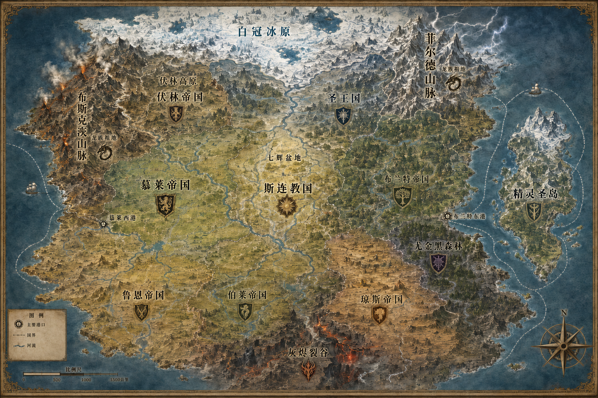

# 西幻世界（暂定名）

> 一片由一至百级生命阶梯与七大元素法则托起的大陆。人族、精灵、兽人、巨龙与恶魔五族并存于世，凡俗众生受制于七十级“限制器”的无形穹顶，创世遗留的十件规律宝器散落尘寰；自混沌初开，历元祖、鼎荒三纪风雷，编年史已绵延至元祖纪七千五百年后的列国盛世。（世界名尚未最终确定，暂以“西幻世界”占位，待定名后更名。）

## 世界速览

主大陆幅员约一千一百八十万平方公里，东西最宽处横跨约五千公里，三大世俗种族的常住人口约一亿八千五百万，星罗棋布于慕莱、伏林、斯连、圣王国、布兰特、精灵圣岛、尤金黑森林及鲁恩、伯莱、琼斯诸国之间；巨龙盘踞在西部与东北的两道擎天山脉深处，恶魔残部则流亡于南方的灰烬裂谷与地下遗迹。大陆生灵共分五大主体种族：人族（含人类与矮人）、精灵族（含精灵与黑暗精灵）、兽人族、龙族与恶魔。五族之外，人族与精灵或兽人结合所诞的混血后裔统称“亚人”，自成一类，禀赋尽随父族；而“神人”并非独立种族，只是人族、精灵族、兽人族后裔中远古真神遗血隔代返祖显化的特殊血脉状态。

世间万灵皆以“级”（1—100级）量度生命层次。魔法师、战士、弓箭手三大主干战斗职业与众多分支职业、百工技艺并行于世，每十级为一阶，百级即达此方世界生命演化的绝对终点——“神”。元祖纪5000年，元祖龙神耶莫稣统御七大元素降下“限制器”规则：凡人族、精灵族、兽人族及其混血亚人，生命等级升至70级即触及无形壁垒，唯有神人、龙族、恶魔与元素生物不受此限。后世凡能寻出并格杀地下深处的领主级元素生物、当场炼化其元素核心以“掌控”一系元素，从而打破70级桎梏者，世称“突破者”；而在限制器确立之前便已跨过70级、存世至今的宿老，则被尊为“远古领袖”。在生命阶梯之外，大地上还流传着创世二神遗下的十大规律宝器——“规则”权杖、“不死”王冠、“国律”宝石、“至尊”项链、“掌控”宝石、“傲慢”宝石、“救赎”圣水、“光明”战斧、“制裁”圣剑与“命运”之书——每一件皆握有干涉乃至扭曲世界运行规则的伟力。

编年史载：太初之时，虚无一分为二，化作创造神与毁灭神，二神辟陆衍灵、留下七大元素与十件规律宝器后飘然离去。其后，太初龙神执“规则”权杖改写底层法则，开启万灵吐纳元素、攀登等级之门，旋即携权杖隐遁；人、精灵、兽人三族初代达到100级的“三大神”因争夺规律宝器混战数千年，打得陆沉天裂，终被混沌龙神一举湮灭；元祖纪中叶，龙族曾联手恶魔进攻三大世俗种族，反在两败俱伤之际遭恶魔背叛，初代魔神卡迪瓦一度君临大陆，后由人族第二位真神“盖亚”舍身封印；元祖纪5000年，元祖龙神平定恶魔与秘境之乱，降下70级限制器后隐入深山；元祖纪6000年鼎荒时代，三大种族集齐五件规律宝器设局围杀98级至尊龙王，令龙族痛失五位龙王与十五头成年巨龙，自此封山闭族。及至元祖纪7500年后的当下，斯连教国连番剿灭多处地下秘境与洞穴之主，整片大陆正处于列国并立、民生繁庶的新一轮盛世。

## 正式设定

### 大陆地理

主大陆总面积约一千一百八十万平方公里，东西极宽处约五千公里，南北纵深最长处约三千三百公里。整体地势呈西北与东北高耸、中央腹地低平、南境渐次过渡为辽阔草原与干旱台地的格局。西境的布斯克茨山脉与伏林高原、东北境的菲尔德山脉如两道巨脊撑起大陆的天际线，也是整片大陆最主要的水系源头；数条大河自高山雪线奔涌而下，在大陆中部冲积出广袤肥沃的千里平原，慕莱帝国、斯连教国与布兰特帝国最稠密的人烟与城郭，悉数聚拢在这条横贯东西的中央文明带上。

大陆的风土寒暑并非单纯由魔法元素主宰——山脉走向、洋流季风、纬度与海拔首先塑造了四时气候，冰、火、风、土、雷、光、暗七大元素则在自然地理之上叠加上了第二重生态印记。顺着山川水脉与元素富集带的走向，主大陆可清晰地划分为四条地理链：

- **西部山地链**：涵盖布斯克茨山脉、伏林高原与绵延的活火山群，是土、火双元素与重金属矿藏的天然熔炉。
- **北部冰—雷链**：由极北的白冠冰原、圣王国北疆防线与东北菲尔德山脉串联而成，终年被极寒冰雾与狂暴雷云笼罩。
- **中央文明带**：自慕莱大河平原一路向东，穿过斯连七辉盆地，直抵布兰特东部古森林，农耕、漕运、学院与陆路驿道最为繁盛。
- **南部草原—裂谷链**：西南至东南依次铺开兽人三大帝国驰骋的草原、河谷与砾石台地，最南端则是恶魔流亡残部潜伏的灰烬裂谷。

七大元素在大陆各处的分布浓淡悬殊：北方白冠冰原的冰元素冠绝全陆；布斯克茨山脉与伏林高原富集土、火；菲尔德山脉终年雷暴不息，雷、风二系最为活跃；中央的斯连七辉盆地是已知规模最大的光元素汇聚之地；东南的尤金黑森林与南方的灰烬裂谷，则分别沉积着高浓度的暗元素以及火、暗复合魔力。布斯克茨与菲尔德两大山脉不仅是巨龙世代栖息的龙脉祖巢，更是大陆的江河源头、气候屏障与晶矿命脉。而在地表版图之下，另有一条自布斯克茨山脉经七辉盆地一直延伸至尤金黑森林的**地下深层秘境带**，穿行于多国地底，历来是领主级元素生物、洞穴之主与秘境之灵最常盘踞的幽深腹地。

海洋则是主大陆的第二副骨架。西岸的慕莱大港、东岸的布兰特海港与孤悬东海的精灵圣岛遥相呼应，借季风与随船风系法师之助，维系着一条跨越种族疆界的远洋商路。

---

### 种族

> 原始便签按语：精灵族与兽人族之间存在生殖隔离，无法繁衍后代；龙族亦无法与任何异族结合留嗣。唯人族与精灵族、兽人族结合所诞生的混血后代，统称为“亚人”。

大陆生灵的谱系由五大主体种族与两类特殊血统构成：
- **人族**（亚种：人、矮人）
- **精灵族**（亚种：精灵、黑暗精灵）
- **兽人族**（亚种：兽人）
- **亚人**（独立于五族之外的混血类别）
- **神人**（三大世俗种族内部的神血返祖状态，非独立种族）
- **龙族**
- **恶魔**

（按：早年原始便签曾将亚人与神人附列于各族括号之内；今依血统与法理明定——亚人系独立混血谱系，不隶属于任何单一母族；神人则并非独立种族，仅出现在人族、精灵族、兽人族内部，是远古神血隔代显化的特殊生命状态。）

#### 神人：远古真神的隔代回响

在七辉圣城与列国学派的谱系考据中，“神人”从不是一切神祇子嗣的泛称，而是专指**人族、精灵族、兽人族三大世俗种族中特有的一种远古神血返祖现象**。混沌与元祖年间，三大世俗种族皆曾诞生过攀至100级极境的真神（如初代三大神、人神盖亚）。这些真神在世时留下的血脉，历经数千年世代繁衍与通婚，早已不断稀释、隐没在凡俗家族的血管深处；唯有当某一名后裔体内的远古神血发生隔代返祖、重新苏醒并达到特定浓度时，该个体才会被确认为“神人”。

因此，神人的种族归属从未改变：人族神人依旧是人族（如93级的苏、84级的闪耀星光），精灵神人依旧是精灵族，兽人神人依旧是兽人族。**龙族与恶魔绝无“神人”这一概念**——龙神留下的直系子嗣仍属龙族（如太初龙神之子释迦格，只称“龙神之子”或“神裔”），魔神后裔仍属恶魔。世间亦有不少豪门贵族或高阶武人，仅因祖上出过八九十级的接近极限强者便自诩“神人”；然而其血脉中既无100级真神遗血，在正统神学与血统法理中一概不予承认。

神人的生命法则受三重铁律支配：
1. **四档神血浓度与血脉硬顶**：神人天然不受元祖龙神70级限制器的约束，但其返祖显化时的神血浓度分为四档——**稀薄（等级上限71—79级）、一般（等级上限80—89级，如84级的闪耀星光）、浓郁（等级上限90—99级，如93级的苏）、纯血（等级上限可达100级，即有望成“神”）**。神血浓度在返祖显化时便已彻底定型，终生不再自然改变，由此化为该神人血脉内部不可逾越的“硬顶”。一名稀薄神人跨过70级后，其自然成长通常会在71级之后变得极其迟缓，终生无法突破79级天花板；至于能否真正走到自身浓度所允许的上限，仍取决于个人天赋、苦修与机缘。
2. **毫无公式可循的随机返祖**：神人绝非可以按代数减半遗传的贵族头衔。神人自身的生育率极低，即便诞下子嗣，若未触发返祖，神血便会重新隐入家族血脉之中；反过来，一个数千年未出过神人的寻常家族，只要其血脉源头确曾流入三大神或盖亚的一缕真血，后代便始终存在极微渺的概率突然发生返祖（“家族史上曾出过神人”只是该族确系神裔的强力佐证，而非触发返祖的前提条件——否则任何神血家族的第一位神人都将无从诞生）。返祖与否、显化出的浓度高低，与相隔代数并无简单的线性关系，全凭天命随机；且返祖状态自母胎降生时便已注定，只是幼年时期多处于沉寂，待成长至一定阶段方才完全显化确认。
3. **怀璧其罪的处境**：神人之血是炼器、炼药与肉身强化中千金难求的稀世奇珍，足以令地下世界的“神血猎人”与各大野心势力铤而走险。然而**外来神血绝非打破限制器或提升血脉档位的途径**——普通人即便注射、服用或炼化他人神血，既不能变成神人，也解不开70级限制器；稀薄或一般浓度的神人，同样无法靠吞服外来神血或炼化领主级元素核心来抬高自己的神血浓度档位（元素核心只能解除70级限制器，对突破神血浓度硬顶毫无作用）。饶是如此，单凭神血在炼金与魔药上的价值，已足以让全大陆屈指可数的神人人人自危：绝大多数神人终生隐姓埋名、藏拙于市井，唯有少数受庞大势力庇护（如斯连教国救赎教团中的闪耀星光），或如93级战祖苏那般凭绝对武力方能震慑宵小。由于人数过于稀少（明面确认仅4至6人，算上终生藏匿者亦不过8至15人），世间从未形成过独立的神人聚落或组织。

#### 亚人与黑暗精灵

**亚人**是人族与另外两大可通婚世俗种族（精灵族、兽人族）结合所诞混血后裔的统称。亚人独立于五大种族之外，不归属单一母族；但其**生命等级上限、天生元素系别上限与自然寿命，一概严格遵循父族标准计算**，日常则随父族或母族融入相应的国度与城邑生活。

**黑暗精灵**则是精灵族内部背负着沉重历史枷锁的特殊亚种。相传他们本是远古精灵族中的王族支脉，只因犯下不可饶恕的滔天罪孽，在初代精灵神（三大神之一）被混沌龙神湮灭之前，遭精灵神亲手降下血脉诅咒；由于施咒的真神早已形神俱灭，这道诅咒数千年来无人能解。诅咒在黑暗精灵身上烙下了两重残酷印记：
- 其一为**接触诅咒**：任何异族生灵只要与黑暗精灵本体发生直接肢体接触，便会当场受到**[诅咒Ⅲ]**侵袭。黑暗精灵同族之间对此彼此免疫；而被诅咒的异族生灵仅自身受害，不会化为新的传染源将[诅咒Ⅲ]继续传给第三者。
- 其二为**千年锁寿**：翻开寿命表，黑暗精灵的正常基础寿命长达600年、极限上限1000年，表面上反而比普通精灵（基础200年、70级600年）更长。但这恰恰是诅咒最冷酷的反讽——黑暗精灵本系精灵王族，天生拥有远比寻常精灵悠长的王族血统；精灵神降下的惩罚并非简单“削减寿元”，而是将王族本可随境界突破继续绵延至数千年的寿数**永久锁死在1000年以内**。所谓的“长寿”，实则是将整支王族钉死在千年尺度的无解牢笼中。

黑暗精灵的魔法天赋极为出众（暗系比例尤高，亦不乏其他元素），性情却普遍惊惧胆小。受接触诅咒所困，他们几乎无法与外族通婚，全族人口长期处于极缓慢增长甚至微幅负增长的状态。虽然远未到灭绝边缘，人口停滞却始终是尤金黑森林历代祭司最忧心忡忡的内部课题。

#### 各族文明肌理与人口均衡

五族与特殊血统的差异，远不止于寿命长短与元素多寡，更深植于他们对时间、家室、土地、权力、生死与职业声望的千年习俗之中：

| 族群 / 血统 | 文明核心与价值取向 | 社会与权力结构 | 常态婚育与繁衍模式 | 典型职业倾向 | 先天元素与魔法法则 |
| --- | --- | --- | --- | --- | --- |
| 人族（人类） | 律法、拓殖、城郭营建与组织力 | 世袭皇权、封地贵族、自由城邦与行会并存 | 正常完婚且家计稳定之户常见存活子女 2.5—4.5 名 | 三大主干战斗职业、行商、牧师、百工、官僚 | 最多两系（神人除外），个体差异与多样性居各族之冠 |
| 人族（矮人） | 炉艺、契约精神、宗族名誉 | 炉族世家 + 百工行会 + 矮人王廷 | 正常完婚且家计稳定之户常见存活子女 2—3 名 | 锻造师、战士、矿工、岩土与军工工程师 | 同人族最多两系；火、土亲和比例略高（非硬性铁律） |
| 精灵 | 世代长程记忆、自然秩序、血统与艺术 | 精灵王室、古老门阀、林地长老议会 | 正常完婚且家计稳定之户常见存活子女 1.5—2.2 名，生育间隔极长 | 弓箭手、魔法师、草药师、林地守卫 | 最多三系，多系觉醒比例显著高于人族 |
| 黑暗精灵 | 族群存续、避世、赎罪与接触管控 | 森林聚落 + 祭司领统治体系 | 正常完婚且家计稳定之户常见存活子女约 1.5—2 名；诅咒断绝跨族通婚 | 暗系魔导、森林斥候、诅咒学与魔药考据 | 最多三系；暗系觉醒率极高，但不限定只能修习暗系 |
| 兽人 | 氏族荣耀、血誓、武勇、祖灵与共担责任 | 帝国军政官制 + 氏族祖庭双轨并行 | 正常完婚且家计稳定之户常见存活子女约 3—5 名 | 战士、弓箭手、牧民、重装骑兵 | 最多一系，惯将单一元素锤炼至极致专精 |
| 龙族 | 巢域主权、古老血统、历史记忆、藏品与尊严 | 个体独立巢域 + 龙王战时召集议事 | 成熟配偶常隔 150—300 年方尝试繁殖一次，龙卵孵化存活率极低 | 不入世俗职业；有守巢者、古学者、遗物收藏者 | 元素系别无上限，随年龄、血统与个体天差地别 |
| 恶魔 | 血脉家系、契约、强权崇拜与乱世求存 | 血族家系、独立战团、流亡王廷 | 数十年至百年尝试繁殖一次，受孕率与幼体存活率皆低 | 战士、魔法师、契约师、猎手 | 最多两系，血脉统计上偏嗜暗、火（非必然锁死） |
| 亚人 | 随俗地方化，无独立母邦 | 融入父族或母族所在国度社会 | 随父母所属族群与居住地而异 | 无固定范式 | 等级上限、自然寿命、元素系别限制一律从父 |
| 神人 | 无独立文明或聚落 | 散隐于人、精灵、兽人三族社会内部 | 极难留嗣，返祖与否全凭随机 | 与出身国度及母族一致 | 元素无上限；不受70级限制器束缚，受神血浓度硬顶限制 |

在这套生态天平上，**龙族与恶魔**因为基本不会自然衰老，造物规则便将其繁殖率压到了极致。许多成年巨龙终生独居不育；即便结为成熟配偶，所谓“150至300年一次”也仅仅是尝试孕育的周期，从结偶、产卵到真正破壳成活，十有八九会在中途夭折。正因整体净繁殖率低得惊人，当今整片主大陆现存的巨龙加起来也仅有**600至900条**——明乎此，便能理解元祖纪6000年鼎荒围剿一役中“五位龙王、十五头成年巨龙战死”，对龙族而言是何等伤筋动骨的文明级浩劫。恶魔同样受困于低受孕率与低幼体存活率，加之家系火并、流亡内耗与地表政权的常年清剿，目前在主大陆地表可确认的恶魔不过**2,000至5,000名**。至于**人、精灵、兽人三大世俗种族**，上表所列的子女数目，仅指平安完成婚育且家庭稳定的常户均值；在真实历史中，连绵的边境战乱、瘟疫、秘境折损、高阶修行走火、宗教独身誓约、城市低生育率与灾荒，长期压制着世俗人口的净增长，使大陆总人口维持在约一亿八千五百万的均衡线上。

---

### 国度

| 主导种族 | 所属国度与核心聚居地 |
| --- | --- |
| 人族 | 慕莱帝国（人类主导）、伏林帝国（矮人主导）、斯连教国（人类主导）、圣王国（人类主导） |
| 精灵族 | 布兰特帝国（精灵主导）、精灵圣岛（精灵主导）、尤金黑森林（黑暗精灵主导） |
| 兽人族 | 鲁恩帝国（兽人主导）、伯莱帝国（兽人主导）、琼斯帝国（兽人主导） |
| 龙族 | 布斯克茨山脉（西部龙族祖地）、菲尔德山脉（东北龙族祖地） |
| 恶魔 | 灰烬裂谷及地下深层遗迹（流亡家系与战团，无完整地表国家） |

（注：巨龙并非群居种族，绝大多数巨龙在布斯克茨与菲尔德两道山脉中各辟独立巢域，亦有极少数隐居在世人未知的荒僻绝地。）

#### 现代列国棋局

自元祖纪5500年的大内战将旧日大帝国撕成碎片以来，主大陆再未出现过能够一统三大世俗种族的单一皇权。“人族”“精灵族”“兽人族”皆是血统与文明共同体，而非单一政治实体：人族四分于慕莱、伏林（矮人）、斯连与圣王国；精灵族鼎立于布兰特、精灵圣岛与尤金黑森林；兽人族则并立着鲁恩、伯莱与琼斯三大帝国。同族诸邦之间既有唇齿相依的防务同盟，亦不乏商路竞争、边境关税摩擦与教派分歧。

龙族从不建立凡俗意义上的官僚国家，布斯克茨与菲尔德两大山脉中，每头成年巨龙各自划定巢域与领空，唯有遭遇关乎全族存亡的大变，龙王方会召集诸龙议事。恶魔自元祖纪5000年遭元祖龙神清剿后，早已丧尽地表国度，如今只剩零星血脉家系、战团与秘密据点散落于南方灰烬裂谷与地下遗迹；93级魔神“灰烬魔王”赫卡莫斯·烬，是其中唯一公开现世的流亡君主。

| 国家 / 势力 | 政体与版图（常住面积） | 常住人口 | 常备军 / 战时动员上限 | 经济命脉与特产资源 | 主流宗教与传统 | 外交态势与地缘关系 | 代表人物（等级/身份） |
| --- | --- | ---: | --- | --- | --- | --- | --- |
| 慕莱帝国 | 世袭皇权 + 行省贵族；中西部大河平原，约 175 万 km² | 约 4,200 万 | 18–24 万 / 80–120 万 | 粮食、纺织、战马、内河漕运、西海远洋贸易 | 双源圣律教普及，非国教 | 与伏林工农高度互补；与斯连既合作又提防教权渗透 | 皇帝、财政大臣、埃德温·海姆（53级海军统帅）、穆尔萨（51级供奉） |
| 伏林帝国 | 矮人王权 + 锻炉议会；西部高原山地，约 105 万 km² | 约 1,800 万 | 8–11 万 / 30–45 万 | 金属冶炼、元素晶矿、兵甲、岩土工程、山道商路 | 祖炉祭 + 双源信仰混合 | 慕莱最稳固贸易盟友；与布斯克茨龙族维持危险中立 | 格林·奥瑞弗（59级战王、锻造圣匠）、巴尔杜（58级）、奥托（63级） |
| 斯连教国 | 教皇选举制神权国；中央七辉盆地，约 80 万 km² | 约 2,700 万 | 12–16 万 + 2–4 万教团武装 / 45–60 万 | 朝圣、高阶医疗、魔法教育、典籍、金融与跨国慈善网 | 双源圣律教（国教） | 人族外交中枢；与圣王国准同盟；列国忌惮其跨境教团影响力 | 丽莎娅（67级女教皇）、赛弗隆（68级）、奎克（53级）、闪耀星光（84级神人）、苏（93级神人·非直属） |
| 圣王国 | 世袭圣王 + 骑士议会；北疆寒地，约 110 万 km² | 约 2,400 万 | 10–14 万 + 约 2 万骑士 / 40–55 万 | 战马、北方硬木、雷矿、军工锻造、边关榷税 | 盖亚护世派（双源教分支） | 与斯连紧密军事联防；与菲尔德龙族维持停战与高度警戒 | 罗林福（61级战士长）、阿德里安·维斯（74级现代突破者）、阿尔贝（66级） |
| 布兰特帝国 | 精灵王室 + 古树议会；东部大森林，约 130 万 km² | 约 2,400 万 | 6–9 万 / 20–30 万 | 灵木、药草、魔法植物、上等弓材、精密魔导工艺 | 七枝自然礼 | 与精灵圣岛同气连枝；与尤金黑森林世代保持历史敌意与隔离 | 百丽耶塔（59级精灵女王）、莱昂娜（66级）、赫尔曼·奥克（61级）、布施（52级）、恩伯鲁（49级）、圣伯特（54级） |
| 精灵圣岛 | 长老院 + 守卫者制度；东海大岛，约 16 万 km² | 约 300 万 | 0.8–1.5 万精锐守卫 | 远古典籍、珍稀魔植、元素考据、远洋航海 | 七枝自然礼（最保守派） | 原则上恪守中立；与布兰特共担同族防卫 | 艾露希娅·卡佩恩（86级守卫者、远古领袖）、伊莱恩（67级） |
| 尤金黑森林 | 黑暗精灵祭司领；东南古森林，约 50 万 km² | 约 250 万 | 约 1–2 万 + 地方守林者 | 暗系晶矿、奇异菌类、毒药、诅咒学考据、地下矿脉 | 幽夜赎罪礼 | 与布兰特维持冷和平；外族因[诅咒Ⅲ]极难常驻 | 斯特林·哥加咖（63级大祭司）、薇拉·奈特（62级夜巡长） |
| 鲁恩帝国 | 战争皇帝 + 氏族大会；西南大草原，约 150 万 km² | 约 1,800 万 | 12–16 万 / 50–70 万 | 畜牧、战马、皮革、池盐、草原商路 | 祖灵天穹礼 | 兽人三国中兵锋最盛；与伏林通山地贸易 | 摩罗哥·恩典（62级，三国共尊之兽人族族长）、卡哈尔（60级）、辛迪亚兹（55级） |
| 伯莱帝国 | 皇权 + 氏族/商业双议会；南部河谷，约 100 万 km² | 约 1,500 万 | 9–12 万 / 35–50 万 | 谷物、畜产、药材、内河航运、边境集市 | 祖灵天穹礼 | 兽人三国中最重商贸；与人族诸邦往来最密 | 赛博洛娜·希望（56级伯莱女皇）、玛尔莎（57级亲卫长） |
| 琼斯帝国 | 军功皇权；东南台地，约 110 万 km² | 约 1,100 万 | 7–10 万 / 30–40 万 | 铜矿、巨石建材、耐旱杂粮、军马 | 祖灵天穹礼（强硬派） | 直面尤金黑森林与灰烬裂谷，南境边防压力冠绝诸邦 | 森诺迩·正义（69级镇族大将）、塔拉尔（64级南境统帅） |
| 布斯克茨山脉 | 非国家；龙王领域与个体巢域并存 | 巨龙约 300–450 条 | 无常备军；成年龙约 80–130 头 | 古矿、龙巢遗宝、火土元素地脉 | 龙祖纪念传统 | 与伏林维持边界默契，禁绝外族深入龙巢 | 多位现存龙王祖系源自此山 |
| 菲尔德山脉 | 非国家；龙族东北祖地 | 巨龙约 300–450 条 | 成年龙约 100–140 头 | 雷晶、风脉、极高山秘境 | 龙祖纪念传统 | 对圣王国高度戒备；与东部精灵冲突较少 | 现存龙王主要在此沉睡或轮值守山 |
| 灰烬流亡势力 | 无完整国家；恶魔家系、战团与地下暗桩 | 主大陆可确认约 2,000–5,000 名 | 无统一军队；70级以上凤毛麟角 | 黑晶、禁术、地下黑市交易、古遗迹发掘 | 归烬信仰 | 被地表列国一致视为头号安全大患 | 赫卡莫斯·烬（93级魔神、流亡君主） |

列国政制之中，有两桩常被外人误读的制度细节：
- **兽人族族长的祖庭权柄**：鲁恩帝国的摩罗哥·恩典所领“兽人族族长”一衔，并非兼辖鲁恩、伯莱、琼斯三国的太上皇帝，而是三国共同尊奉的**祖庭职位**——相当于战时总盟主、祭祖大祝与跨氏族最高仲裁者的合体。平日里，摩罗哥无权向伯莱女皇赛博洛娜或琼斯皇室直接下达内政军令；唯有当全族总动员、祖庭大祭或跨国氏族血仇需要裁断时，祖庭族长的一言方具最高权威。
- **斯连教国的两翼教团与奎克之位**：斯连教国麾下的“救赎教团”与“罪孽教团”绝非一正一邪的对立教派，而是国教“双源圣律教”一体两面的职能机构。救赎教团主司医疗、赈灾、收容、公共慈善与驱除寻常魔物异常；罪孽教团则专司危险禁术管控、恶魔大案追缉、诅咒封存考据、异端秘密审判，以及一切非动用暗系力量不足以处置的凶险实务。在双源圣律教的正统教义中，光与暗同为创造神遗下的自然元素，故神权教国从不将暗元素视为异端邪恶。这也是为何罪孽教团团长“死亡大法师”奎克身为53级暗、土双系大魔导师，其个人等级反而低于麾下61级的审判长艾德蒙与57级的副团长塔尔顿——只因罪孽教团本质上是宗教司法、禁术研究与机密档案中枢，团长一职从来依凭禁术学识、教会资历、组织手腕、审判经验与教皇密授权柄，而非按擂台斗狠的高低排定座次。

---

### 职业与境界

#### 生命等级与百工技艺的分际

在这方大陆的底层法则中，**等级永远归属于生灵本体，而不归属于职业**。每一个生灵自降生至消亡，体内都只有一条唯一的“实力等级”（1—100级）。世人所谓的“职业”，只是锤炼与施展力量的技艺路径，世上从不存在“战士几级、魔法师又几级”的双重计法。战斗类职业的阶位称号（如战王、大魔导师、法神），只是用来标示某人生命等级所处的区间及其主修方向；而锻造、炼金等生产百工技艺根本不占用生命等级，只凭手艺火候深浅独立划分为六等：**学徒 → 初级 → 中级 → 高级 → 宗师 → 圣匠**。例如伏林帝国的矮人王格林·奥瑞弗，其生命本体是59级火系战王，同时在铁砧之上又拥有锻造“圣匠”的至高技艺。

#### 先天元素铁律与元素生态

世间魔法元素唯有**冰、火、风、土、雷、光、暗**七系。一个生灵此生能感应并驾驭几系元素，**自母胎降生那一刻便已彻底固定**，越多越是罕见；后天无论如何苦修，或是炼化元素核心冲破限制器，都不会令元素系别增加或减少半分。各族的先天元素系别上限壁垒森严：
- **兽人族**：天生至多只能掌握**一系**元素，故兽人强者惯将单一元素锤炼至极致专精；
- **人族（含人类与矮人，神人除外）**：天生至多掌握**两系**元素；
- **恶魔**：天生至多掌握**两系**元素（血脉统计上普遍偏嗜暗系与火系，但非绝对硬性锁死）；
- **精灵族（含精灵与黑暗精灵）**：天生至多掌握**三系**元素；
- **龙族与神人**：**无元素系别数量上限**。

由于神血返祖状态自出生时便已潜藏体内，一名尚未在成年期正式显化神血的潜在人族神人，其先天元素数量同样在出生时便已注定，因而可能自幼便展露出超越人族两系上限的“三系乃至更多系”异象。在各国神殿与学院的孩童天赋初鉴中，这类违背常理的多系天赋往往会被密档标记为疑似神裔的重要线索，但仍须待日后神血正式显化，方能百分之百坐实其神人身份。

七大元素遍布整片天地，但在大陆各处的富集浓度却有四级之分：**普通区域**的元素仅微调四季晴雨、草木枯荣与寻常魔兽习性；**富集区**开始生长元素魔植、伴生元素晶矿，并游荡着低阶元素小妖；**高浓度区**则会化作险恶地貌，孕育出成群的大型元素生物；唯有地底极深处或绝险秘境腹地的**极端浓度区**，方能孕育出不受70级限制器束缚、体内凝结着完整“元素核心”的**领主级元素生物**。

| 元素系别 | 大陆主要富集地域 | 典型自然奇观与地貌 | 代表性元素生物 | 主要产出的魔法资粮 |
| --- | --- | --- | --- | --- |
| 冰 | 白冠冰原、精灵圣岛北部高地、地下万年冰窟 | 终年严寒、凝霜冻雾、奇异冰晶矿脉 | 冰霜巨兽、冰灵 | 冰晶、寒性魔药材 |
| 火 | 布斯克茨火山带、伏林深层地脉、南方灰烬裂谷 | 地热喷涌、地下熔岩河、硫磺火山瘴 | 火元素领主 | 火晶、耐热神铁、高阶锻炉建材 |
| 风 | 菲尔德高山、东岸断崖、鲁恩大草原 | 常年烈风走廊、跨洲气旋、高空浮尘带 | 风之妖精王 | 风晶、轻质羽金与弓箭魔材 |
| 土 | 伏林高原、琼斯台地、布斯克茨与菲尔德两大龙脉 | 巨型地下晶洞、地鸣震动、重矿脉高度富集 | 土之泰坦 | 精金重铁、土晶、巨石城防建材 |
| 雷 | 菲尔德山脉、东北雷暴走廊 | 终年落雷不绝、强磁性矿层裸露 | 雷灵王 | 雷晶、导魔秘银与特种金属 |
| 光 | 斯连七辉盆地、部分高原与精灵圣林 | 高魔力日照、昼夜自然发光植物群落 | 光之圣灵 | 光晶、祝圣与高阶治疗药材 |
| 暗 | 尤金黑森林、灰烬裂谷、地下极深秘境 | 幽暗吸光、魔力沉降、夜行魔物生态繁盛 | 暗之魔灵 | 暗晶、诅咒媒介与隐匿魔材 |

在魔法学理上，有两条常被外行混淆的铁则。首先，**七大元素中并无“水系”**。江河湖海的水体属于凡俗自然物质——冰系法师可以通过操控温差与相态凝水成冰、化冰为水，风系法师可以掀起狂涛巨浪，土系法师可以改易河床走向；高阶法师凭借多系复合魔法照样能召来灭世狂澜（如高级魔法[超超级海啸]），但世间从不存在所谓的“水系天赋”。同理，时间、空间、灵魂、死亡等触及世界底层的力量，在法理上归属于**“规则/特殊术式”（即♛特殊魔法）**，并非第七元素之外的新增职业元素。其次，**领主级元素生物体内的“元素核心”绝无储存与交易之可能**。元素领主毙命的刹那，其核心便会在短短数息之间溃散于天地，只能在杀敌现场当场吞服炼化，既无法装匣封存，也无法长途运输或送入拍卖行囤积——这一自然法则直接断绝了大国靠财力收购核心、流水线批量制造“突破者”的可能，也是70级限制器能维持数千年稀缺性的根本所在。

#### 职业阶位序列与59级分支上限

三大主干战斗职业（魔法师、战士、弓箭手）的阶位按每10级一阶、自整十起算，一路延伸至99级：

| 主干职业 | 一至十阶称谓序列（1—99级，每10级一阶） |
| --- | --- |
| 魔法师 | 魔法学徒（1—9级）→ 初级魔法师（10—19级）→ 中级魔法师（20—29级）→ 高级魔法师（30—39级）→ 魔导师（40—49级）→ 大魔导师（50—59级）→ 圣魔导师（60—69级）→ 法神（70—79级）→ 至尊法神（80—89级）→ 法祖（90—99级） |
| 战士 | 战士学徒（1—9级）→ 初级战士（10—19级）→ 中级战士（20—29级）→ 高级战士（30—39级）→ 战宗师（40—49级）→ 战王（50—59级）→ 战圣（60—69级）→ 战神（70—79级）→ 至尊战神（80—89级）→ 战祖（90—99级） |
| 弓箭手 | 弓箭手学徒（1—9级）→ 初级弓箭手（10—19级）→ 中级弓箭手（20—29级）→ 高级弓箭手（30—39级）→ 弓箭宗师（40—49级）→ 弓箭王（50—59级）→ 弓箭圣（60—69级）→ 弓箭神（70—79级）→ 至尊弓箭神（80—89级）→ 弓箭祖（90—99级） |

当生命等级真正跨入**100级**，便到达了此方世界力量体系的绝对顶点。100级不属于任何职业阶位，凡踏入此境者，一律尊为**“神”**（如太初龙神、混沌龙神、元祖龙神、初代三大神、人神盖亚）。至于第八阶（70—79级）职业称谓中的“法神”“战神”“弓箭神”，仅仅是古礼沿袭下来的职业尊号，与100级真神所拥有的真正“神格”不可同日而语。

在三大主干职业之外，大陆上还流传着剑士、刺客等诸多其他战斗职业。这些分支职业同样按每10级一阶递进，但只有魔法师、战士、弓箭手三大完整体系的阶位能够跨入60级第七阶并一路通往100级（世俗种族受70级限制器所阻，常规止步于70级第八阶门槛）；**其余一切分支战斗职业，其修炼体系最高只能支撑生命等级成长到59级（第六阶的终点）**，部分偏门职业甚至只能支撑到49级（第五阶终点）：
- **剑士**（分支战斗职业，上限59级）：剑士学徒（1—9级）→ 初级剑士（10—19级）→ 中级剑士（20—29级）→ 高级剑士（30—39级）→ 剑宗师（40—49级）→ 剑圣（50—59级）。
- **锻造**（生产百工技艺，不占生命等级）：锻造学徒 → 初级锻造师 → 中级锻造师 → 高级锻造师 → 锻造宗师 → 圣匠。

“分支职业最高59级”并非世界规则把那名生灵锁死在了59级，而是该职业现有的呼吸、发力与魔力循环体系最多只能将生命体托举到59级。倘若一位59级剑圣（如圣王国王室剑术教习维勒·格兰特、布兰特公爵布施·勋尔瓦、兽人圣兽军团团长弗雷莫）立志叩开60级大门，唯一的出路便是转修战士、魔法师或弓箭手三大完整体系之一，从头构建对应的高阶修炼道路——转修既不会让人自动跳上60级，也不会凭空赐予新职业的高阶技能，必须实打实地完成新体系的打磨；昔日浸淫数十年的剑术经验自可留存为临敌手段，却无法替他绕过60级的生命蜕变门槛。

既然分支职业有着59级的天花板，为何列国之中依然有无数人选择修习剑士等其他职业？答案朴素得近乎冷酷：**因为59级的上限，对世间九成九以上的生灵而言根本毫无现实影响**。在这片拥有一亿八千五百万世俗人口的大陆上，绝大多数普通人终其一生连30级“强者领域”的边都摸不到；40级便已是名动一国的英雄级人物；50级以上的国家级顶尖战力，寻常大国举国上下也不过十位左右。能够走到59级剑圣之人，早就是站在世俗世界最顶端的一小撮人中龙凤。一个普通少年在择业时，考量的是自身禀赋、家传渊源、所在地域有什么师承、军伍与行会需要什么人手、入门快慢以及哪种搏杀方式更合心意——没有人会因为“这条路到不了绝大多数人连做梦都不敢想的60级”，就放弃眼前最适合自己的传承。况且分支职业在入门速度、特定战局（如剑士的单体近身杀伐、刺客的潜行暴起）上亦各擅胜场，无需靠任何人为的“同级战力补偿”去与三大主干职业强行拉平。

至于非世俗族群的位格阶梯，则依其天生强大的生命构造另行起算：
- **龙族等级阶位**：幼年龙（30—49级）→ 青年龙（50—69级）→ 成年龙（70—89级）→ 龙王（90—99级）→ 龙神（100级）。（原始便签曾记“龙王90—100级”；为与全书“100级即为神”的顶层铁律统一，龙王止于99级，100级单列为龙神。）
- **恶魔等级阶位**：幼年恶魔（20—29级）→ 成年恶魔（30—49级）→ 大恶魔（50—69级）→ 魔王（70—89级）→ 魔神（90—99级）→ 神（100级）。（原始便签曾作20-30/30-50等跨段记法，今统一对齐全书的整十阶位结构。）

一切魔法与武技名称后所缀的罗马数字（**Ⅰ—Ⅹ**），代表该技能的修习品级。品级越高，术式威能越强，须由生灵日夜苦修逐级精进；高阶强者通常掌握更高品级，但低等级者亦可能仅窥得低品级门径。

---

### 突破限制器

元祖纪5000年，元祖龙神耶莫稣统御七大元素在天地间立下铁律：凡人族、精灵族、兽人族及其混血亚人，生命等级升至70级便会撞上一道无形壁垒，寸步难进；唯有神人、龙族、恶魔与纯粹元素生物天然不受此律束缚。

在市井农夫与寻常冒险者眼中，70级限制器是一条一辈子也感知不到的规则——绝大多数人终生在1至29级的凡俗区间打转，连30级的门槛都难以企及，整片大陆从来不是人人都在为了突破70级而苦修。然而在列国朝堂、最高军事统帅部与种族存亡的棋盘上，这道70级铁闸却直接锁死了世俗文明的理论战力上限，决定了人、精灵、兽人三族在面对成年巨龙（70级起步）、龙王（90—99级）与高阶魔神时的战略天花板。

世俗种族若想砸碎这道铁锁，古往今来唯有**一条独木桥：掌控冰、火、风、土、雷、光、暗七大元素之一**。

这里的“掌控”，既不是顿悟某门高深技能，也不是饮下真神遗血，而是实打实地**寻出并击杀一头“领主级”以上的强大元素生物，于其毙命后的呼吸之间，当场吞服并炼化其体内凝结的“元素核心”**。

> 史册辨正：古籍常载“元祖龙神统御七大元素”，是指耶莫稣身为100级全系龙神，生来便能调动并统御七系元素伟力，绝非他一人吞服了七枚元素核心。世俗突破者严格受制于**“一人一核”**的自然铁律——倘若有人妄图在体内炼入第二枚元素核心，异种元素本源立刻便会在经脉中炸开暴乱，轻则修为尽废，重则当场爆体而亡。

元素生物是由纯粹元素在火山熔心、万年冰渊、雷暴云海、极深地脉、光之圣域或暗之巢穴中自然孕育而成的野性生灵，无人知晓其确切起源，只知它们桀骜暴戾，且不在元祖龙神所立的70级限制器管束之内。寻常的元素小妖或元素仆役体内并无核心；唯有盘踞在**地下深层秘境与绝险洞穴最深处**的“领主级”巨擘——如火元素领主、冰霜巨兽、雷灵王、土之泰坦、风之妖精王、光之圣灵、暗之魔灵——体内方凝结着一枚完整的**元素核心**。那是元素领主一身精粹的唯一结晶，也是它死后唯一能短暂留存于世的东西。而每一头领主级元素生物的实力皆凌驾于70级之上，顶尖者甚至直逼90级乃至更高。

正因如此，每一位世俗“突破者”的诞生，都是一场九死一生的豪赌，必须连闯四重生死关隘：
1. **寻踪与围猎**：领主级元素生物数量极少、行踪飘忽，且深居地底绝境，许多人穷尽一生也未曾亲眼见过一只。更棘手的是，它们的战力普遍高于70级封顶的世俗巅峰强者，单打独斗无异于送死，必须集结举国最顶尖的团队、携重宝与地利结阵围猎，往往伴随惨烈的伤亡代价。
2. **呼吸间当场炼化**：元素领主毙命的刹那，其元素核心便会在数息之内迅速消散于天地，绝无带回安全之地慢慢闭关的可能。突破者必须在激战刚歇、自身伤疲交加的呼吸之间当场吞服炼化；炼化途中狂暴的元素之力会剧烈反噬，十人尝试，十之八九非死即废。
3. **元素属性严丝合缝**：所炼化的元素核心，必须与突破者自身天生的元素属性同源——火系强者只能炼化火元素核心，光系强者只能炼化光元素核心，属性不符者强行吞服必遭反噬惨死。若突破者天生掌握多系元素（如光、雷双系），则只需寻得其中任意一系的同源领主核心即可成事，择猎余地较单系者略宽，但同源领主依旧可遇不可求。
4. **破锁而不改旧貌**：一旦炼化功成，即算完成了对该系元素的“掌控”，70级限制器自此对该生灵彻底失效，可一路修行直指100级，世人尊之为**“突破者”**。需要特别阐明的是，**元素核心的唯一功效便是“解除70级限制器”**：它既不会替多系强者抹去或替换其余元素，也不会令所炼化的那一系元素凭空获得什么“根源级威力加成”或变得比从前更顺手。无论单系还是多系，突破后原有的全部元素照旧保留，各系运用水准与突破前完全一致。

纵观数千年编年史，真正闯过这四重鬼门关的突破者寥寥无几，同一时代能有一两位在世已属罕见，且多数隐世不出。当今主大陆公开确认的现代世俗突破者，以圣王国裁决骑士团团长**“白雷裁决”阿德里安·维斯（74级）**为代表——他本是光、雷双系强者，在围杀一头光系领主级元素生物、当场炼化光之核心打破限制器后，如今光、雷两系本领俱在，运用如常。而与突破者并立于70级之上的另外两类存在，一是元祖纪5000年限制器降世前便已修至70级以上的**“远古领袖”**（如精灵圣岛86级守卫者艾露希娅），二是不受限制器约束、却受自身神血浓度硬顶锁死的**“神人”**（如93级的苏与84级的闪耀星光；即便让一名上限79级的稀薄神人吞下元素核心，也绝无可能借此突破80级的神血硬顶）。

---

### 等级差与战力常识

生命等级是衡量强弱的硬标尺，却不是死板的算术胜负表。在列国兵部与冒险者公会的实战常识中，级差带来的压制遵循以下基准：

- **5级以内**：当双方职业、装备、元素亲和相差不远时，战斗技巧、临阵经验、地形利用与战术算计足以逆转胜负。
- **10级以上**：通常形成肉眼可见的全面压制，低等级一方若无特殊克制手段或重宝傍身，极难取胜。
- **20级以上**：生命层次已出现质的断层，正常情况下正面交锋毫无胜算，硬拼无异于以卵击石。
- **撕裂常理的异数**：★高级魔法、♛特殊魔法、高浓度神人血脉，或是创世遗留的“十大规律宝器”，皆可强行打破上述等级铁律——例如佩戴规律宝器“至尊”项链者，哪怕自身仅有30级，亦足以正面战胜一头70级的成年巨龙。

---

### 十大规律宝器

创世二神离界时留下的十件至高造物，每一件都蕴含着直接干涉乃至改写世界规则的权柄：

1. **“规则”权杖**：唯有达到100级的真神方有资格催动，可改写此方世界中的一切底层规则。（混沌时代被太初龙神带离大陆，今已不知所踪。）
2. **“不死”王冠**：佩戴者将享有无穷无尽的寿命，并恒常获得**[坚韧Ⅸ]**（九级）的强横防御。
3. **“国律”宝石**：一次性消耗宝器。使用者激发后，以自身为中心、周围100公里范围内将瞬间撑开一层**[绝对防御Ⅲ]**护罩。护罩之内的魔法规则彻底消失，所有生灵恒常受到**[虚弱Ⅲ]**压制，任何魔法皆无法在罩内起效；在持续整整一小时的[绝对防御Ⅲ]面前，除非有100级真神亲临，否则罩内生灵插翅难飞，罩外大军亦休想踏入半步。（元祖纪6000年鼎荒时代围剿至尊龙王之战中已被激发过一次，战后力竭化作凡石，当世已无可用之效。）
4. **“至尊”项链**：佩戴者将同时获得**[神圣庇护Ⅲ]**、**[死亡支配者Ⅲ]**与**[元素圣体Ⅲ]**三种顶级增益加持。在这三重状态护持下，即便是30级的低阶生灵，也足以正面击败70级的成年巨龙。
5. **“掌控”宝石**：一经使用即与使用者灵魂死锁——只要当前使用者尚在人世，普天之下任何其他生灵皆无法发动；唯有原使用者彻底死亡，绑定方告解除，下一位生灵方可使用。对目标发动后，目标将陷入**[精神支配Ⅹ]**（十级），对发动者唯命是从；一旦发动者身死，目标便会恢复正常神智。
6. **“傲慢”宝石**：千年冷却周期型凶器，每隔1000年方可发动一次。发动刹那，方圆一公里范围内除发动者本人之外，**所有生命等级低于或等于发动者的生灵，无论敌我盟友与部下，尽数触发[即刻死亡Ⅲ]**。这种敌我不分的无差别抹杀正是该宝器本身的凶险特性，而非规则漏洞。
7. **“救赎”圣水**：消耗型宝器。圣水盛放在一只华丽而神秘的古瓶中，满瓶共100滴。凡尚未断气的生灵服下一滴，周身一切伤势与异常状态都会瞬间抹平，立复全盛；重复多饮不会产生额外效果。唯其效力止于规律级之下——凡由100级真神、规律宝器或世界底层规则直接施加的永久性烙印（如黑暗精灵的血脉诅咒、“命运”之书损耗的生命本源），圣水亦无法解除。
8. **“光明”战斧**：神级一阶光、火双系战斧。在神级兵刃面前，任何低于神级的凡俗武器与之相撞，都如萤火遇烈日般脆弱易折。持有者恒得**[太阳神的祝福]**；任何被战斧劈中的目标，都将同时陷入持续10秒的**[灵魂吞噬Ⅲ]**与**[死亡注视Ⅲ]**。
9. **“制裁”圣剑**：神级一阶光系圣剑。任何被圣剑斩中的目标，都将同时陷入持续20秒的**[虚弱Ⅲ]**与**[死亡审判Ⅲ]**。
10. **“命运”之书**：可对任何低于100级的生灵开启。每次翻阅皆可窥见该生灵一生的大致命轨，但使用者每次发动都将**永久消耗自身完整生命本源的四分之一**。这一代价既非肉身伤势，亦非异常诅咒：无法治疗，无法靠延寿秘法弥补，无法被“不死”王冠规避，更无法用“救赎”圣水恢复。世俗有寿种族翻阅后表现为自然寿元永久暴削；龙族、恶魔等不会自然衰老的种族同样会永久折损四分之一的生命本源。无论何人，累计使用四次必死无疑。

**神级权限与“规则”权杖的高下之辨**：达到100级的真神虽亦拥有**有限干涉世界规则**的伟力——可在特殊条件下付出沉重代价，针对特定对象立下一条单一、明确、权限有限的规则（元祖龙神耶莫稣为世俗种族建立70级限制器即属这一层次）；但十大宝器之首的**“规则”权杖**所掌握的，是远高于寻常100级真神的**世界底层重写权限**。它能够直接修改修行法则、世界运行机制与万灵普适的底层规律。当年太初龙神借“规则”权杖令天下万灵皆可吐纳魔法元素、踏上1—100级进化阶梯，便是一次真正的世界底层重写，绝非徒手施为的100级真神所能企及。

---

### 种族寿命

| 种族 / 亚种 | 正常基础寿命 | 40级 | 50级 | 60级 | 70级 | （80级） | （90级） |
| --- | --- | --- | --- | --- | --- | --- | --- |
| 人族（人类） | 100年 | 200年 | 300年 | 400年 | 500年 | 1000年 | 3000年 |
| 精灵族（精灵） | 200年 | 300年 | 400年 | 500年 | 600年 | 1200年 | 3600年 |
| 黑暗精灵 | 600年 | 700年 | 800年 | 900年 | 1000年 | 受血脉诅咒锁死，终生无法超过 1000 年 | 受血脉诅咒锁死，终生无法超过 1000 年 |
| 兽人族 | 与人族相同（100年） | 200年 | 300年 | 400年 | 500年 | 1000年 | 3000年 |
| 矮人 | 与人族相同（100年） | 200年 | 300年 | 400年 | 500年 | 1000年 | 3000年 |

表中括号内的80级、90级寿数，仅适用于打破限制器的突破者、远古领袖，以及达到相应等级的神人。龙族与恶魔基本不会自然衰老，但照样会被兵戈、魔法或更高层次的力量杀死。神人本质上仍属其母族，自然寿数严格遵循对应母族（人族、精灵族、兽人族）的等级寿命表随级递增；唯有真正跨入100级成“神”之后，方才彻底超脱凡俗自然寿命体系。

---

### 巅峰战力

本章收录当今主大陆50级以上的巅峰强者（龙族、恶魔、神人因位格与数量级特殊，于后文单列；布兰特帝国“战斗公爵”恩伯鲁·卡佩恩虽为49级，因身份显赫作特殊收录）。名录按“种族 → 国家/主要活动地 → 人物”编次。某位强者被列于某一国度名下，并不意味着其必然属于该国朝廷或军队的直属编制——冒险者公会成员、宗教人员与独立强者均按其长期归属及主要活动地域录入，并在括号内标明其真实组织关系（国家直属／教团直属／公会成员（非直属）／独立强者）。

#### 人族

**慕莱帝国**
- **埃德温·海姆“银潮将军”**（海军统帅·国家直属）：53级 风系战王，[疾风刃Ⅴ][风之屏障Ⅴ]
- **穆尔萨·科恩“金库之手”**（宫廷供奉法师·国家直属）：51级 土系大魔导师，[磐岩术Ⅴ][裂地术Ⅴ]
- **塞勒斯·凡恩“远航者”**（远星罗盘队长、S级冒险者公会成员、非帝国直属战力）：56级 风系弓箭王
- **莉亚·莫恩“星灯”**（远星罗盘副队长、S级冒险者公会成员、非帝国直属战力）：54级 土光双系大魔导师
- **多恩·铜环“炉眼”**（远星罗盘成员、矮人、S级冒险者公会人物、非帝国直属战力）：53级 火系战王
- **卡尔·维德“航线”**（远星罗盘成员、S级冒险者公会人物、非帝国直属战力）：50级 风系战王

**伏林帝国**
- **格林·奥瑞弗“矮人王”**（伏林帝国国王·国家直属）：59级 火系战王（另拥锻造圣匠技艺），[熔岩剑Ⅴ]
- **巴尔杜·奥格“锻炉大长老”**（锻炉议会首席·国家直属）：58级 火系大魔导师，[熔火弹Ⅵ][火鳞甲Ⅵ]
- **奥托·克雷格“山岳统帅”**（山地军团统帅·国家直属）：63级 土系战圣，[山崩锤Ⅶ][石肤Ⅶ]

**斯连教国**
- **丽莎娅“胜利女皇”**（女教皇·国家/教会最高领袖）：67级 光暗双系圣魔导师，[高级治愈Ⅵ][黑暗吞噬Ⅵ]
- **赛弗隆·奥雷尔“圣光枢机”**（枢机主教之首·国家直属）：68级 光系圣魔导师，[圣光斩Ⅶ][治愈圣光Ⅶ]
- **柯蒂斯·瓦尔“惩戒骑士长”**（圣殿骑士团团长·国家直属）：65级 光系战圣，[光耀斩Ⅶ][圣光护体Ⅶ]
- **格里高·勒文“颂歌法师长”**（法师团团长·国家直属）：63级 光雷双系圣魔导师，[圣雷刃Ⅶ][光雷爆Ⅶ]
- **艾德蒙·格瑞“罪渊审判官”**（罪孽教团审判长·教团直属）：61级 暗系圣魔导师，[暗蚀Ⅵ][暗幕Ⅵ]
- **罗莎琳·露西“白烛圣女”**（救赎教团首席牧师·教团直属）：58级 光系大魔导师，[圣愈Ⅵ][圣光抚慰Ⅵ]
- **塔尔顿·莫尔“黑狱司铎”**（罪孽教团副团长·教团直属）：57级 暗系大魔导师，[暗影缚Ⅵ][夜袭Ⅵ]
- **奎克“死亡大法师”**（罪孽教团团长·教团直属）：53级 暗土双系大魔导师，[死之审判Ⅴ]
- **闪耀星光“神人”**（斯连教国救赎教团团员·教团直属）：84级 冰火土三系至尊战神（神人双重索引，详参下文“特殊血脉单列：神人”）
- **苏“神人”**（斯连教国所属；独立强者；退役传奇冒险者；S级冒险者公会“神圣审判”前队长·非教国直属战力）：93级 暗光雷三系战祖（神人双重索引，详参下文“特殊血脉单列：神人”）
- **阿德里克·诺恩“白刃”**（神圣审判队长、S级冒险者公会成员、非教国直属战力）：58级 光系战王
- **塞琳娜·维尔“寒祷”**（神圣审判副队长、S级冒险者公会成员、非教国直属战力）：57级 冰光双系大魔导师
- **凯尔·罗森“苍鹰”**（神圣审判成员、S级冒险者公会人物、非教国直属战力）：55级 风系弓箭王
- **德里安·沃克“灰壁”**（神圣审判成员、S级冒险者公会人物、非教国直属战力）：53级 土系战王
- **伊莲娜·索尔“晨星”**（神圣审判成员、S级冒险者公会人物、非教国直属战力）：53级 光雷双系大魔导师
- **雷蒙·凯恩“铁手”**（神圣审判成员、S级冒险者公会人物、非教国直属战力）：52级 火系战王
- **维拉·诺恩“夜风”**（神圣审判成员、S级冒险者公会人物、非教国直属战力）：51级 暗风双系大魔导师
- **奥尔文·格雷“寻路者”**（神圣审判成员、S级冒险者公会人物、非教国直属战力）：50级 风土双系大魔导师

**圣王国**
- **阿德里安·维斯“白雷裁决”**（裁决骑士团团长、当代世俗突破者·国家直属）：74级 光雷双系战神，[★雷霆王座Ⅰ][★圣裁天幕Ⅰ]
- **阿尔贝·雷因“北境之壁”**（北方军团统帅·国家直属）：66级 雷系战圣，[雷锤Ⅶ][雷甲Ⅶ]
- **玛蒂达·布莱特“王廷之盾”**（王廷骑士团团长·国家直属）：64级 光系战圣，[圣盾击Ⅶ][光之壁垒Ⅶ]
- **罗林福“雷金剑神”**（战士长·国家直属）：61级 雷系战圣，[雷电缠绕Ⅵ]
- **维勒·格兰特“断岳之剑”**（王室剑术教习·国家直属）：59级 光系剑圣，[圣剑斩Ⅵ][光刃Ⅵ]
- **奥斯顿·雷因“雷矛”**（苍穹之矛队长、S级冒险者公会成员、非王国直属战力）：57级 雷系战王
- **艾琳·雪鸦“冰冠”**（苍穹之矛副队长、S级冒险者公会成员、非王国直属战力）：55级 冰风双系大魔导师
- **赫尔曼·瓦尔“重盾”**（苍穹之矛成员、S级冒险者公会人物、非王国直属战力）：51级 土系战王

#### 精灵族

**布兰特帝国**
- **莱昂娜·露娜“林歌者”**（古树议会大长老·国家直属）：66级 冰风土三系圣魔导师，[冰风刃Ⅶ][林歌护佑Ⅶ]
- **赫尔曼·奥克“深林守望”**（王室禁卫长·国家直属）：61级 风系战圣，[风刃斩Ⅵ][林盾Ⅵ]
- **百丽耶塔·卡佩恩“精灵女王”**（精灵族女王·国家最高领袖）：59级 冰风雷三系弓箭王，[冰锋箭雨Ⅴ]
- **圣伯特·神圣“光明意志”**（神圣骑士团团长·国家直属）：54级 光系战王，[光明治愈Ⅴ]
- **布施·勋尔瓦“护花公爵”**（精灵族公爵·国家直属）：52级 光火雷三系剑圣，[光剑护体Ⅴ]
- **恩伯鲁·卡佩恩“战斗公爵”**（精灵族公爵·国家直属）：49级 暗风火三系战宗师，[黑暗视野Ⅳ]（特殊收录）

**精灵圣岛**
- **艾露希娅·卡佩恩“寒风女王”**（守卫者、远古领袖·圣岛直属）：86级 冰风土三系至尊弓箭神，[★霜星坠落Ⅱ][★风王猎场Ⅱ][★大地君王Ⅱ][♛灵魂烙印Ⅱ]
- **伊莱恩·怀特“潮汐守望”**（守卫者副长·圣岛直属）：67级 冰风双系圣魔导师，[寒潮Ⅶ][冰风环Ⅶ]

**尤金黑森林**
- **斯特林·哥加咖“暗黑大祭司”**（大祭司·祭司领最高领袖）：63级 暗系圣魔导师，[黑暗笼罩Ⅵ]
- **薇拉·奈特“夜巡长”**（守林者之首·祭司领直属）：62级 暗系圣魔导师，[幽藤缚Ⅶ][暗影缠Ⅶ]

**慕莱帝国（远星罗盘·长期活动）**
- **伊萨·风歌“长翼”**（远星罗盘成员、S级冒险者公会人物，长期活动于慕莱帝国）：51级 风冰双系弓箭王

#### 兽人族

**鲁恩帝国**
- **摩罗哥·恩典“雅典兽”**（兽人族族长——三国共同承认的祖庭职位）：62级 风系战圣（熊），[风暴冲击Ⅵ]
- **卡哈尔·英勇“阿尔忒弥斯”**（骑兵统帅·国家直属）：60级 风系战圣（狼），[烈风斩Ⅵ][骑影Ⅵ]
- **辛迪亚兹·祝福“赫尔墨斯”**（兽人族总管·国家直属）：55级 光系弓箭王（虎），[光剑雨Ⅴ]

**伯莱帝国**
- **玛尔莎·忠诚“赫斯提亚”**（女皇亲卫长·国家直属）：57级 风系战王（羊），[商道疾风Ⅵ][风幕Ⅵ]
- **赛博洛娜·希望“阿波罗”**（伯莱女皇·国家最高领袖）：56级 光系大魔导师（鹿），[光宇Ⅴ]

**琼斯帝国**
- **森诺迩·正义“忒弥斯”**（镇族大将·国家直属）：69级 火系战圣（牛），[★炎天噬地Ⅰ][大火球Ⅵ][纵火Ⅵ]（注：[★炎天噬地Ⅰ]源于琼斯帝国皇室秘传的特殊古血脉与古代传承，使森诺迩得以在69级破例跨越70级门槛，提前获得该高级魔法的修习资格。）
- **塔拉尔·无畏“德墨忒尔”**（南部防线统帅·国家直属）：64级 土系战圣（犀），[铁壁Ⅶ][裂谷斩Ⅶ]

**兽人祖庭 / 圣兽军团**
- **弗雷莫·残酷“阿瑞斯”**（圣兽军团团长·祖庭直属）：58级 暗系剑圣（豹），[暗之手Ⅴ]

**圣王国（苍穹之矛·长期活动）**
- **洛克·灰狼“荒猎”**（苍穹之矛成员、S级冒险者公会人物，长期活动于圣王国）：53级 风系战王（狼）

#### 特殊血脉单列：神人

本节为统计全大陆已知神人而设的双重索引，不代表神人是独立种族；苏与闪耀星光本质仍属人族，故同时列于上文“人族·斯连教国”名录之中（国家列表回答“该国境内有哪些强者”，本节回答“全大陆有哪些已确认神人”）：

- **闪耀星光“神人”**（斯连教国救赎教团团员；人族神人；神血浓度“一般”，血脉等级上限80—89级）：84级 冰火土三系至尊战神，[★冰王斩Ⅱ][★超大冰暴Ⅱ][★沙王领主Ⅱ][冰刺Ⅷ]
- **苏“神人”**（斯连教国所属；人族神人；神血浓度“浓郁”，血脉等级上限90—99级；昔日S级公会“神圣审判”前任队长，现已退役）：93级 暗光雷三系战祖，[★雷光真闪Ⅲ][★圣光庇护Ⅲ][★光明之主Ⅲ][★暗之闪Ⅲ][暗黑精灵Ⅸ][高级治愈Ⅸ]

#### 恶魔

- **赫卡莫斯·烬“灰烬魔王”**（恶魔族流亡君主；“灰烬魔王”系其流传世间的尊号，93级按恶魔位格实属魔神）：93级 火暗双系魔神，[★灰烬魔域Ⅲ][★日蚀之刃Ⅲ][★终·烈日焚天Ⅲ][♛灵魂烙印Ⅲ][♛不灭魔躯]

#### 龙族

- **释迦格“毁灭龙王”**（太初龙神之子）：94级 全系龙王，[★龙神意志][★真火吞Ⅲ][★最终一击·雷霆][♛死亡注视Ⅲ]
- **摩耶巳格“绝望龙王”**（太初龙神之子）：95级 全系龙王，[★龙神意志][★耶梦加得凝视][♛死亡支配者Ⅲ]
- **桀骜稣“贪恶龙王”**（至尊龙王之子）：91级 全系龙王，[★龙神意志][★幽暗庇护Ⅲ][★至暗洗礼Ⅲ]
- **维克基“圣金龙王”**：92级 全系龙王，[★龙神意志][♛天使羽]
- **堡思维亚“灾难龙王”**（太初龙神之子）：94级 全系龙王，[★龙神意志][★噩梦Ⅲ][♛斩魔剑]
- **菲羽克“自然龙王”**：96级 全系龙王，[★龙神意志][★超位雷斩][★暗之闪Ⅲ][♛陨星灭地]
- **耶莫稣“元祖龙神”**：100级 全系龙神（即元祖纪5000年降下70级限制器之元祖龙神，隐世至今），[★龙神意志][♛起死回生][♛统治Ⅲ][★雷光铠甲Ⅲ][♛元素圣体Ⅲ][♛时间禁锢]

---

### 等级经验

| 阶位跨越节点 | 晋升所需经验量度 |
| --- | --- |
| 0—1级 | 100 经验值 |
| 9—10级 | 1,000 经验值 |
| 19—20级 | 5,000 经验值 |
| 29—30级 | 25,000 经验值 |
| 39—40级 | 100,000 经验值 |
| 49—50级 | 500,000 经验值 |
| 59—60级 | 2,000,000 经验值 |
| 69—70级 | 12,000,000 经验值 |
| 79—80级 | 96,000,000 经验值 |
| 89—90级 | 1,056,000,000 经验值 |
| 99—100级 | 19,008,000,000 经验值 |

（按：“0级”并非正式的生命等级，而是生灵在体内尚未建立起稳定力量循环、尚未正式跨入等级体系前的蒙昧状态；表中“0→1级”的100经验值，即生灵由蒙昧初胎正式踏入1—100级世界法则阶梯的第一步。）

---

### 魔法技能表

世间高阶魔法与术式共分两类：**★为高级魔法**，**♛为特殊魔法**。无论是★还是♛，常规情况下生灵皆须达到**70级以上**方能“解锁”——所谓解锁，仅代表其生命位格已足以承载该技能的修习，绝非跨入70级便能自动学会；70级以下者通常不具备修习这两类高阶术式的能力。唯有在极特殊的机缘下，70级以下者方可能破例获得学习资格：例如该术式系王室或古族代代相传的血脉秘术（如琼斯帝国69级镇族大将森诺迩所掌的[★炎天噬地Ⅰ]），或由已掌握该术的高阶大能以灌顶、血契、神器传承等非常规手段强行赐予。至于名录中同名的★与♛技能（如[雷光铠甲Ⅲ]），分属不同源流与法则传承，在世间并行不悖。以下仅录常见高阶术式，人物实际所持技能可包含表外秘传。

**★高级魔法**：[火焰领主Ⅲ]（召唤）、[炎天噬地Ⅲ]（范围）、[炎龙凤燃]（范围）、[真火吞Ⅲ]（单体）、[烈焰护体]（防御）、[元素庇护]（单体增益）、[绝对冰冻Ⅲ]（范围）、[冰王斩Ⅲ]（单体）、[终·冰元素]（召唤）、[超大冰暴Ⅲ]（范围）、[真王冰甲Ⅲ]（防御）、[绝对重力Ⅲ]（范围）、[沙王领主Ⅲ]（召唤）、[超大土暴Ⅲ]（范围）、[天崩地裂]（范围）、[磐石装甲]（防御）、[终·元素贯穿]（单体）、[真王穿刺Ⅲ]（单体）、[混沌铠甲]（范围防御）、[雷光真闪Ⅲ]（瞬移、单体）、[雷龙缠绕Ⅲ]（单体、范围）、[雷光铠甲Ⅲ]（防御）、[超位雷斩]（单体）、[雷神剑]（单体、范围）、[最终一击·雷霆]（范围）、[飓风笼罩Ⅲ]（范围）、[次元斩Ⅲ]（单体）、[次元隧道]（范围瞬移）、[次元屏障Ⅲ]（防御）、[超超级海啸]（范围）、[圣光庇护Ⅲ]（单体增益）、[圣光之音Ⅲ]（单体、治疗、范围）、[祝福之光Ⅲ]（单体治疗）、[魔法极致化]（单体增益）、[防御极致化]（单体增益）、[伤害真实化]（单体增益）、[光明圣剑Ⅲ]（单体、范围）、[光明之主Ⅲ]（召唤）、[雷霆审判]（单体）、[终·六翼大天使]（召唤）、[神圣庇护Ⅲ]（范围增益）、[黑暗吞噬Ⅲ]（单体、范围）、[耶梦加得凝视]（范围）、[噩梦Ⅲ]（单体）、[暗黑魔甲Ⅲ]（防御）、[至暗洗礼Ⅲ]（治疗）、[暗光箭矢]（单体）、[幽暗庇护Ⅲ]（范围防御）、[暗黑领主Ⅲ]（召唤）、[暗之闪Ⅲ]（瞬移）、[龙神意志]（单体增益）、[至尊炎火Ⅲ]（单体）、[灭世之威]（范围）、[雷霆王座Ⅲ]（召唤、范围）、[圣裁天幕Ⅲ]（范围防御）、[霜星坠落Ⅲ]（范围）、[风王猎场Ⅲ]（范围、速度加持）、[灰烬魔域Ⅲ]（范围）、[日蚀之刃Ⅲ]（单体、范围）、[终·万雷归一Ⅲ]（单体）、[天穹之门]（范围瞬移）、[极寒神殿Ⅲ]（范围、防御）、[终·烈日焚天Ⅲ]（范围）、[虚空风暴Ⅲ]（范围）、[大地君王Ⅲ]（召唤）

**♛特殊魔法**：[死亡支配者Ⅲ]（全面加持、范围召唤）、[元素圣体Ⅲ]（元素加持、防御）、[太阳神的祝福]（全面加持）、[灵魂吞噬Ⅲ]（单体）、[死亡注视Ⅲ]（单体）、[超级虚弱Ⅲ]（单体）、[死亡审判Ⅲ]（单体）、[统治Ⅲ]（范围）、[绝对死亡Ⅲ]（单体）、[时间禁锢]（单体）、[时间回溯]（单体）、[恶魔契约]（全面加持）、[天使羽]（速度加持）、[陨星灭地]（范围）、[九重神斩]（单体）、[斩魔剑]（单体、范围）、[锁龙Ⅲ]（单体）、[冰火重天Ⅲ]（范围）、[风雷天暴Ⅲ]（范围）、[递种]（单体）、[五元素诛神斩]（单体）、[起死回生]（治疗）、[灵魂烙印Ⅲ]（单体）、[不灭魔躯]（全面加持）、[星界放逐Ⅲ]（单体）、[神威降临Ⅲ]（范围、全面加持）

---

### 神学与宗教

在斯连七辉圣城与列国神学院的典籍中，世人日常口中的“神”与受祭祀的崇高存在被严格区分为四个不可混淆的层级：

1. **本源 / 创世级存在（超脱等级之外）**：即**创造神**与**毁灭神**。他们在世界成形之前便已自虚无中化出，是1—100级世界规则的缔造者而非世界内部的生灵，不能用等级体系去衡量。
2. **神级生灵（100级真神）**：此方世界内部的生灵攀升至100级极境后的生命状态。太初龙神、混沌龙神、初代三大神、人神盖亚、元祖龙神耶莫稣皆属此列；他们能够繁衍后代、留下真正的神之血脉，但究其根本仍是在世界内部成长起来的至高生命。这一区分直接厘清了“100级才是神，而创世二神显然不是普通100级”的法理边界，无需引入“更高世界”的假设亦能完全自洽。
3. **神裔（真神直系或近支子嗣）**：100级真神留下的直接子女或近代后裔，可存在于任何种族之中（如太初龙神之子释迦格，即龙族的“龙神之子”）。神裔生来并不天然拥有100级神格，唯有本人亦修至100级方能成为新的真神。神裔与“神人”截然不同——神人专指人、精灵、兽人三族中远古神血历经世代隐没后重新返祖显化的个体。
4. **圣者、祖灵与元素灵**：历史上的护国英雄、氏族先祖或领主级元素巨兽，虽常受地方立祠崇敬，但在神学与生命位格上皆不是“神”。

| 宗教 / 信仰传统 | 核心教义与世界观 | 主要传播范围 | 核心圣地 | 祭祀制度与组织形态 |
| --- | --- | --- | --- | --- |
| 双源圣律教 | 创造神赋予物质、自然、生命本源与七元素；毁灭神赋予死亡、地狱、灵魂轮回与万族形骸。二神非善恶对立，而是世界完整性的两面 | 斯连教国及人族广大地区 | 斯连七辉圣城 | 司祭—主祭—大主教—枢机—教皇；教皇由最高教会选举产生 |
| 盖亚护世派 | 尊奉双源创世，尤将舍身封印魔神的100级人神盖亚奉为“护世圣神/殉道者”，强调牺牲、守土与庇护 | 圣王国 | 盖亚封印纪念地 | 王室加冕仪轨与骑士团誓约合二为一 |
| 七枝自然礼 | 奉创造神为生命与七元素之源；视初代精灵神为本族先祖真神，而非创世造物主 | 布兰特帝国、精灵圣岛 | 七座古林、精灵圣岛 | 重圣林守护、四时季节祭与元素礼，不偏重大型石造神殿 |
| 幽夜赎罪礼 | 将先祖王族罪孽与[诅咒Ⅲ]视为全族共担的历史宿债，强调接触管控、自我克制与古史守望 | 尤金黑森林 | 最古老的黑暗精灵王陵 | 大祭司主持，宗教祭礼同时兼具公共卫生与防疫隔离职能 |
| 祖灵天穹礼 | 敬畏创世二神但视之遥远；氏族先祖与历代战魂方是日常生活的精神核心 | 兽人三大帝国 | 三国共同祖庭 | 氏族大祭、成人血誓、出征前祖灵祭旗 |
| 龙祖纪念传统 | 从不将100级龙神奉为宇宙造物主，唯视作确曾存世的祖先与至高血脉源头 | 龙族 | 布斯克茨、菲尔德两大龙脉祖巢 | 无专职祭司阶层，由巨龙各自维护记忆与古老墓巢 |
| 归烬信仰 | 独尊毁灭神掌管死亡、轮回与种族形骸的一面；唯极端狂热支派方鼓吹毁灭现世 | 恶魔流亡势力 | 地狱入口、南方灰烬裂谷 | 高度分散，各恶魔血脉家系仪轨差异巨大 |

在正统神学中，**光不等于善，暗亦不等于恶**。光与暗同为创造神留下的七大基础元素，毁灭神亦是死亡与轮回秩序的缔造者而非“邪神”——是以光系施法者未必仁慈，暗系魔导师也绝非天生邪魔。

---

### 历史

主大陆的成文编年史，自太初至今共历四纪：**混沌时代 → 元祖时代 → 鼎荒时代 → 现代**。

#### 混沌时代：双神创世与三神之陨

天地未辟之时，世间唯有一片无边虚无。直到某一日，虚无从中分裂为二，一半化为**创造神**，一半化为**毁灭神**。创造神执掌物质、自然与生命本源，劈开整座主大陆，赋予万灵智慧，并在天地间布下冰、火、风、土、雷、光、暗七大元素；毁灭神执掌死亡、地狱与灵魂轮回，捏塑出人族、精灵、兽人、巨龙、恶魔等万族形骸，又立下束缚众生的底层规则。创世既毕，二神飘然离开此界，只将七大元素与十件规律宝器遗落尘寰。

不知流逝了多少难以稽考的漫长洪荒岁月，龙族首先诞生了此界第一位达到100级的真神——**“太初龙神”**。他规范了1—100级的生命等级制度，并执十大规律宝器之首的“规则”权杖改写了世界底层法则，使世间一切生灵自此皆可吐纳魔法元素、踏上修行进化的阶梯，同时亲手将催动魔法的法门传授给世间万族。事成之后，太初龙神携“规则”权杖离开主大陆，隐遁于世人视线之外。

紧随太初龙神之后，人族、精灵族与兽人族亦各有一位天纵之才攀至100级极境，成为真正的神祇，史称**“初代三大神”**。三大神为世俗三族开创出百工职业、厘定每10级一阶的职业阶位，并推演出浩如烟海的魔法技能（精灵王族支脉亦在这一时期因犯下滔天罪孽，被初代精灵神降下千年锁寿与[诅咒Ⅲ]之罚，沦为黑暗精灵）。然而好景不长，三大神很快便为了争夺散落世间的规律宝器反目成仇，掀起了一场绵延数千年的灭世神战。整片主大陆被打得支离破碎，连苍穹天幕都裂开道道缝隙。危急关头，与太初龙神几乎同一时期晋升100级的**“混沌龙神”**踏空现世，以雷霆手段将三大神尽数湮灭，并亲手修补了破碎的大陆与天空。

临去之前，混沌龙神向后世一切有望成神的生灵颁下严令：

> “任何生灵成神之后，都不得再打规律宝器的主意，也不得再次破坏大陆，否则必将接受我的审判。”

这道规定属于混沌龙神留给后世100级生灵的威慑禁令与审判警告，并非借“规则”权杖写入世界底层的强制法则——后世若有100级真神现世，理论上仍可动用规律宝器，只是必须承担违背禁令、招致混沌龙神审判的风险。随后，混沌龙神取出三件规律宝器，分别赐予人族、精灵族与兽人族，便破空离开了这个世界；此前隐遁于世的太初龙神亦随之彻底消失。后世史家遂以两尊龙神离去之年为界，改元**“元祖纪”**。

#### 元祖时代（元祖纪元年—5000年）：魔神乱世与限制器降临

两尊龙神离去后，人族、精灵族与兽人族迎来了两千余年的和平繁衍，大陆秩序渐趋稳固。直至**元祖纪2500年**，久居高山的龙族忽然与恶魔族缔结同盟，联兵向三大世俗种族发动了全面战争。这场席卷全陆的惨烈大战足足打了**整整一千年**。三大种族被拖得精疲力竭，无数高阶强者陨落，仅余少数残部仍在据险死守；龙族同样付出了极其惨重的代价，大批巨龙在千年拉锯中折翼战死。就在双方两败俱伤之际，恶魔族突然背叛盟友、反戈一击——世间第一位魔神**“卡迪瓦魔神”**横空出世，一举击溃疲敝的龙族大军，逼得巨龙全族退隐山脉；卡迪瓦旋即挥军横扫平原，全面征服三大世俗种族，首次以恶魔之身一统整片主大陆。

恶魔的黑暗统治持续了三百年。**元祖纪3800年前后**，人族在绝境中诞生了本族历史上第二位100级真神——**“盖亚”**。盖亚深知，倘若自己以百级真神之躯与卡迪瓦魔神在大陆上放手死战，甫经千年兵燹的主大陆必将再次崩毁；于是他决然选择牺牲自己，以生命为代价将卡迪瓦魔神强行封印，临终前唯有警告世人时刻提防恶魔族的卷土重来。外患既除，失去共同压力的三大种族很快陷入内部分裂，各族先后建立起诸多各自为政的世俗帝国，列国之间攻伐不休。

**元祖纪4000年**，主大陆各地陆续浮现出大量幽深的地下秘境与洞穴，里头藏有无数古宝乃至规律宝器的传闻令各国探险者趋之若鹜。孰料到了**元祖纪4500年**，一场筹谋五百年的惊天阴谋骤然收网：原来，任何生灵只要死在洞穴或秘境之中，其一身残存的生命力量都会被盘踞深处的“洞穴之主”或“秘境之灵”吞噬吸收。潜伏暗处的恶魔族正是摸透了这一法则，早早与诸洞穴之主、秘境之灵结成死盟，以重宝传闻为诱饵，将三大种族的探险者源源不断骗入地底虐杀！整整五百年间，三大种族的中层与高层栋梁被持续抽血削弱，而地底的洞穴之主与秘境之灵却被喂养得空前强大。时机既熟，恶魔族遂联手洞穴之主与秘境之灵再度向地表发起全面战争。三大种族防线节节败退，却始终凭血肉之躯拼死抵抗；恶魔与秘境一方亦在酷烈消耗中损失惨重，数位洞穴之主与秘境之灵先后陨落。

战火一直僵持至**元祖纪5000年**。是年，龙族诞生了第三位100级真神——**“元祖龙神”耶莫稣**。元祖龙神出手强行终止战争，铁腕清剿地表恶魔族主力，并将破封重现的卡迪瓦魔神彻底放逐。随后，元祖龙神统御七大元素，在天地法则间缔下了那条改写后世数千年格局的新规：**自即日起，人族、精灵族、兽人族等世俗种族，生命等级最高不得超过70级**（神人、龙族、恶魔与元素生物不受此限）。这便是悬于世俗众生头顶的70级**“限制器”**。其后世人方摸索出唯一破局之途——唯有猎杀领主级元素生物并当场炼化其元素核心以“掌控”七大元素之一，方能解除限制器（称“突破者”）；而在元祖纪5000年以前便已超过70级的幸存宿老，则被尊为“远古领袖”。立规既毕，元祖龙神耶莫稣主动退出了大陆各族之间的政治与战争，隐居深山，立誓除非发生威胁整个世界、底层规则或大陆整体存续的浩劫，否则绝不再直接插手任何种族内争。

#### 鼎荒时代（元祖纪5000年—7500年）与现代盛世

限制器降世后，大陆暂享了五百年和平。**元祖纪5500年**，三大世俗种族之间爆发了前所未有的惨烈大内战，无数古老帝国在战火中灰飞烟灭；内战平息后的废墟之上，渐次生长出今日列国并立的政治版图，新兴职业与百工技艺亦在此期蓬勃涌现。

**元祖纪6000年**，三大世俗种族高层流传起一条“确切消息”：元祖龙神早已离开此方世界（实为误传，元祖龙神耶莫稣始终隐世于大陆深处）。恰逢此时，一头修至**98级**的绝顶巨龙——**“至尊龙王”**出世，令世俗列国感受到了灭顶的战略威胁。为了拔除龙族悬在头顶的利剑，人、精灵、兽人三族罕见地捐弃前嫌，倾全大陆之力集齐了五件规律宝器——**“傲慢”宝石、“救赎”圣水、“光明”战斧、“制裁”圣剑与“国律”宝石**，并秘密集结了**三位90级以上的神人、四位80级以上的远古领袖，以及十多位70级以上的远古领袖**，发动了一场针对龙族的绝杀围剿。

这一战的战术设计精密而酷烈。三大种族先派出一支由**一位90级以上神人战士与两位80级以上远古领袖战士**组成的三人死士队，诱使98级至尊龙王一同踏入预设战场，旋即由场外发动一次性规律宝器**“国律”宝石**！半径100公里的[绝对防御Ⅲ]护罩轰然合拢，将三名战士与至尊龙王死死锁在其中。在国律天幕之内，一切魔法规则尽数归零，所有生灵同受[虚弱Ⅲ]压制。这一手直接掐断了至尊龙王最大的依仗——至尊龙王虽然龙躯强横无匹，但其98级综合战力中有极大一部分建立在七系全通的龙族魔法、高阶元素技能、魔法护体与大范围灭世吐息之上；一旦魔法尽失，它便丧失了最致命的大部分高阶手段。而三族精心挑选进罩内的三名围杀者，恰恰全是肉体强度极高、专精纯粹武技、对魔法依赖极低，且携带着不靠魔力催动的高阶实体神兵与专门破龙重甲的顶尖近战狂人！国律领域并未让这三人变得比98级龙王更强，却硬生生将一场“原本完全不可能正面对抗的神魔之战”，压缩成了“三名绝顶近战强者仰仗人数、破龙装备与惨烈伤亡代价的铁笼肉搏”。与此同时，外围剩下的**两位90级神人、两位80级以上远古领袖与十多位70级以上远古领袖**，则携另外四件规律宝器，趁虚直扑龙族祖地！

终局惨烈得令整片大陆失声：**龙族一方，包括98级至尊龙王在内的五位龙王被彻底湮灭，另有十五头成年巨龙战死（“国律”宝石亦于此役后力竭化作凡石）；三大种族一方，同样有一位90级龙王级战力强者与二十位70—80级成年龙级强者同归于尽。** 隐世的元祖龙神耶莫稣全程冷眼旁观了本族的这场大劫——只因在他立下的誓约中，此役虽令龙族遭受了文明级的创伤，却仍属大陆内部的种族战争，尚未触及毁灭世界法则的底线。经此一役，总数本就不足千条的龙族元气大伤，自此彻底封山闭族，退回布斯克茨与菲尔德两道山脉沉睡守巢；三大世俗种族则踩着龙族的鲜血，迎来了长达千年的繁荣霸权。

**元祖纪7000年**，列国疆界与政治格局彻底稳固，巨龙在凡人眼中几成远古传说。及至**元祖纪7500年**，人族国力最盛的斯连教国连番出兵，接连剿灭多处为祸一方的地下秘境与洞穴之主，主大陆遂步入今日的新一轮盛世。

---

### 经济、交通与公会

尽管世间不乏能移山填海的法祖与战祖，但70级以上的生灵放眼全大陆亦如凤毛麟角，掌握空间瞬移或时间回溯的大能断无可能替凡俗商队充当苦力；是以整片主大陆的物质文明底座，依旧停留在**“高魔力加持的前工业时代”**——商贾贩货仍需车马道路与内河漕船，王命军报仍赖驿站快马接力飞传。

#### 大陆衡币制、舟车日程与七曜历法

列国通行以白银为核心本位的多国铸币体系，史称**“大陆衡币制”**。市井百姓日常买菜零用使**铜星**；常规商贸交割与冒险者佣金结算使**银盾**；国库调拨、大贵族田产买卖与跨国大宗结算则用**金冠**；跨国大商会的账簿上另设虚拟记账单位**“银衡”**。由于列国王廷各自开炉铸币，同名钱币的克重与成色参差不齐，世间并无“一金冠恒兑百银盾”的死板比价；商队跨境交易时皆须经大型商会验秤折算，按商会定期公布的旬牌价汇兑。

| 通行方式 | 常态日程速度 | 主要适用场景与人群 |
| --- | ---: | --- |
| 徒步 / 重装商队 | 20–30 km / 日 | 寻常百姓行旅、低成本大宗货物转运 |
| 城际马车 | 25–40 km / 日 | 城际旅客往来与常规百货流通 |
| 普通单骑轻马 | 35–55 km / 日 | 富裕行旅、冒险者赶路、常规骑兵机动 |
| 国家驿骑换马急递 | 80–120 km / 日 | 王廷军国急报、跨省机密公文 |
| 内河漕运 | 约 40–100 km / 日（视水流顺逆） | 大宗皇粮、原木、重金属矿石转运 |
| 远洋海船 | 借季风与随船风系法师助航，运量与速率远超陆路 | 跨国、跨种族大宗远洋贸易 |
| 高阶空间瞬移 | 绝不纳入公共运力 | 70级以上强者的特殊战略能力，属国家级战略资源 |

全大陆奉**元祖纪**为统一纪年正朔。一年分12个月，每月固定30日，正年共360日；岁末之外另设5个不归属任何月份的**“界日”**，每四年增加第6个“闰界日”以校准天时。每周7日，依次以七大元素冠名为**冰、火、风、土、雷、光、暗“七曜”**——各国教派的礼拜吉日、百工行会的休沐日以及城镇大集的开市周期，皆循七曜流转。

#### 三层教化、三大行会与城邑规模

列国的**教育体系**分为三层：启蒙阶段由地方神殿、城市公学或氏族长者传授识字、筹算、古史与基础魔法安全常识；孩童到了适龄阶段，皆会接受人生第一次正式的**元素天赋鉴定**——能感应几系元素自降生便已注定，学校与神殿只负责发掘，无法替人凭空增加系别。进学阶段则转入各国军校、魔法学院、国家高阶学院或百工师徒行会：战士、魔法师、弓箭手三大主干职业可在此一路深造，而锻造等生产技艺则单独考评六等匠衔，不与生命等级混用。

大陆的**行会网络**亦非一家包揽万事的单一组织，而是由**商人公会**（主司异币汇兑、商路维护与船货保险）、**职业行会**（主司百工学徒规训与器物品质核验）与**冒险者公会**（主司民间与官方委托、秘境情报、队伍登记与伤亡确认）三脉并立。行会既承担着不可或缺的公共协调职能，在地方上也常常演变为盘根错节的垄断利益集团，绝非天然无私的慈善堂口。

| 聚居城邑分级 | 常住人口区间 | 城市生态与承载力特征 |
| --- | ---: | --- |
| 聚落 / 村庄 | 300–2,000 人 | 农牧或林地基层聚落 |
| 小镇 | 2,000–10,000 人 | 乡集中心、驿道停靠点 |
| 地方城镇 | 10,000–50,000 人 | 地方行政、驻军与初级行会分部所在 |
| 区域中心城市 | 5 万–20 万人 | 行省重镇、水陆商路枢纽 |
| 大都市 | 20 万–60 万人 | 大国核心商业港、高阶学院或重工都会 |
| 帝国级首都 / 圣城 | 约 40 万–80 万人（寥寥数座） | 慕莱皇都、斯连七辉圣城等顶层政治中枢 |

得益于光系公共医疗防疫、治愈魔法以及土系法师参建的地下排水与城防工程，主大陆大都市的人口承载力明显高于纯粹的凡俗农耕王朝；但受制于马车粮道与城郊农业产出，全大陆从未出现过常住人口破百万的现代级巨城。

---

### 冒险者公会

冒险者公会是主大陆最庞大的跨国自由职业武力网络，却绝非凌驾于列国王权之上的“超级帝国”。其运行脉络按**“大陆共同通则 → 各国/地区总会 → 城市公会分部 → 注册冒险者与固定公会”**四层铺开。列国冒险者协会共享一套大体统一的铭牌登记、公会F—S评级、委托风险分级、任务档案、违约黑名单与秘境情报交换规则——一名在斯连教国注册的冒险者远赴慕莱西港，其公会身份照样能获得当地分部承认；但各国分会在日常运营上拥有高度自治权，世上并不存在一位能够直接向全大陆所有分会发号施令的“世界总会长”。

#### 小而精锐的公会编制与多维身份

在这方大陆的语境里，一家注册在案的“冒险者公会”（包括神圣审判、苍穹之矛、远星罗盘三大S级公会），并不是拥兵数千的私家军团，而是由一支固定冒险团队发展而成的精锐职业组织。**一家公会的正式冒险者（核心战斗成员）通常仅有3至15人**：小型公会3—5人，常规公会5—10人，大型公会10—15人；正式战斗成员超过15人已属罕见，逾20人者更是凤毛麟角（至于公会驻地雇佣的前台、书记员、厨师、马夫、情报员、医师、仓管与外部合作工匠，均属后勤雇员，不计入“正式冒险者”编制——一座大型公会总部里或许有数十名工作人员忙碌，但真正挂名出战的正式冒险者往往只有个位数到十余人）。

公会规模之所以普遍维持在十来人的体量，是由世界底层的力量分布与秘境环境共同决定的：在这片30级即入强者领域、40级即为国之英雄、50级在一国之内亦不过十指之数的大陆上，高阶冒险者本就极其稀少；强者大多心高气傲、各有诉求，根本不可能像普通步卒那样让几十名英雄级人物长期俯首听命于同一人；况且幽深狭窄的地下秘境、古遗迹与深层洞穴，在空间、补给、隐蔽与机动上也只容得下一支十人上下的精锐小队潜入周旋。

因此，一名强者的身份往往是多维并存、互不冲突的：种族、国籍或文化归属、公会编制、职业阶位、特殊血脉与生命等级分属不同维度的账册。以93级战祖**苏**为例，她既是人族、也是神血浓度“浓郁”的人族神人，国籍与文化归属系斯连教国，早年曾任S级公会“神圣审判”队长，如今则已退役为独立强者——“属于斯连教国”只代表她的家国归属与常住地，绝不意味着她是斯连政府或教皇一纸军令便能随意调遣的朝廷私兵。

在日常与战时，冒险者公会与世俗政权维持着**“长期合作 ＋ 有限依附 ＋ 组织自治”**的微妙平衡。公会不是朝廷兵部、骑士团或密探衙门，皇帝与教皇无权向公会直接下达军事调令；国家若需借重冒险者清剿魔物、勘探秘境、搜救失踪要员或护送重宝，必须循规发布高额委托、签订合作协议并支付酬劳。遇有某国发动纯粹的对外侵略战争，驻地公会完全可以拒接军榜；但若逢魔物暴动、恶魔袭城、大规模秘境决口或灭城天灾，当地公会通常都会主动与正规军并肩死守。反过来，公会也绝非独立于王法之外的国中之国——公会驻地、合法经营牌照、免税特权、边境通行证、秘境探索许可与官方军图皆仰赖驻在国朝廷核发，注册冒险者个人一旦在城内触犯刑律，照样要受当地王法拿问，并不享有所谓的“法外豁免权”。

#### 公会评级（F—S）与核算铁律

在冒险者体系中，有一条必须首先厘清的铁律：**个人冒险者绝不存在独立于1—100级生命等级之外的“第二套F—S个人等级”**。一名冒险者的铭牌上，只会如实记载其本人的生命等级（如25级、45级、58级）、职业、元素属性、历史完单率、秘境履历与违约记录；而**F、E、D、C、B、A、S七个字母等级，专属于“冒险者公会”这一团队组织的综合评级，以及具体“委托任务”的综合风险评级**。

协会核定一家公会的评级，绝非简单计算成员等级的算术平均分，而是综合考校**现役正式成员的平均生命等级、最强成员实力、核心成员人数、长期配合默契、历史完单率、高危秘境生还率、情报后勤与行业信誉**。在评审中，有四条不可触碰的硬规矩：
1. **严防“一人拉高全队”**：譬如一支5人小队（1名60级老怪带4名20级新人），算术均级虽有28级，协会也绝不会因其拥有一名60级强者就直接核发A级乃至S级牌照；反过来，一支均级37级、坐拥三名40级英雄、长年稳定攻克高危秘境的精锐团队，则完全够格评为A级。
2. **严格只计“现役正式战斗成员”**：计算公会平均等级时，只统计当前登记在册、能够正常出勤的现役核心冒险者；已退役者（如退出神圣审判的93级前队长苏）、阵亡者、荣誉挂名者、后勤雇员与政府临时派遣人员一概剔除在外，以免扭曲公会真实的现役战力。
3. **逐级申报与跨国联审**：公会评级不会随成员升级而自动跳档，必须由公会主动申请、核验数年任务档案并完成指定晋级实地测试。F至C级由地区协会核准；B级须经国家级协会确认；A级须由国家总会会同多个地区协会联审；而至高无上的**S级，则必须获得全大陆各主要国家冒险者协会的一致公认**——是以世间绝无可能突然冒出第四家“自称S级”的野路子公会。
4. **能升亦能降**：评级不是终身铁帽子。一旦某家公会遭遇核心主力大批战死、集体退役、内部散伙、重大任务连番溃败或严重背信弃义，协会随时可以重审并将其降级摘牌。神圣审判在93级的苏退役之后仍能稳坐S级之首，靠的是现役10名成员实打实的52级均级与彪悍战绩，而非靠前任队长的余荫保送。

| 公会评级 | 现役成员常见均级 | 队内最强者常见区间 | 常见正式编制 | 组织生态、实力分水岭与典型承接任务 |
| --- | ---: | ---: | --- | --- |
| F（新人级） | 5—10级 | 10—15级 | 3—6人 | 初出茅庐的熟人团队，仅代表已进入协会正式登记体系；承接城内寻物、采药、驱赶农村野兽、低危跑腿，成立与解散皆极频繁 |
| E（稳定入门级） | 10—15级 | 15—20级 | 4—8人 | 已证明能靠冒险稳定糊口并长期存续；常接城郊魔物清理、短中途商队护卫、山林搜救、浅层洞穴与小型遗迹外围勘查 |
| D（成熟职业级） | 15—20级 | 20—25级（极少近30级） | 5—10人 | 寻常城市最倚重的中坚专业团队；可稳定完成跨区押运、中型魔物讨伐、已知地下遗迹与多日野外搜救 |
| C（精锐地方级） | 20—25级 | 25—30级（少数含1名初入30级者） | 5—12人 | 在一城一地已具响亮名号，地方领主与大商会皆会主动长期合作；可处置高危魔物、复杂洞穴、中型秘境外围与贵族护卫 |
| B（强者级） | 25—32级 | 30—39级（极罕见含1名40级） | 6—12人 | **重要实力分水岭**——队内已真正坐拥1—3名30级以上“强者领域”成员，需国家级协会确认；可接大型魔物讨伐、高危秘境、跨国要务与恶魔行迹追查，全大陆数量已明显稀少 |
| A（英雄级） | 35—40级 | 40—49级（极少数含1名50+） | 6—12人 | **国家级高端独立组织**——全员普遍踏入30级以上，且**必有数名40级以上“英雄级”人物坐镇**；可深入大型秘境腹地、处置大规模恶魔事件与国家级灾变，全大陆仅十余家至二十余家 |
| S（大陆传奇级） | 50—52级 | 50级中后段 | 8—10人 | **国家级顶尖战力集团**——现役正式战斗成员均级达约50级，几乎全员接近或踏入40级英雄领域且坐拥数名50+巨擘，须获大陆主要国家协会一致联署承认；当世固定仅存三家 |

（注：委托任务同样以F—S标注风险等级，综合衡量敌人强度、环境凶险、路程远近、情报缺失度与政治风险。常规下公会只接本级或更低级委托，唯高级公会带队、多队联手或特批时方可越级接榜；S级委托多关乎极深秘境、领主级元素生物或国家级危局，但并非死板地将“一切70级以上事件”自动划为S级。）

#### 当世三大S级冒险者公会

放眼元祖纪7500年后的主大陆，获列国协会一致公认的S级冒险者公会唯有三家，在册现役正式冒险者合计仅**27人**，三家均级皆在50—52级之间，却走出了三种截然不同的专精路线：

1. **“神圣审判”（驻斯连教国；S级之首，极致的正面攻坚铁军）**
   早年由93级神人苏担任队长时，神圣审判曾臻至历史最巅峰；苏退役后，现役10名正式冒险者的实算总等级仍高达**520级（平均52级）**，平均等级最高、纯战斗职业密度最高、现役个人最高等级（58级）与绝地攻坚完成率皆居三家之冠。全队结构完全为正面硬仗而生，专精于顶级地下秘境、洞穴之主清剿、恶魔大案讨伐、高危诅咒事件与跨国危局：
   - **阿德里克·诺恩“白刃”**（队长）：58级 光系战王（三家S级公会现役个人等级第一）
   - **塞琳娜·维尔“寒祷”**（副队长）：57级 冰光双系大魔导师
   - **凯尔·罗森“苍鹰”**：55级 风系弓箭王
   - **德里安·沃克“灰壁”**：53级 土系战王
   - **伊莲娜·索尔“晨星”**：53级 光雷双系大魔导师
   - **雷蒙·凯恩“铁手”**：52级 火系战王
   - **维拉·诺恩“夜风”**：51级 暗风双系大魔导师
   - **奥尔文·格雷“寻路者”**：50级 风土双系大魔导师
   - **塞尔·罗伊“猎犬”**：48级 雷系战宗师
   - **米娅·索伦“白烛”**：43级 光系魔导师

2. **“苍穹之矛”（驻圣王国；S级标准强度，北疆极寒远征与巨兽猎杀霸主）**
   现役8名正式冒险者实算总等级**400级（平均50级）**，长年活跃于圣王国北境与白冠冰原一线，最擅极端严寒环境下的长途奔袭与大型魔物正面搏杀：
   - **奥斯顿·雷因“雷矛”**（队长）：57级 雷系战王
   - **艾琳·雪鸦“冰冠”**（副队长）：55级 冰风双系大魔导师
   - **洛克·灰狼“荒猎”**：53级 风系战王（兽人族·狼）
   - **赫尔曼·瓦尔“重盾”**：51级 土系战王
   - **莉西亚·白羽**：49级 冰光双系魔导师
   - **凯恩·霍克**：47级 雷系战宗师
   - **伊沃·寒刃**：45级 冰系战宗师
   - **塔娅·逐风**：43级 风系弓箭宗师

3. **“远星罗盘”（驻慕莱帝国西海大港；S级探索型，远洋、古遗迹与绝境勘测权威）**
   现役9名正式冒险者实算总等级**450级（平均50级）**。它不以正面战场强攻见长，其无可替代的S级价值在于超长距离远洋探索、未知海岛与地下古遗迹勘测、古代机械机关拆解、舆图测绘以及长时间与世隔绝的绝境生存能力：
   - **塞勒斯·凡恩“远航者”**（队长）：56级 风系弓箭王（队内最高战力，精于超远距侦察、风向预判、航海领航与大型远征统筹）
   - **莉亚·莫恩“星灯”**（副队长）：54级 土光双系大魔导师（主司遗迹调查、古魔法结构解析、治疗防护与远征后勤保障）
   - **多恩·铜环“炉眼”**：53级 火系战王（矮人，兼具精湛的遗迹结构、古代机械、陷阱机关与特殊金属鉴定造诣）
   - **伊萨·风歌“长翼”**：51级 风冰双系弓箭王（精灵，主司高空与超远程侦察、气候判断、野外求生与长途追踪）
   - **卡尔·维德“航线”**：50级 风系战王（主力近战与海战好手，尤擅甲板接舷战、狭窄地形、风暴搏杀与抢滩登陆）
   - **艾维娜·索尔“白帆”**：49级 光系魔导师（主司远征医疗、疫病防治与全队状态维持）
   - **哈尔·克莱恩“石门”**：47级 土系战宗师（主司遗迹前卫重盾防御、地下甬道开拓与塌方抢险）
   - **菲尔娜·月海“霜潮”**：46级 冰风双系魔导师（精灵，专精海洋气象、冰海航行、风暴预判与极寒海域探索）
   - **罗恩·灰锁“暗钩”**：44级 暗系战宗师（专精夜间行动、潜入侦察、地下遗迹探路与机关陷阱排查）

---

### 人口与强者分布

当今主大陆约一亿八千五百万三大世俗种族常住人口中，**人族约1.11亿**（含人类与矮人）、**精灵族约2,950万**（含精灵与黑暗精灵）、**兽人族约4,400万**；混血亚人散居各国，已并入上述各邦人口统计；神人明面确认仅4至6名，计入终生藏匿血统者亦不过8至15名（同样含于三族人口之内）。非世俗族群中，**龙族全大陆仅存约600至900条**，**地表可确认的恶魔约2,000至5,000名**。

在这座庞大的人口基座之上，高阶强者的数量随着等级攀升呈断崖式收束：1—29级是芸芸众生终生打转的凡俗区间；**30级**正式跨入“强者领域”；**40级**踏入“英雄级领域”，已成为单一国家的重要战略人物；**50级**属于“国家级顶尖战力”，寻常大国举国上下通常不超过十位；**60级以上**则是足以威慑邻邦的“镇国级柱石”。

| 等级 / 位格区间 | 当世大陆存世数量级 | 世界地位与战略分量 |
| --- | ---: | --- |
| 30–39级 | 约 1 万–2 万人 | 踏入“强者领域”的地方名家、军中校尉与公会中坚 |
| 40–49级 | 约 500–1,500 人 | 踏入“英雄级领域”，单一国家的重要战略人物、A级公会主力 |
| 50–59级 | 约 50–100 人 | 国家级顶尖战力；寻常大国一国之内通常不超过 10 位 |
| 60–69级 | 约 10–20 人 | 镇国级巨擘（如赛弗隆68、丽莎娅67、伊莱恩67、阿尔贝66、莱昂娜66、柯蒂斯65、玛蒂达64、塔拉尔64、奥托63、格里高63、斯特林63、摩罗哥62、薇拉62、罗林福61、艾德蒙61、赫尔曼·奥克61、卡哈尔60、森诺迩69等） |
| 70级世俗封顶者 | 约 3–6 人 | 各国皆立有完整专档盯防的战略级底牌 |
| 当代世俗突破者 | 1–2 人 | 圣王国阿德里安·维斯（74级）为当世公开代表；受制于领主核心瓶颈，人口再多亦难增长 |
| 尚存远古领袖 | 约 2–5 人 | 精灵圣岛守卫者艾露希娅（86级）为已知代表 |
| 神人 | 实际存世约 8–15 人（公开确认 4–6 人） | 散隐于三大世俗种族内部，大多终生藏匿血脉 |
| 非龙族 80–89级 | 约 3–6 人 | 由一般浓度神人（闪耀星光84级）、远古领袖（艾露希娅86级）与高阶突破者构成 |
| 非龙族 90–99级 | 约 2–3 人 | 浓郁神人苏（93级）、恶魔流亡君主赫卡莫斯·烬（93级）等 |
| 龙王（90–99级） | 已知至少 6 位 | 菲羽克（96）、摩耶巳格（95）、释迦格（94）、堡思维亚（94）、维克基（92）、桀骜稣（91），龙族真正的战略核心 |
| 100级（真神） | 当世确认 1 位 | 隐世不出的元祖龙神耶莫稣（世界内生灵的绝对顶点） |

若按国度与地域统计50级以上强者的分布（包含未公开出场的皇室供奉、将领与枢机主教）：

| 国家 / 势力 | 50级以上估算（含未出场者） | 巅峰战力在册人物核对（括号内为等级） |
| --- | ---: | --- |
| 斯连教国 | 18+（国家及教团直属 9 ＋ 境内非直属 9） | 直属 9 人：赛弗隆（68）、丽莎娅（67）、柯蒂斯（65）、格里高（63）、艾德蒙（61）、罗莎琳（58）、塔尔顿（57）、奎克（53）、闪耀星光（84·教团·神人）；境内非直属 9 人：苏（93·独立·神人·前“神圣审判”队长），以及S级公会“神圣审判”现役50+八人——阿德里克（58）、塞琳娜（57）、凯尔（55）、德里安（53）、伊莲娜（53）、雷蒙（52）、维拉（51）、奥尔文（50）；另含未出场枢机与高层 |
| 圣王国 | 9（国家直属 5 ＋ 境内非直属 4） | 直属 5 人：阿德里安（74·突破者）、阿尔贝（66）、玛蒂达（64）、罗林福（61）、维勒（59）；境内非直属 4 人：S级公会“苍穹之矛”现役50+——奥斯顿（57）、艾琳（55）、洛克（53·兽人）、赫尔曼·瓦尔（51） |
| 慕莱帝国 | 7（国家直属 2 ＋ 境内非直属 5） | 直属 2 人：埃德温（53）、穆尔萨（51）；境内非直属 5 人：S级公会“远星罗盘”现役50+——塞勒斯（56）、莉亚（54）、多恩（53·矮人）、伊萨（51·精灵）、卡尔（50） |
| 布兰特帝国 | 5–6 | 莱昂娜（66）、赫尔曼·奥克（61）、百丽耶塔（59）、圣伯特（54）、布施（52）（另特殊收录 49 级战斗公爵恩伯鲁） |
| 伏林帝国 | 3–4 | 奥托（63）、格林（59）、巴尔杜（58） |
| 鲁恩帝国 | 3–4 | 摩罗哥（62）、卡哈尔（60）、辛迪亚兹（55） |
| 伯莱帝国 | 2–3 | 玛尔莎（57）、赛博洛娜（56） |
| 琼斯帝国 | 2–3 | 森诺迩（69）、塔拉尔（64） |
| 精灵圣岛 | 2–3 | 艾露希娅（86·远古领袖）、伊莱恩（67） |
| 尤金黑森林 | 2–3 | 斯特林（63）、薇拉·奈特（62） |
| 兽人祖庭 / 圣兽军团 | 1–2 | 弗雷莫（58） |

由表可见，**斯连教国**是公认的人族第一强国，境内汇聚的50级以上强者高居列国之首；而人口多达四千二百万的**慕莱帝国**，朝廷直属的50级以上高手反而相当单薄，在高端事务上颇为仰仗长年驻扎西海大港的S级公会“远星罗盘”。在大陆的军事战略中，一名60级镇国强者的意义并非“折算成固定几千名步兵”——普通士卒根本无法与60级强者正面交锋；但几十万常规大军依然不可替代，因为战争包含了疆土占领、粮道补给、城池驻防、斥候侦察与多线拉锯，高阶强者则如同游弋于棋盘之上的国家级战略武器，专司巅峰威慑与中军斩首。

---

## 当前世界状态

主大陆当下正处于元祖纪7500年后的新一轮盛世。三大世俗种族受70级限制器约束，突破者（如74级阿德里安·维斯）与远古领袖（如86级艾露希娅）皆是世间罕见的战略级存在。龙族自元祖纪6000年鼎荒围剿痛失五位龙王与十五头成年巨龙后，一直闭族不出——所谓“闭族”，是指巨龙不再介入大陆世俗种族的争霸，全族收缩于布斯克茨与菲尔德两道山脉与祖巢之中，六大龙王平日多在沉睡或轮值守护族地、仅料理龙族内部事务，与“几乎不再出世”的史录完全吻合；但个别龙王与100级的元祖龙神耶莫稣仍在山中暗自守望。恶魔族经元祖龙神清剿后丧失地表版图，仅余93级流亡君主赫卡莫斯·烬等少数残部盘踞灰烬裂谷；斯连教国则是当前最强势的世俗政权，近期已连番剿灭多处地下秘境与洞穴之主。散落于三大世俗种族中的神人因一身神血价值连城而处境微妙：大多数隐姓埋名，少数受斯连教团等大势力庇护（如84级闪耀星光），或以绝顶武力自保（如93级苏）。放眼当世，站在个体战力金字塔最顶端的，仍是100级元祖龙神耶莫稣、六大龙王、93级神人苏、93级魔神赫卡莫斯·烬以及86级远古领袖艾露希娅。

---

## 未定设定

- **世界正式定名**：目前暂以“西幻世界”占位，留待作者最终定名。
- **卡迪瓦魔神的准确等级备考**：历史章称卡迪瓦为“第一位魔神”，而人族第二位100级真神盖亚因“若正面交战大陆必然再次崩溃”而选择牺牲自身将其封印。按恶魔阶位，90—99级称“魔神”、100级称“神”；卡迪瓦究竟是99级魔神极境还是已触及100级神格，暂保留原表述不作强行锁死。
- **其余前期悬置议题**：神血甄别、现代神人祖源、突破条件、★/♛门槛、龙族闭族口径、黑暗精灵诅咒来源、矮人寿命、恶魔元素上限、宝器分布、创世神格分类，均已写入正式设定或候选扩展，待作者逐条审阅定夺。

---

## 候选扩展

（AI 或用户提出、但尚未正式采用的内容，不自动视为正式设定。）

- **阶位命名可调整（AI说明）**：71—100级阶位名（法神/至尊法神/法祖、战神/至尊战神/战祖、弓箭神/至尊弓箭神/弓箭祖）及100级“神”顶点的处理，为按整十划分时的建议方案，命名风格可随时按作者喜好替换。
- **神血检测方式（AI提议）**：可设“真神之血滴入祝圣水（圣堂鉴血液）泛金辉、经久不散；伪神血则浊化下沉”的鉴别法（祝圣水为普通宗教圣水，在各教国圣堂皆有储备，与十大规律宝器之一“救赎”圣水完全不是同一种物品），用以解决“自诩神人者”的甄别问题。具体仪式待作者定夺。
- **十大宝器分布方案（AI提议）**：“规则”权杖被太初龙神带走（已消失）；鼎荒围剿之战动用的五件（傲慢、救赎、光明、制裁、国律）战后由三大种族分藏于各族核心宝库（“国律”宝石已发动过一次、力竭化为凡石）；“不死”王冠、“至尊”项链、“掌控”宝石与“命运”之书至今下落不明，散落于大陆秘境或古遗迹中。是否正式采用由作者决定。
- **世界本源构想（AI提议）**：此方大陆之上存在更高层次的世界——“低级大陆”的称谓即由此而来；神（100级存在）可以离开此界前往更高世界，这解释了历代神祇（太初龙神、混沌龙神、盖亚等）最终“离开世界”的去向，也与元祖龙神耶莫稣选择隐世（而非离开）并不冲突。创造神与毁灭神即来自更高世界。此构想涉及世界框架，是否采用由作者决定。
- **其他职业简表（AI提议）**：若需展开，可依“大致以此类推”补骑士、刺客、牧师等（均为其他职业、最高59级：如骑士学徒1—9…骑士王50—59，无第7阶；牧师同理），仅在作者需要时展开。

---

## 当前空白

- **其余分支职业**：锻造、剑士之外的其他职业（如骑士、刺客、牧师等）是否正式展开，尚待定夺。
- **技能品级精进机制**：技能品级（Ⅰ—Ⅹ）如何习得、修练与逐级提升的具体机制尚未铺陈。
- **十大规律宝器当代落位**：除已消失的“规则”权杖与已化凡石的“国律”宝石外，其余宝器的确切藏匿地点与持有者尚待由候选扩展转正。
- **列国内政与风物细节**：各国宏观档案虽立，但具体城池街区、王室世系、豪门家族、边境摩擦与历史宿怨仍待随叙事补充。
- **创世二神来历与去向**：创造神、毁灭神的终极来历，以及是否存在更高层次世界，按既定原则保持留白（在此界内，100级即绝对终点）。
- **地下深层秘境生态**：“洞穴之主”与“秘境之灵”的具体分类、实力层级与现存名录尚未展开。
- **市井民生质感**：经济、交通、历法、公会与教育骨架已立，但普通人的日常物价、饮食、七曜节庆、服饰与低阶魔法在民生中的具体器用仍可继续丰富。

---

## 废弃设定

（暂空。）
